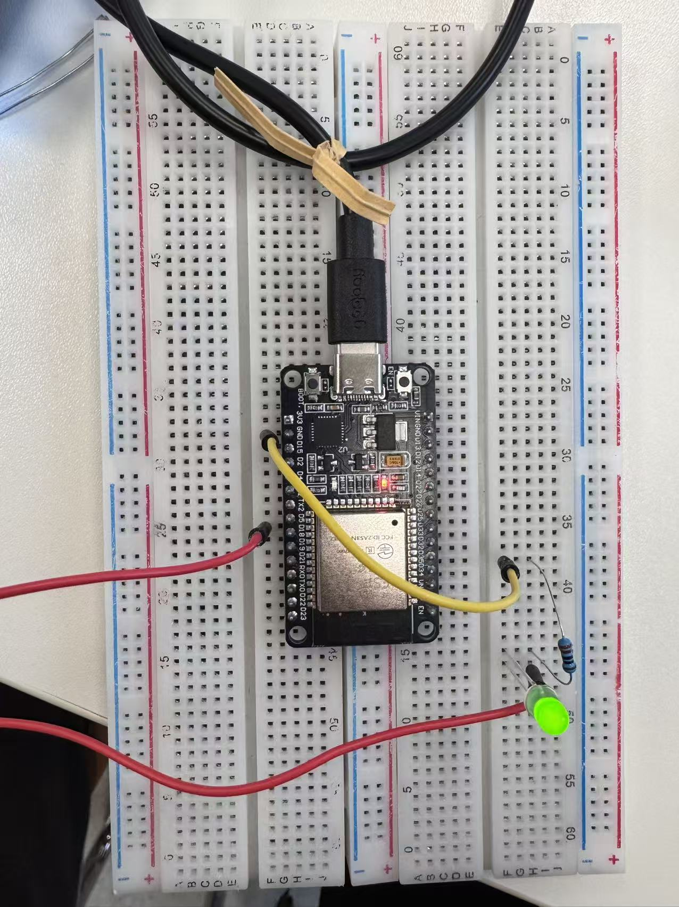
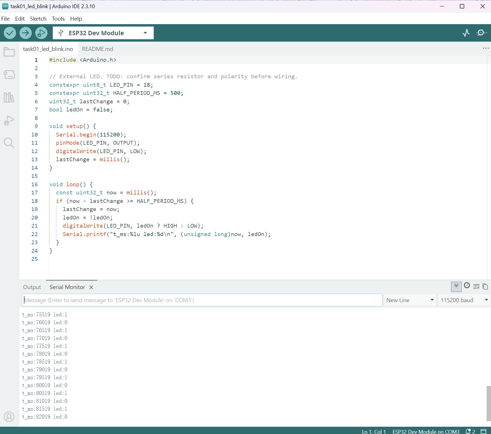

# Task 1 — External LED Blink: Hardware Verification

## Aim

Test GPIO output control using a physical LED and examine the timing of state changes reported by the ESP32.

## Equipment and configuration

- ESP32 Dev Module (classic ESP32)
- Green LED and breadboard/jumper wires
- 10 kΩ series resistor (as identified from its five color bands; not the recommended resistor for a standard LED brightness test)
- Arduino IDE 2.3.10; esp32 by Espressif Systems core 3.3.12
- Serial connection: COM3, 115200 baud during the documented test
- Program: [task01_led_blink.ino](../code/task01_led_blink/task01_led_blink.ino); [run instructions](../code/task01_led_blink/README.md)
- Programmed output pin: GPIO18; output changes every 500 ms using `millis()`

## Circuit principle

`GPIO18 → series resistor (10 kΩ) → LED anode (+) → LED cathode (−) → ESP32 GND`

The physical wiring photograph shows the LED illuminated. The pin labeling and exact electrical continuity were not independently verified with a meter.

## Observations and evidence

*Figure 1. Physical ESP32/breadboard setup; green external LED illuminated at the moment of capture.*

*Figure 2. Serial Monitor prints alternating `led:1` and `led:0` states at approximately 500 ms intervals.*

- Sketch upload and serial output were observed on the real ESP32.
- The serial log shows repeated changes of commanded GPIO18 state between HIGH and LOW.
- A photograph confirms light emission at one instant, but a still image alone does not demonstrate the full optical blink cycle.
- No independent current, voltage or optical intensity measurement was performed.

## Discussion

The 10 kΩ resistor results in much lower LED current than the commonly used 220–330 Ω range. Assuming a 3.3 V HIGH output and approximately 2 V forward voltage for a red LED, a 10 kΩ resistor would yield approximately 0.13 mA; the actual green LED forward voltage is different, so this is only an illustrative estimate, not a measurement of this experiment.

`led:1` and `led:0` represent the program's commanded states; serial messages do not measure the optical output or current. The evidence establishes successful execution of GPIO control code, alternating commanded states, and illumination of the physical LED.

## Status

**Verified:** upload, serial timing/state changes, LED illuminated in the hardware photograph.
**Not independently verified:** LED current, precise pin voltages, optical blink timing.
**Follow-up:** repeat with an appropriately verified 220–330 Ω resistor if available, and optionally record a short video of the blink cycle.
