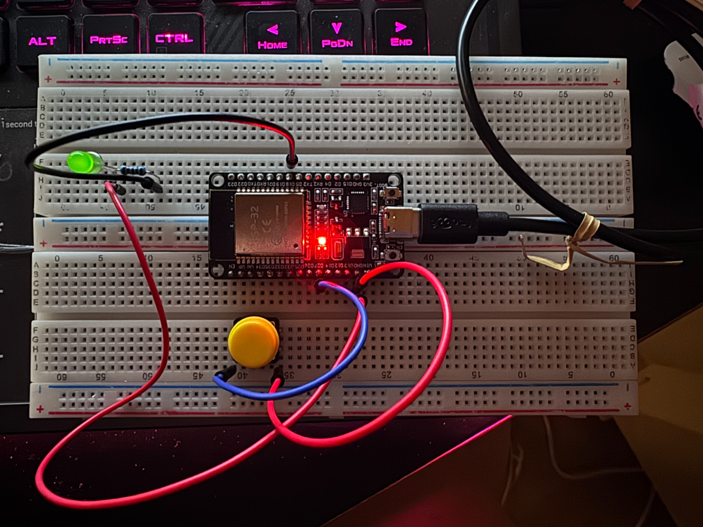
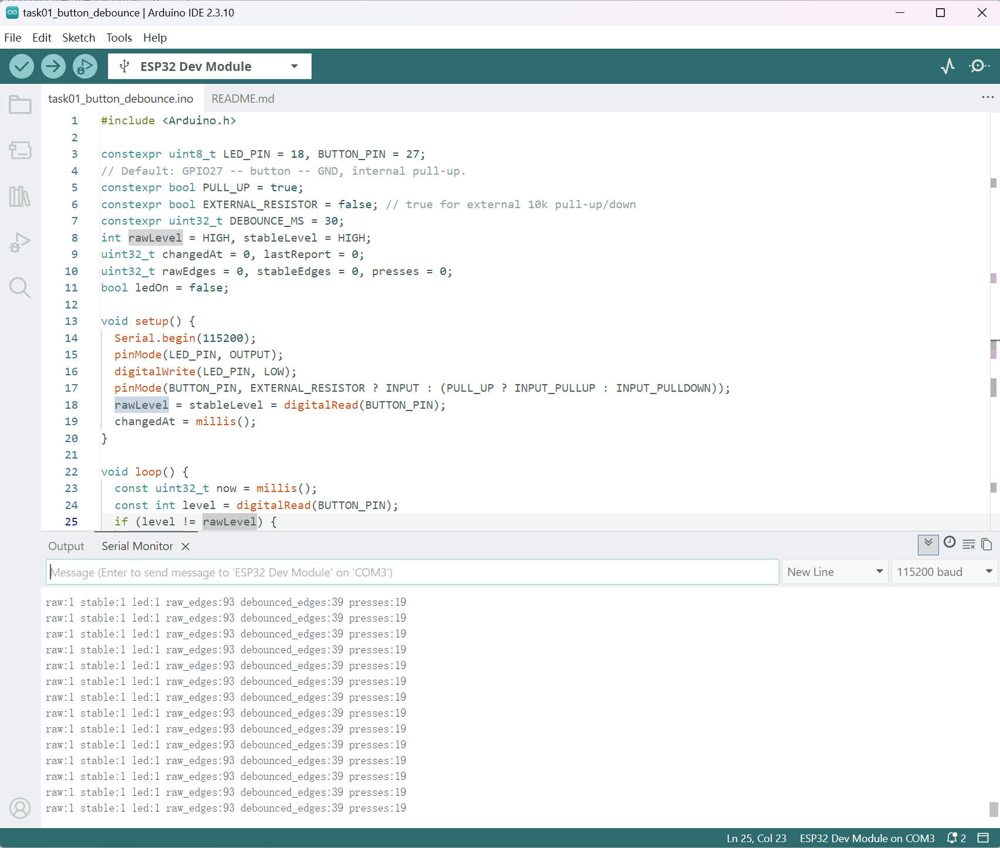
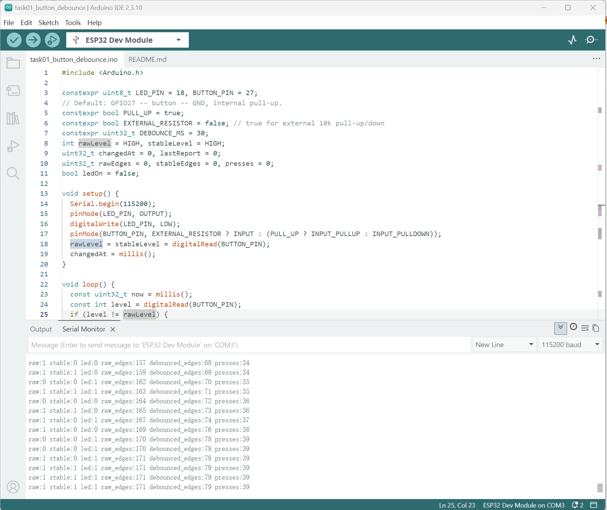

# Task 2 — Mechanical Button Debouncing on ESP32

The filename and Task 2 label follow the supplied experiment package. In the original module preparation, button/debounce code belongs to Task 1; this report does not complete the separate serial plotting and delay/millis comparison requirements. Review date: 2026-10-26; actual test date and operator: TODO. No new physical test was performed during this review.

## 1. Objective
Implement and test a software-debounced mechanical push button on an ESP32. Compare raw input transitions with accepted, stable transitions, count software-accepted button presses, and use each accepted press to toggle an external LED.

## 2. Hardware and software
- ESP32 Dev Module connected via USB (Arduino IDE 2.3.10; serial monitor at 115200 baud)
- Momentary yellow push button, breadboard and jumper wires
- External LED and series current-limiting resistor (resistor value not independently measured or verified in this record)
- Source sketch: `Module01/code/task01_button_debounce/task01_button_debounce.ino` (existing project file; **not included** in this import package)

## 3. Electrical connections and program configuration
The code in the captured Arduino IDE uses GPIO27 for the button, GPIO18 for the LED, internal input pull-up (`INPUT_PULLUP`) and a 30 ms debounce interval.

| Device | Connection |
| --- | --- |
| Momentary push button | GPIO27 → normally-open switch → ESP32 GND |
| External LED | GPIO18 → series current-limiting resistor → LED anode (+); LED cathode (−) → ESP32 GND |

The button does not require an external pull-up resistor under this configuration. Wiring details and component resistor values should be verified before reuse; the photograph documents the assembled setup but does not prove electrical continuity for every contact.

## 4. Software method
The sketch repeatedly samples `digitalRead(GPIO27)`. It tracks immediate input changes as `raw_edges`. A transition is accepted into `stableLevel` only if the candidate input has stayed unchanged for at least 30 ms. Each accepted transition contributes to `debounced_edges`; each accepted active-low press increments `presses` and toggles `ledOn`. Status information is printed at regular intervals. The sketch uses a non-blocking `millis()` timer rather than adding `delay()` for debouncing. Each raw change restarts `changedAt`; the condition `stableLevel != rawLevel && now - changedAt >= DEBOUNCE_MS` accepts a new stable state. This is a stable-duration algorithm, rather than merely waiting once after the first edge. Counters start at zero and the startup input is read without counting an initial press. Reports are emitted about every 100 ms, so brief bounce edges may be missed by polling or absent from printed snapshots. The source file was checked locally and left unchanged.

The normal released state is `raw:1 stable:1` because of the internal pull-up. During a press held long enough to debounce, the expected state is `raw:0 stable:0`.

## 5. Recorded real-hardware evidence
The following values are **observed snapshots** from the user's actual Arduino IDE serial monitor. They are cumulative software-counter snapshots, not a controlled dataset in which every physical press was separately counted. The images do not independently establish the startup state or whether a reset occurred between captures.

| Evidence | raw | stable | led | raw_edges | debounced_edges | presses |
| --- | ---: | ---: | ---: | ---: | ---: | ---: |
| Screenshot A: stable released state | 1 | 1 | 1 | 93 | 39 | 19 |
| Screenshot B: later stable released state | 1 | 1 | 1 | 171 | 79 | 39 |

The second screenshot also captures `raw` and `stable` changes, `presses` progressing through 34–39, and `led` changing between 0 and 1. The numerical differences between the snapshots are 78 raw edges, 40 debounced edges, and 20 accepted presses; interpreting these as one continuous-run interval assumes no intervening reset. Because the screenshots do not show every physical action, these counts must **not** be interpreted as a calibrated per-press bounce rate.

Raw and debounced edge counts include both press and release transitions; `presses` counts only accepted active-low transitions. The observed debounced totals (39 and 79) must not be replaced with twice the press totals (38 and 78). Startup/earlier event history is not fully captured, so the extra edge cannot be uniquely explained from these screenshots.

## 6. Interpretation
The serial output demonstrates that the input is read in both logic states, the internal pull-up produces HIGH while released, accepted button presses are registered, and LED state is toggled by the program. The larger `raw_edges` count compared with `debounced_edges` is consistent with the software rejecting short raw transitions, but raw edge counts alone do not quantify the true duration of contact bounce or separate bounce from wiring noise. The raw-minus-debounced differences are 54 and 92 respectively; these are comparisons of software counters, not measured physical bounce rates. A longer press/release interval is required to register both stable states; very short intentional presses may also be rejected. The LED is visibly illuminated in the photograph, although individual ON/OFF transitions are evidenced more clearly by the serial log.

**Assessment:** Core button detection, 30 ms debounce handling, press counting and LED state toggling were demonstrated on hardware. A strict one-count-per-manual-press repeatability experiment is not evidenced by these screenshots.

## 7. Remaining work / limitations
- TODO: perform a controlled repeatability check: reset the board and count a known number of slow physical presses (e.g. 10), then compare with `presses` and capture an unambiguous before-and-after record.
- TODO: record actual experiment date/operator, reset/startup conditions and complete time-stamped logs; neither screenshot measures debounce latency or contact-bounce duration.
- Record a clear photograph or measurement of the series resistor's actual resistance and confirm LED polarity.
- Optionally compare the results with debouncing disabled to quantify spurious counts under similar conditions.
- Preserve the original sketch and other modules without inventing additional observations.

## 8. Conclusion
A momentary button on ESP32 GPIO27 was used to control an LED on GPIO18 through a 30 ms, non-blocking software debounce routine. The recorded output confirms rising press counts, accepted state transitions and corresponding changes in the software LED state. This is sufficient to demonstrate the core functionality; a controlled repeatability measurement remains a useful follow-up.
