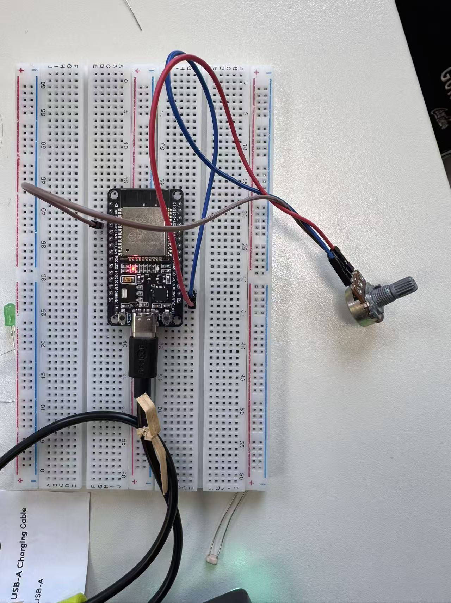
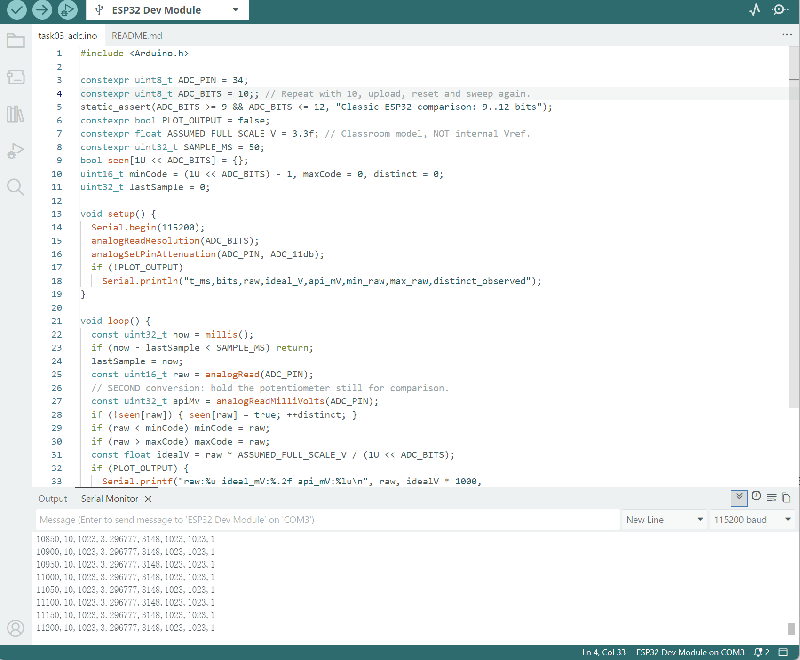
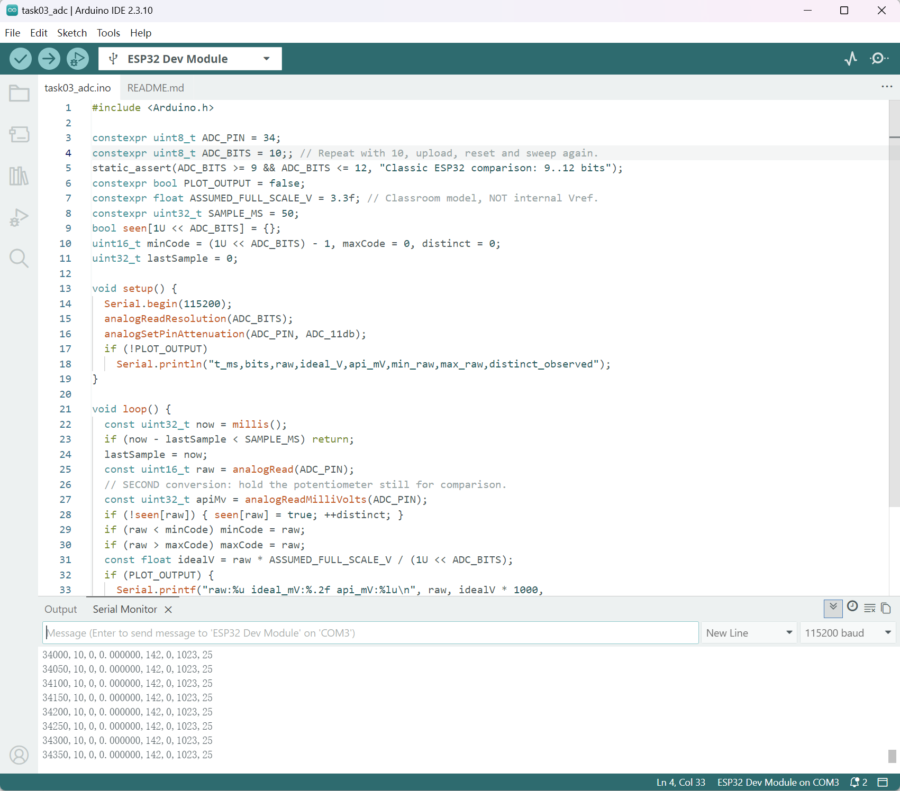
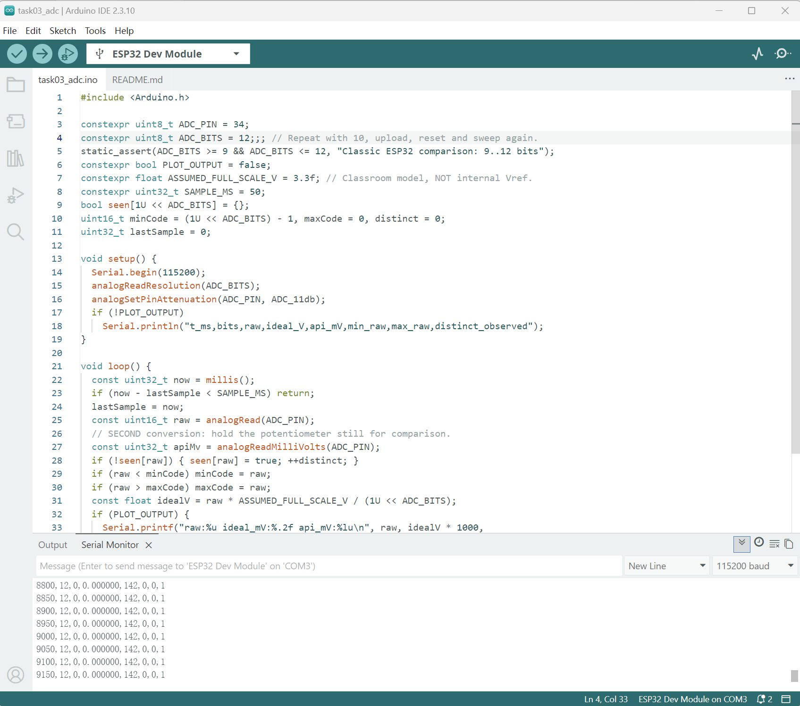
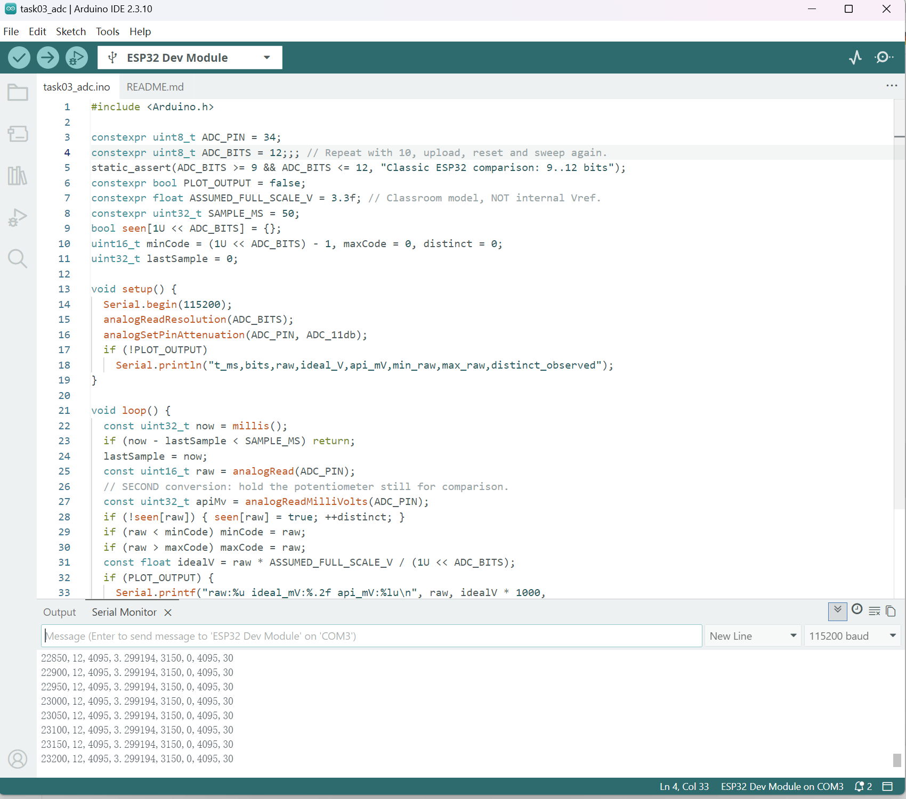

# Task 3 — ESP32 ADC Resolution Comparison with a B10K Potentiometer

## Aim

Compare the reported digital code ranges for 10-bit and 12-bit ADC configurations, using the analog output of a B10K potentiometer as the input signal.

## Hardware and setup

- ESP32 Dev Module, breadboard, B10K nominal 10 kΩ potentiometer and jumper wires
- Potentiometer outer terminals to 3V3 and GND; middle wiper terminal to GPIO34 (as intended in the test setup)
- Arduino IDE 2.3.10, Espressif ESP32 core 3.3.12
- Serial baud rate: 115200; sampling period: 50 ms
- Program: [task03_adc.ino](../code/task03_adc/task03_adc.ino); [run instructions](../code/task03_adc/README.md). The saved default is 12 bits; the 10-bit screenshots show the changed configuration used for that run.
- `analogReadResolution(ADC_BITS)`, `analogSetPinAttenuation(ADC_PIN, ADC_11db)`, and `analogReadMilliVolts(ADC_PIN)`

## Actual wiring

*Figure 1. Actual ESP32 and B10K potentiometer setup used for the ADC experiment. Pin-to-terminal continuity was not independently checked with a multimeter.*

## Evidence: 10-bit ADC

*Figure 2. 10-bit endpoint: raw code 1023.*

*Figure 3. 10-bit endpoint: raw code 0; running minimum and maximum shown in the serial output.*

## Evidence: 12-bit ADC

*Figure 4. 12-bit endpoint: raw code 0.*

*Figure 5. 12-bit endpoint: raw code 4095.*

## Results

| Quantity | 10-bit mode | 12-bit mode |
|---|---:|---:|
| Theoretical output levels | 1024 | 4096 |
| Lowest endpoint raw code documented | 0 | 0 |
| Highest endpoint raw code documented | 1023 | 4095 |
| Ideal step, assuming a 3.3 V full scale | 3.2227 mV / code | 0.8057 mV / code |
| `analogReadMilliVolts()` at raw minimum | 142 mV | 142 mV |
| `analogReadMilliVolts()` at raw maximum | approx. 3148 mV | approx. 3150 mV |

Raw-code and API endpoints above are taken from the supplied Serial Monitor screenshots; theoretical levels and ideal steps are calculations, not observed quantities. The millivolt results are estimates from the ESP32 ADC API, **not independent multimeter measurements**. The idealized model voltage shown by the sketch is not the same quantity as `analogReadMilliVolts()` and should not be reported as an independently measured voltage.

The code also records `distinct_observed`, a count of raw codes encountered during one run. It is **not** the number of ADC quantization levels or effective number of bits.

## Theory and interpretation

For an ideal N-bit ADC spanning an assumed 3.3 V input range, the nominal quantization interval is:

`ΔV = 3.3 V / (2^N)`

- 10 bits: `3.3 / 1024 ≈ 0.0032227 V = 3.223 mV`.
- 12 bits: `3.3 / 4096 ≈ 0.0008057 V = 0.806 mV`.

The 12-bit configuration has four times the nominal digital levels and one quarter of the ideal code interval of the 10-bit configuration. This does **not** imply fourfold improvement in real accuracy: ADC offset, attenuation, nonlinearity, noise and calibration all affect practical results. The full-scale 3.3 V assumption is used for a classroom model only; it is not a claim about the exact calibrated ESP32 ADC transfer function.

## Conclusion

The real ESP32 program ran in both modes. After turning the potentiometer to different positions, the endpoint screenshots show raw codes spanning 0 to 1023 in 10-bit mode and 0 to 4095 in 12-bit mode, supporting the basic resolution comparison.

## Remaining work / limitations

- TODO: record stationary intermediate readings, for example at approximately 25%, 50% and 75% travel; retain full sweep logs and plots.
- TODO: compare actual wiper voltage with API estimates at several positions using a multimeter and document uncertainty. This course cross-check remains incomplete if no meter is available.
- Do not interpret the endpoint screenshots as evidence of a calibrated, linear voltage response over the entire range.
