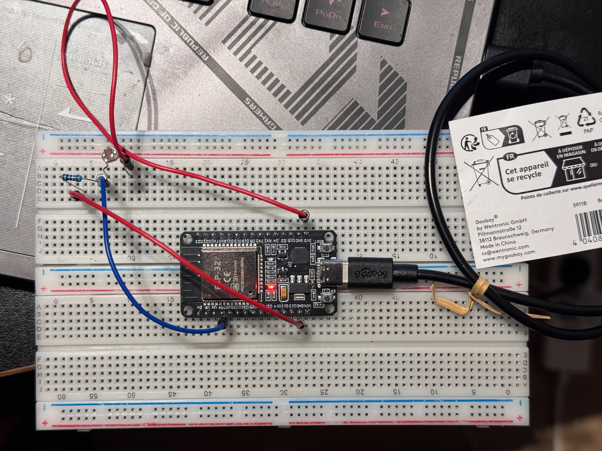
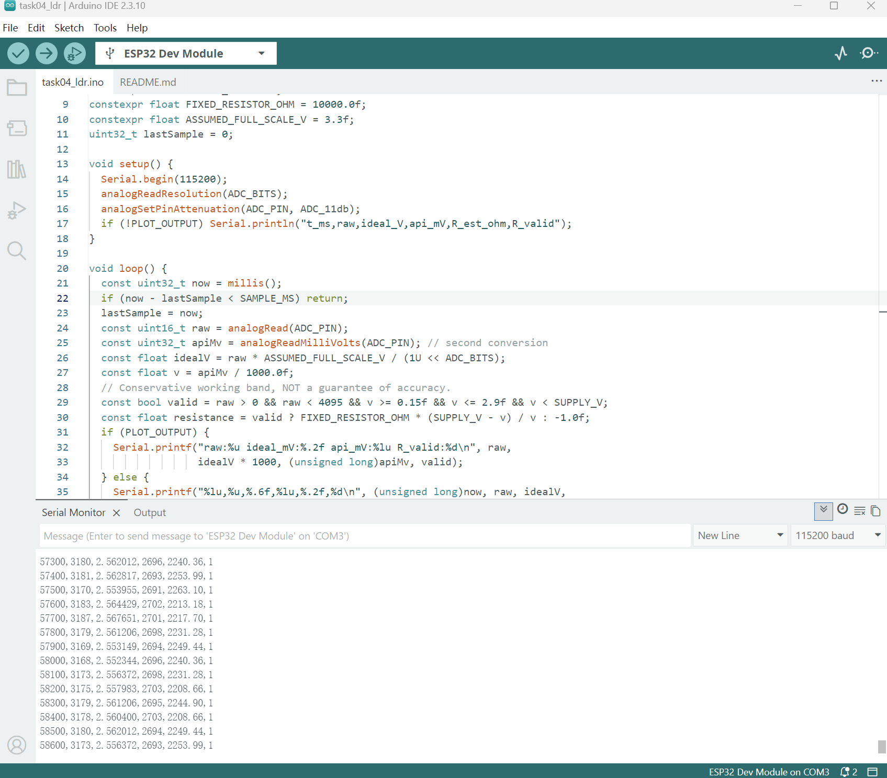
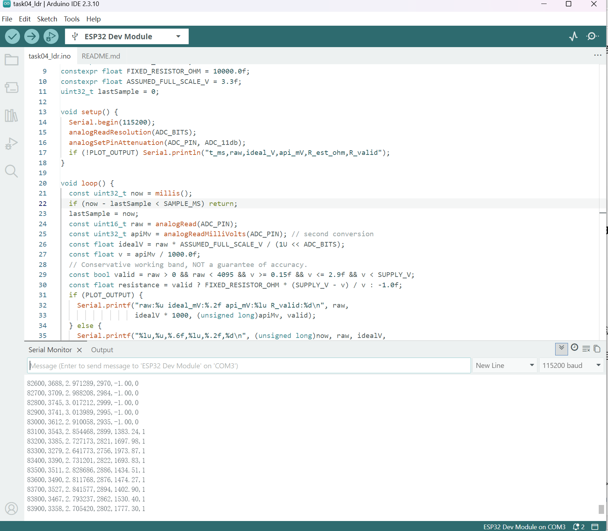
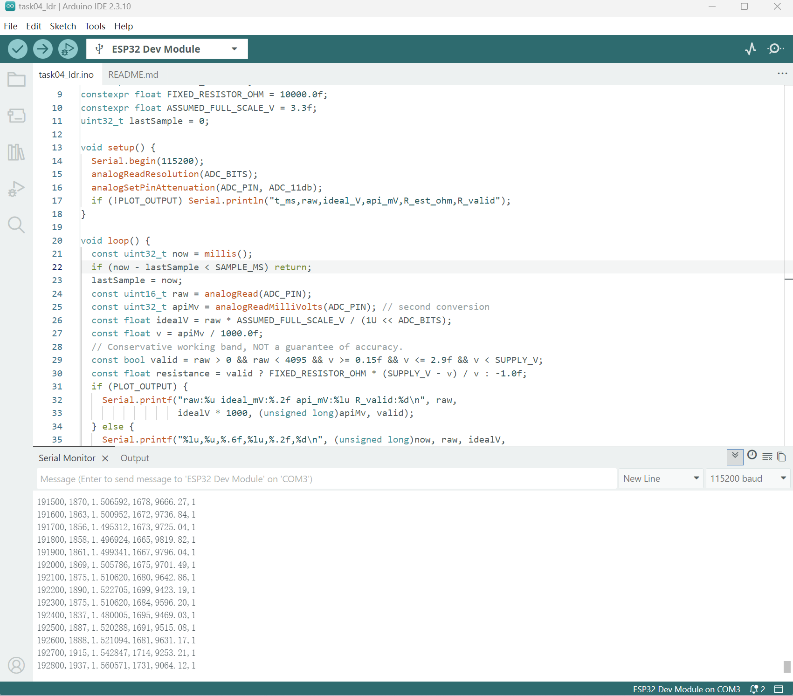

# Task 4 — Photoresistor (LDR) Voltage Divider Experiment

Status: **real light-response observations documented; quantitative characterization remains incomplete**. This report was checked against the original photograph and three Serial Monitor screenshots from the supplied ZIP. Review date: 2026-10-26; actual experiment date/operator: TODO. No new hardware measurement was made during this review.

## Objective

Observe how illumination changes the output of an LDR divider read by an ESP32. Distinguish raw ADC codes, ideal-model voltages, API voltage estimates and calculated resistance from independently measured physical quantities.

## Hardware and configuration

- ESP32 Dev Module, breadboard, jumper wires and a bare LDR; exact LDR model TODO.
- Nominal 10 kΩ fixed resistor; actual resistance/tolerance and supply voltage have not been meter-verified.
- Intended divider: **3V3 → LDR → measurement junction → 10 kΩ → GND**; GPIO34 at the junction. The photograph documents the assembly; electrical continuity and pin voltages were not independently checked with a meter.
- Arduino IDE 2.3.10, COM3, 115200 baud, visible in the screenshots. Espressif Core version for this run: TODO independently document; 3.3.12 is the previously recorded project environment.
- Sketch identified as `Module01/code/task04_ldr/task04_ldr.ino`: 12-bit ADC, 11 dB attenuation, nominal 100 ms interval, `PLOT_OUTPUT=false`. Nominal constants are `SUPPLY_V=3.3`, `FIXED_RESISTOR_OHM=10000` and `ASSUMED_FULL_SCALE_V=3.3`; they are not meter readings.
- CSV columns: `t_ms,raw,ideal_V,api_mV,R_est_ohm,R_valid`.

## Original evidence

### Physical wiring



### Ambient / initial light



### Brighter illumination



### Covered / reduced light



The condition names follow the supplied experiment report and filenames. The serial screenshots alone do not establish flashlight distance, shielding, illuminance in lux or controlled environmental conditions. All four images are original supplied evidence; no generated circuit illustration is used.

## Screenshot-verified observations

These ranges cover only the rows visible in each screenshot. They are not statistics for a complete exported recording, calibrated operating ranges or proof of repeatability across repeated lighting trials. Minima/maxima of different columns need not occur in the same row.

| Condition | Visible timestamp range, ms | Raw code range | API estimate range, mV | Calculated valid resistance range, Ω |
|---|---|---|---|---|
| Ambient / initial | 57300–58600 | 3168–3187 | 2691–2703 | 2208.66–2263.10 |
| Brighter | 82600–83900 | 3279–3745 | 2756–2999 | 1383.24–1973.87; invalid rows excluded |
| Covered / reduced light | 191500–192800 | 1837–1937 | 1665–1731 | 9064.12–9819.82 |

The imported draft's ambient upper raw code (3182) and covered lower raw code (1856) were corrected to **3187** and **1837** after inspecting the screenshots. These corrections do not alter the original image files.

### Selected exact rows transcribed from the screenshots

| Condition | t_ms | raw | ideal_V | api_mV | R_est_ohm | R_valid |
|---|---|---|---|---|---|---|
| Ambient | 57500 | 3170 | 2.553955 | 2691 | 2263.10 | 1 |
| Ambient | 57700 | 3187 | 2.567651 | 2701 | 2217.70 | 1 |
| Ambient | 58000 | 3168 | 2.552344 | 2696 | 2240.36 | 1 |
| Ambient | 58300 | 3178 | 2.560400 | 2703 | 2208.66 | 1 |
| Brighter | 82800 | 3745 | 3.017212 | 2999 | -1.00 | 0 |
| Brighter | 83100 | 3543 | 2.854468 | 2899 | 1383.24 | 1 |
| Brighter | 83300 | 3279 | 2.641773 | 2756 | 1973.87 | 1 |
| Covered | 191800 | 1858 | 1.496924 | 1665 | 9819.82 | 1 |
| Covered | 192400 | 1837 | 1.480005 | 1695 | 9469.03 | 1 |
| Covered | 192800 | 1937 | 1.560571 | 1731 | 9064.12 | 1 |

Visible successive timestamps are separated by 100 ms, consistent with the configured interval over the shown fragments. They do not establish the timing of the entire run or the LDR's physical response time.

## Interpretation and worked calculation

For the stated divider orientation:

```text
Vout = Vsupply × Rfixed / (RLDR + Rfixed)
RLDR = Rfixed × (Vsupply − Vout) / Vout
```

More light normally reduces LDR resistance and raises the junction voltage. The supplied readings are consistent with this trend: the brighter fragment has higher raw codes than the covered fragment. Actual sensitivity, linearity and lux dependence are not established.

Worked example using the ambient row at `t_ms=57500`: take the **API estimate** `Vout=2.691 V` and the **nominal assumptions** `Vsupply=3.3 V`, `Rfixed=10000 Ω`:

```text
RLDR ≈ 10000 × (3.3 − 2.691) / 2.691 ≈ 2263.10 Ω
```

This reproduces the program's calculated resistance; it is not a direct resistance measurement or independent validation of the API voltage. Accuracy depends on actual supply/resistor values, the ADC transfer/calibration and loading assumptions. The output's displayed decimals are not established physical accuracy.

`ideal_V = raw × 3.3 / 4096` is an ideal classroom model. `api_mV` comes from a second `analogReadMilliVolts()` conversion, so it is not simply the ideal voltage rescaled, nor the calibrated value of the exact preceding raw sample. Neither column is a multimeter reference.

### Invalid brighter-condition rows

At `t_ms=82800`, `api_mV=2999` exceeds the sketch's conservative 2.9 V calculation gate, so `R_valid=0` and `R_est_ohm=-1.00`. The first five visible brighter rows are invalid under this gate. **-1 is a sentinel, not a negative physical resistance.** This rejection alone does not prove ADC saturation: the raw values shown do not reach 4095. Valid resistance ranges above exclude these rows.

## Remaining work / TODO

- Record actual test date, operator/pod roles, LDR model, lighting geometry and settling procedure.
- Verify fixed resistance, supply voltage, pin continuity and junction voltages with a meter; report instrument specification and uncertainty.
- Collect several repeated, stable dark/shade/bright trials with a complete time series; the supplied short fragments are not a controlled repeatability experiment.
- Compare physical response/settling under a defined light step. Nonlinearity and temperature effects remain limitations to study, not measured results here.
- Preserve/export raw records for the Task 5 filter comparison; add plots if obtained.

**Conclusion:** real hardware and serial evidence support a qualitative LDR light-response demonstration. Absolute voltage/resistance accuracy, repeatability, response time and illuminance calibration remain TODO. No fictitious readings, hardware validation or classroom discussion have been added.
