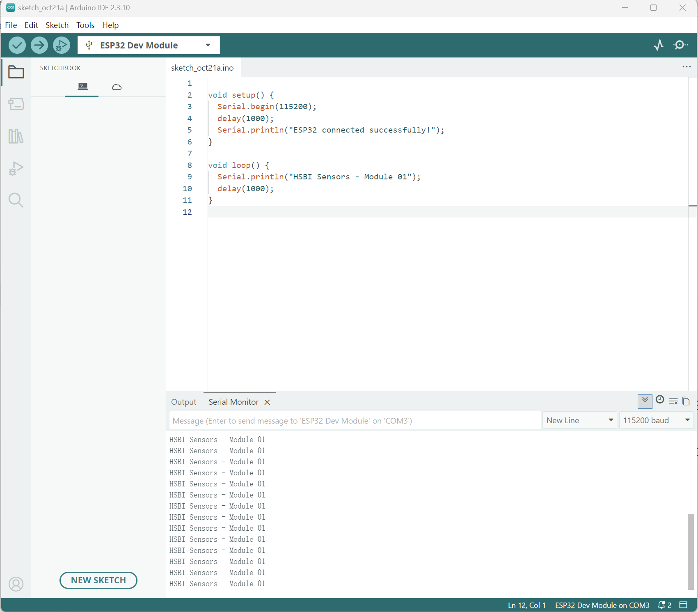

# Existing ESP32 Hardware Serial Test — PASS

Status: **PASS for basic upload and serial communication only**. The student reports a successful real-board test. The existing screenshot visibly supports ESP32 Dev Module, COM3, 115200 baud, Arduino IDE 2.3.10 and repeated `HSBI Sensors - Module 01` output. Espressif Core 3.3.12 is student-reported and its local package is installed; the screenshot itself does not show the Core version.

The original filename was `esp32-serial-test.png.png`; it was normalized to `esp32-serial-test.png` during repository organization. Image bytes are unchanged; no screenshot was generated or edited. TODO: student to record actual capture/test date and board identification. No external component wiring is visible, so this is not evidence for LED illumination, button debounce, ADC accuracy, LDR or filtering. It is partial Task 2 evidence; plot and timing comparison remain TODO.

The source of that earlier test is visible in the image but was not supplied as a separate `.ino` file. New Task 1–5 sources are prepared examples, not a claim that the screenshot came from them.
