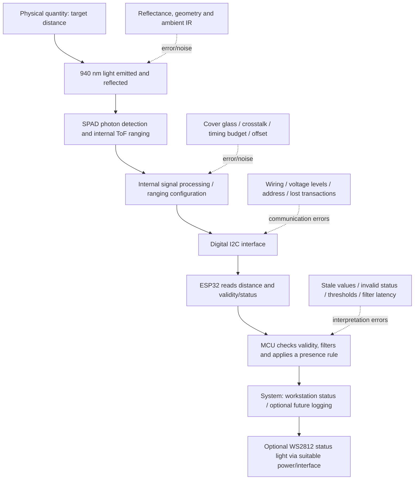

# Task 6 — VL53L0X Signal Chain

Status: literature-based preparation diagram; **no VL53L0X wiring or physical test claimed**. This extends the sensor choice already researched in [Module 0](../00-pre-study.md#31-vl53l0x-time-of-flight-distance-sensor), rather than replacing that work.

Source: [ST VL53L0X datasheet](https://www.st.com/resource/en/datasheet/vl53l0x.pdf). TODO confirm the actual breakout board, regulator, pinout and electrical limits before any future wiring.

| Stage | Explanation |
|---|---|
| Measurand / transduction | Optical time-of-flight uses emitted light and detected photons to estimate distance; classification: active optical sensor, digital output |
| Conditioning/conversion | Detection, ranging and associated processing occur inside the sensor; this is not an external LDR divider or an ESP32 GPIO34 ADC measurement |
| Interface | I2C; ST's address-byte notation 0x52 corresponds to common 7-bit address 0x29. TODO verify actual device/address if hardware is used |
| MCU processing | Read result/status, handle invalid or stale data, then filter/threshold only valid readings |
| System use | Proposed workstation presence indication; no deployed system claimed |
| Actuator | Optional future WS2812 indicator; needs reviewed data-level interface, adequate external supply and common ground. No actuator hardware verified |

TODO: explain the chain in my own words; choose one error source and design a real test (e.g. fixed distance, varying target/ambient light). Do not insert numerical accuracy claims without datasheet conditions or actual measurements. The MCU's 12-bit ADC resolution does not determine this digital sensor's ranging accuracy.
