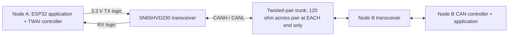

# Bus profile: CAN — Pod 4

**Research Prepared · CAN Hardware Test: Pending · Classroom pitch / Discord sharing: Pending.**

Mei Zhengyong — [@SuYLanM](https://github.com/SuYLanM) · Felix — [@Felix-Gaoxinyu](https://github.com/Felix-Gaoxinyu). Pod 4 / CAN was selected by the group, as confirmed by the user; no individual contributions or instructor grading are inferred.

This compact classroom profile follows [official Module 2 Task 2](https://github.com/iotempire/iotempire-teaching/blob/main/full-classes/hsbi-sensors-actuators-10d/modules/02-i2c-and-sensor-addressing.md). Detailed protocol explanations and source checks are in the [technical notes](can-technical-notes.md).

| Required topic | CAN profile |
|---|---|
| History and background | Bosch developed CAN for economical, reliable communication between automotive controllers as vehicle electronics grew. Substantial protocol development occurred in 1984; the first public presentation was at SAE Detroit in February 1986. [CiA history](https://www.can-cia.org/fileadmin/cia/documents/publications/cnlm/previous_issues/17-1_cnlm.pdf) |
| Wires and connectors | High-speed CAN uses a twisted CANH/CANL pair with an appropriate reference/common-ground arrangement. A connector pinout is application-specific: never assume a universal DB9 or module header. Our proposed kit example is classic ESP32 + SN65HVD230, still untested. |
| Voltage, signaling and drive style | A transceiver converts controller TX/RX logic to differential CANH−CANL. Dominant 0 overrides recessive 1; this is not UART push-pull wiring or I2C pull-ups. SN65HVD230 uses a 3.3 V supply; bus voltages are a separate domain. [TI datasheet](https://www.ti.com/lit/ds/symlink/sn65hvd230.pdf) |
| Topology and addressing | Serial, asynchronous, multi-master broadcast on a linear trunk with short stubs. IDs identify message content and priority, rather than inherently naming destination nodes. Standard IDs have 11 bits; extended IDs have 29. Lower IDs win within the same frame format; equal-base standard/extended arbitration also uses SRR/IDE bits. [CiA CAN CC](https://www.can-cia.org/can-knowledge/can-cc) |
| Speed and maximum length | Classical CAN: up to 1 Mbit/s; our examples configure 500 kbit/s. CiA describes 40 m at 1 Mbit/s as theoretical, with shorter achievable real networks. Length depends on propagation, transceivers, sample point, stubs and cable; it is not a measured or guaranteed limit for our setup. [CiA physical layer](https://www.can-cia.org/can-knowledge/can-hs-transmission) |
| Classical versus FD | Classical: 0–8 data bytes, one bit rate. CAN FD: up to 64 bytes and optional faster data phase, with an FD-capable controller and physical design. Bosch introduced FD in 2012. Classic ESP32 TWAI supports **Classical CAN only**. [Bosch FD](https://www.bosch-semiconductors.com/products/ip-modules/can-protocols/can-fd/) |
| Typical use | Automotive ECUs, industrial drives, robotics and distributed sensor/actuator nodes. Higher-layer protocols such as CANopen define device/application semantics; raw CAN does not specify what a temperature byte means. |
| Relation to other buses | CAN includes priority arbitration, framing and error confinement. UART supplies serial character transport; I2C uses addressed targets and pull-ups; SPI uses clock/chip-select; RS-485 supplies differential signaling but needs an upper protocol. See the [short comparison](can-technical-notes.md#comparison-with-other-connections). |
| Curiosities / remarkable features | Arbitration losers stop without damaging the winning frame. A correctly received frame can be ACKed even when its ID is rejected by an application filter: ACK is not proof of application processing. Error counters can force a faulty transmitter bus-off. |
| What can go wrong / how to debug | Check power/mode, CANH/CANL, common reference, matching bit timing and the **two** end terminations. A lone normal-mode node or a listen-only peer cannot provide the required external ACK. Inspect controller error flags/counters and peer logs; use a CAN analyzer for protocol capture. |

The diagram separates **controller** (frames/arbitration/errors), **transceiver** (electrical interface) and **bus** (shared cable/termination). It is conceptual; the [wiring guide](can-wiring.md) shows the physical two-end layout.

Classroom pack: [2–3 minute speech](can-pitch.md) · [technical notes / sources](can-technical-notes.md) · [actual AI research and verification log](can-research-log.md) · [wiring](can-wiring.md) · [blank hardware/pitch records](evidence/task02-can-test-record.md).

Arduino preparation: [A — local self-test](code/task02_can_self_test/README.md) · [B — external communication](code/task02_can_external/README.md). Both remain **Awaiting hardware validation**. No CAN messages, captures, measurements, delivered presentation or Discord post are recorded as experimental results.
