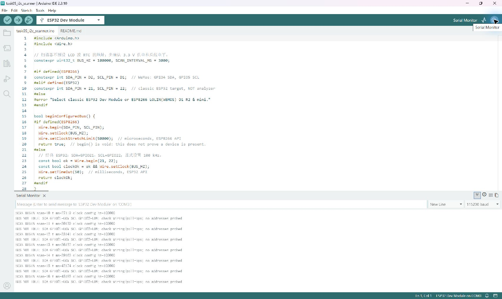

# Module 02 — Hardware Evidence Register

**Task 9 static CH0 LOW/HIGH captures are now verified:** [original files, replay screenshots and checks](task09-logic-analyzer/README.md). The later [real ESP8266 PWM capture](task09-esp8266-pwm.md) is also available. Other rows remain at their existing status; this register is not a declaration that all labs are complete. [Task checklist](../task-checklist.md).

For each actual experiment record: date, board/module markings, sketch/settings, source/library version, wiring/power/pull-ups, operators and their actual roles, raw observations, calculations, uncertainty/limitations, conclusions and remaining work. Put original pictures in [pictures](../pictures/README.md) and use valid relative links only after files exist.

| Task | Required actual evidence | Result / artefact link |
|---|---|---|
| 1 | Defined divider topology/parts, paired input/output readings and comparison | [Two original voltage photos](task01-voltage-divider/README.md) documented; nodes, resistance values and original 5 V divider proof Pending |
| 2 | Actual assigned bus profile, pitch notes and real shared artefact | Pending assignment/discussion |
| 3 | Shared class table and actual discussion/personal note | [Pod 4 CAN row and research answers](../bus-comparison.md) Prepared; classroom artefact and personal confirmation Pending |
| 4a/4b | Student study/verification, neighbouring-pod agreement and Discord post | Pending |
| 5 | First scan, changed connection scan, address-to-module identification | [Real LCD-only attempt and line diagnostics](#scanner-report--task-5-partial-baseline): compile/upload Completed; bus not idle (SDA/SCL LOW); ACK/address/removal Pending |
| 6 | Library value and raw register reconstruction under matched settings | [Report / empty result table](../register-reading.md) Prepared; sensor/library/configuration/readings Pending |
| 7 | A-only/B-only/both scans and actual readings of both devices | [Report / address table](../two-devices.md) Prepared; actual two-device tests Pending |
| 8 | Conflict/fix evidence if hardware available; otherwise explicitly theoretical | Theory prepared; physical experiment Pending |
| 9 | Install/version/pins, PWM/I2C captures, measured timebase and class decision | [CH0 LOW/HIGH verified](task09-logic-analyzer/README.md), 10,000 samples each; [ESP8266 PWM verified](task09-esp8266-pwm.md); [I2C NACK-only capture verified](task09-esp8266-i2c.md); sensor ACK/calibrated timebase/class decision Pending |
| 10 | Optional decoded transaction and measured SCL | Optional / not tested |

## Scanner Report — Task 5 Partial Baseline

**Compile/upload/serial diagnostics Completed; LCD address discovery Blocked; removal comparison Pending.** The actual 2026-11-02 run found both configured bus inputs LOW before any address probe. This is not a successful scan, a NACK result, or evidence that no LCD is present. [Scanner source and instructions](../code/task05_i2c_scanner/README.md) · [Chinese wiring guide](../wiring-zh.md).

### Objective

Use an ESP32 to scan ordinary 7-bit I2C addresses and identify the LCD1602 PCF8574 backpack's actual ACK address. After discovery, power off and remove the LCD, repeat the scan and compare address sets. No RTC display extension is included in this run.

### Hardware

| Item | Confirmed information / limit |
|---|---|
| Controller | Upload tool identified ESP32-D0WD-V3 revision v3.1; ESP32 Dev Module build target |
| Software | Windows 11; Arduino IDE 2.3.10; installed Espressif Arduino Core 3.3.12; Arduino CLI compile/upload |
| Port | COM3, Silicon Labs CP210x USB to UART Bridge; console 115200 baud, 8N1 |
| Display | Student identifies LCD1602 with PCF8574 backpack; actual ACK address unknown |
| Supply | Student confirms LCD VCC connected to ESP32 3V3; ESP32 USB powered. This is a wiring statement, not a measured voltage |
| RTC | Student has now confirmed **DS1302**, not DS3231. DS1302 is three-wire, not an I2C target; it is excluded from this test. Physical isolation of its wires remains unverified |
| Physical wiring limits | LCD GND, actual SDA/SCL landing points, old GPIO22–23 jumper and absence of other powered/pull-up paths are not independently verified. No suitable wiring photo or DMM readings are available |

### Wiring

The intended LCD-only connections are **3V3→VCC, GND→GND, GPIO21→SDA, GPIO22→SCL**. These are the required connections, not a claim that all four have been visually checked. No 5 V is intended. Software digital HIGH/LOW readings cannot determine the voltage, pull-up value or electrical safety.

With USB/power disconnected, trace only the relevant four LCD wires. Isolate DS1302 DAT/CLK/RST if attached to the ESP32/shared lines. Remove an obsolete GPIO22–GPIO23 analyzer jumper if present; it is unnecessary here, but its mere presence does not prove a short. Keep unrelated circuits intact unless they actually share or drive these lines. Check for any remaining static-test GND/3V3 lead on GPIO21/22 and any external board driving the bus. Check the backpack pull-ups and their supply rail; do not introduce 5 V pull-ups. A powered, open-drain I2C bus needs suitable pull-ups to a compatible rail.

A PCF8574 can communicate even if LCD text is not visible at 3.3 V. Backlight/contrast/text are not substitutes for observing ACK. If a future setup requires a 5 V backpack or pull-ups, reassess it before GPIO attachment and use appropriate bidirectional I2C level translation where needed.

### Current Preflight — 2026-11-02

The earlier preflight compiled the original scanner (294564 flash bytes / 23508 global RAM bytes) and withheld upload while hardware identity was unresolved. Its genuine [IDE screenshot](task05-i2c-scanning/arduino-ide-preflight.jpg) remains preserved. The latest user clarification identifies the RTC as DS1302 and requests a real LCD-only attempt; the following results supersede the earlier upload-not-attempted status.

| Step | Current status | Real observation |
|---|---|---|
| Source inspection | Completed | Wire.begin(21,22), requested 100000 Hz, Serial 115200, 0x08–0x77 range, operation timeout 50 ms; no assumed LCD address |
| Original source compile/upload | Completed | 294564 flash bytes / 23508 global RAM bytes; COM3 upload finished with Hash of data verified and RTS reset |
| Original firmware serial read | Completed | Five complete diagnostic attempt records, scan numbers 3–7; every attempt reported BUS_NOT_IDLE, no address probes |
| Minimal diagnostic change | Completed | Read each idle input once and print separate SDA/SCL HIGH/LOW states; retained the existing skip-on-non-idle guard |
| Diagnostic build/upload | Completed | Core 3.3.12: 294644 flash bytes / 23508 global RAM bytes; upload Hash of data verified, port COM3 |
| Diagnostic serial read | Completed | Four complete attempt records, scan numbers 3–6; SDA_GPIO21=LOW and SCL_GPIO22=LOW every time |
| Full address sweep / ACK mapping | Blocked | No SCAN_END records or address probes; ACK/NACK totals unavailable, not zero measured responses |
| Removal comparison | Pending | Requires a stable responding LCD first, followed by user-performed power-off removal |
| DS1302 / RTC-LCD extension | Excluded from this run | DS1302 cannot be read with the DS3231/Wire plan; no RTC read or LCD text result is claimed |

Uploading replaced the selected ESP32's on-board firmware with Scanner. No stored LogicAnalyzer source, captures, screenshots or reports were changed. Serial access was closed after recording the diagnostic screenshot; no forced bus-clear pulses or bypass of the idle guard were attempted. The uploaded sketch continues its normal periodic idle checks while powered; disconnect USB before touching wiring.

### I2C Addresses

| Module | Actual 7-bit address | Identification status |
|---|---|---|
| LCD1602 PCF8574 backpack | **Pending / unknown** | No address was probed because the bus was not idle |
| DS1302 | Not applicable | Not an I2C device; do not assign an I2C address |

No 0x27/0x3F default is substituted for an actual observation. Even a later ACK will not independently identify a chip model; controlled LCD-only/removal evidence is needed for mapping.

### Scanner Results

| Run | Raw evidence | Observed attempts | Result |
|---|---|---|---|
| Original scanner, LCD intended connected | [Original serial bytes](task05-i2c-scanning/lcd-precheck-serial-20261102.txt) | 3, 4, 5, 6, 7 | Five BUS_NOT_IDLE records; no address probes |
| Scanner with per-line diagnostic | [Original serial bytes](task05-i2c-scanning/lcd-line-diagnostic-serial-20261102.txt) | 3, 4, 5, 6 | Four records, both inputs LOW; no address probes |

The first capture used a bounded 15-second read; the diagnostic capture used 12 seconds at 115200 8N1 through System.IO.Ports.SerialPort. Files preserve received bytes without invented headers, edited values or line-ending normalization. Capture started after boot and may end with a partial record (the diagnostic file ends with an incomplete `S`); partial records are not counted. `t_ms` is firmware uptime, not a wall-clock timestamp. The JSON [verification record](task05-i2c-scanning/lcd-diagnostic-verification-20261102.json) records hashes and parsed record counts. There are at least three real attempt records per file, but **zero complete 112-address sweeps**. No measured 100 kHz clock is claimed.

The screenshot was captured later from live Arduino Serial Monitor and shows attempts 10–16, not the same sequence numbers as the earlier raw capture. Both show the same diagnostic states. It is not a reconstructed display of the text files.

**Historical evidence, not this LCD scan:** the preserved [Task 9 ESP8266 NACK-only experiment](task09-esp8266-i2c.md) and [serial log](task09-esp8266-i2c/source-single-scan-115200.txt) record 0 ACK / 112 NACK / 0 other errors. Its [raw acquisition](task09-esp8266-i2c/pulseview-i2c-esp8266-nack-01.sr) and [decoder screenshot](task09-esp8266-i2c/i2c-nack-detail.jpg) remain untouched. Those NACK counts must not be attributed to this blocked LCD run.

### Device Removal Test

**Pending.** After the bus is idle and at least three full LCD-connected scans show a stable address set, the student must power off, remove the LCD's bus/power connections, and restore ESP32 USB power. Capture at least three complete scans again and compare `disappeared = connected_ACK_set − disconnected_ACK_set`. Check idle pull-ups after removing the backpack; a stuck/floating empty bus is not a valid zero-device scan. No physical disconnection or address disappearance was performed here.

### RTC and LCD Communication

**Not performed; outside this LCD-address-only run.** The earlier conditional DS3231 plan (RTClib by Adafruit + Adafruit BusIO, hd44780 by Bill Perry / hd44780_I2Cexp) is not applicable to the now-confirmed DS1302. No combined sketch was created, installed or uploaded; no RTC timestamp, default initial time or LCD text output is claimed. A future DS3231 extension requires an actual I2C RTC, verified electrical compatibility, observed addresses and separately documented library versions. It must not silently set compiler time and present it as an independently read clock.

### Troubleshooting

| Software observation | Supported conclusion / next physical check |
|---|---|
| COM3 opens; compile/upload Hash verified; readable serial text | Toolchain, upload and serial path work; this does not validate LCD wiring |
| Both GPIO21 and GPIO22 repeatedly read LOW before scanning | Bus is not idle at those inputs; inspect actual pin landings, common ground, power, pull-ups and attached devices. Software cannot distinguish missing pull-ups, a short, a miswire or a device holding lines LOW |
| No ACK/NACK lines or SCAN_END | Scanner deliberately skipped address probes. Do not report 112 NACKs or No I2C devices found for these attempts |
| Old GPIO22–23 jumper possibly present | Remove only that obsolete connection with power off if present; do not claim it is the proven cause |
| DS1302 wires possibly attached | Disconnect its signal lines from the shared bus/ESP32 while powered off; DAT/CLK are not SDA/SCL |
| LCD has no text | Not diagnostic of PCF8574 address discovery; verify I2C independently after electrical/wiring correction |

No definite short, 5 V input or particular failed component was proven. Testing was not extended to active recovery or forced probing. Remaining hardware checks are consolidated above; a real wiring photo and, when available, VCC/SDA/SCL voltage measurements would help establish the cause.

### Evidence

| Artefact | Status |
|---|---|
| Original preflight IDE screenshot | Preserved, linked above |
| Two raw serial captures and parsed SHA-256/count record | Saved and linked above |
| Live 115200 Serial Monitor screenshot | Saved and linked above |
| Actual wiring photograph / electrical measurements | Pending / not available |
| Actual LCD ACK address and three full scans | Blocked by both input lines LOW |
| Power-off LCD removal / address disappearance | Pending |

**Conclusion:** the software was compiled, uploaded and exercised on the real ESP32. The LCD-address test is blocked by a reproducible non-idle bus and Task 5 is not complete. No successful ACK, address, removal result or RTC reading is invented.

Sources: [TI PCF8574](https://www.ti.com/lit/ds/symlink/pcf8574.pdf), [ADI DS1302](https://www.analog.com/media/en/technical-documentation/data-sheets/DS1302.pdf), [ADI DS3231](https://www.analog.com/media/en/technical-documentation/data-sheets/DS3231.pdf), [NXP PCA9306](https://www.nxp.com/docs/en/data-sheet/PCA9306.pdf).
