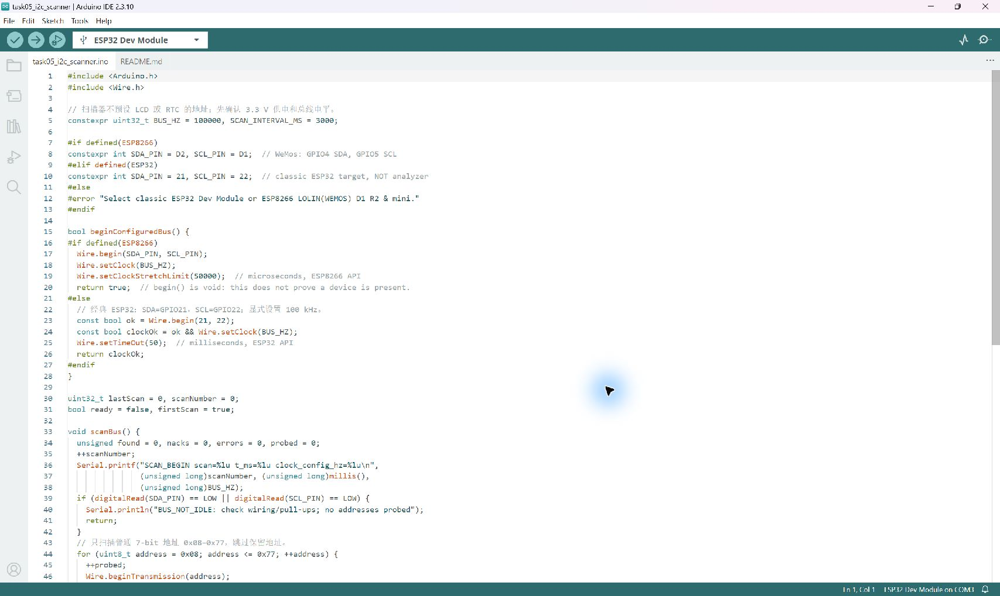

# Module 02 — Hardware Evidence Register

**Task 9 static CH0 LOW/HIGH captures are now verified:** [original files, replay screenshots and checks](task09-logic-analyzer/README.md). The later [real ESP8266 PWM capture](task09-esp8266-pwm.md) is also available. Other rows remain at their existing status; this register is not a declaration that all labs are complete. [Task checklist](../task-checklist.md).

For each actual experiment record: date, board/module markings, sketch/settings, source/library version, wiring/power/pull-ups, operators and their actual roles, raw observations, calculations, uncertainty/limitations, conclusions and remaining work. Put original pictures in [pictures](../pictures/README.md) and use valid relative links only after files exist.

| Task | Required actual evidence | Result / artefact link |
|---|---|---|
| 1 | Defined divider topology/parts, paired input/output readings and comparison | [Two original voltage photos](task01-voltage-divider/README.md) documented; nodes, resistance values and original 5 V divider proof Pending |
| 2 | Actual assigned bus profile, pitch notes and real shared artefact | Pending assignment/discussion |
| 3 | Shared class table and actual discussion/personal note | [Pod 4 CAN row and research answers](../bus-comparison.md) Prepared; classroom artefact and personal confirmation Pending |
| 4a/4b | Student study/verification, neighbouring-pod agreement and Discord post | Pending |
| 5 | First scan, changed connection scan, address-to-module identification | [NACK baseline and scanner record](#scanner-report--task-5-partial-baseline) available; real device ACK/mapping/unplug comparison Pending |
| 6 | Library value and raw register reconstruction under matched settings | [Report / empty result table](../register-reading.md) Prepared; sensor/library/configuration/readings Pending |
| 7 | A-only/B-only/both scans and actual readings of both devices | [Report / address table](../two-devices.md) Prepared; actual two-device tests Pending |
| 8 | Conflict/fix evidence if hardware available; otherwise explicitly theoretical | Theory prepared; physical experiment Pending |
| 9 | Install/version/pins, PWM/I2C captures, measured timebase and class decision | [CH0 LOW/HIGH verified](task09-logic-analyzer/README.md), 10,000 samples each; [ESP8266 PWM verified](task09-esp8266-pwm.md); [I2C NACK-only capture verified](task09-esp8266-i2c.md); sensor ACK/calibrated timebase/class decision Pending |
| 10 | Optional decoded transaction and measured SCL | Optional / not tested |

## Scanner Report — Task 5 Partial Baseline

**Prepared / Upload and scanning on hold: RTC identity and actual bus voltages Pending.** Current hardware is an ESP32 Dev Module, a student-identified PCF8574 LCD1602 backpack and an **RTC module reported as labelled DS3231, with DAT, CLK, RST terminals**. The top-side chip marking and interface have not been verified; the reported module label is not a confirmed DS3231 chip identification. The student reports 3.3 V-compatible modules and intends no 5 V connection or level translator; no actual module/bus-voltage readings have been supplied. [Scanner sketch/instructions](../code/task05_i2c_scanner/README.md) · [Detailed Chinese wiring and checks](../wiring-zh.md).

### Current Preflight — 2026-11-02

| Step | Status | Actual observation / limit |
|---|---|---|
| IDE/project/board | Completed | Observed task05_i2c_scanner in Arduino IDE 2.3.10; ESP32 Dev Module and COM3 selected |
| Port inventory | Completed | COM3, Silicon Labs CP210x USB to UART Bridge; no other serial port detected in this preflight |
| Source inspection / CLI compile | Completed | GPIO21 SDA / GPIO22 SCL, 100000 Hz requested, 115200 console, 0x08–0x77 range; Core 3.3.12 compile PASS, 294564 flash bytes / 23508 global RAM bytes |
| RTC identity / pin mapping | Pending | Student reports a DS3231 module label, but cannot yet confirm chip marking. DAT/CLK/RST alone does not prove I2C; inspect the chip and module traces/schematic |
| Supply/pull-ups/idle voltage | Pending | Student has no multimeter available and no VCC/DAT/CLK readings. Both LCD and RTC signal lines are user-confirmed disconnected from ESP32 GPIO; no DAT-to-SDA or CLK-to-SCL mapping was guessed |
| Upload / flash verification | Pending — not attempted | Firmware not replaced; no upload or Hash verified result is claimed |
| Three complete scan rounds / actual address mapping | Pending — not attempted | No COM3 serial connection/query was opened for this preflight; no new raw scan log exists |
| Physical removal comparison / RTC-LCD extension | Pending | Requires real module identification/electrical checks and user-performed power-off changes |
| Failed steps | None observed in this preflight | Compilation passed; hardware stages were withheld, not tested and failed |

**RTC identification gate:** [DS3231](https://www.analog.com/media/en/technical-documentation/data-sheets/DS3231.pdf) is I2C with SDA/SCL; [DS1302](https://www.analog.com/media/en/technical-documentation/data-sheets/DS1302.pdf) uses I/O, SCLK and CE, not I2C. DAT/CLK/RST suggests a possible three-wire board, but does not establish a chip model or a mapping. Do not connect DAT→GPIO21 or CLK→GPIO22 until module evidence proves those labels are SDA/SCL. DS3231 RST and DS1302 CE have different functions; do not assume an RST-labelled pad is optional or can float. The DS3231-specific wiring and library plan below is conditional on positive identification. A DS1302 will not become an I2C target by connecting two of its three signals to SDA/SCL.

Keep the assembly powered off while checking identity/rewiring. The latest student update confirms the LCD and RTC signal lines remain disconnected; it does not establish voltage compatibility. Read or photograph the chip's full marking using ordinary visual inspection or magnification; a multimeter is not needed for this identification step. Actual electrical measurements remain unperformed until a suitable meter is available. For voltage checks, isolate module signals from ESP32 GPIO before powering the correctly identified supply pins. Software/ACK results cannot establish 3.3 V electrical safety. If the RTC proves to be DS1302, safely isolated LCD-only scanning can be a partial I2C test after LCD electrical checks; it cannot be reported as two I2C devices or the requested DS3231 extension. No upload, new scan, ACK, voltage or time reading results are added by this clarification.

### Objective

Wire a voltage-compatible I2C bus, scan ordinary 7-bit addresses, identify each responding module by controlled connection changes, and verify which addresses disappear after power-off removal. RTC-to-LCD communication is a later extension, after observed addresses and electrical safety are confirmed. No current LCD/RTC experiment is marked completed.

### Hardware

| Item | Current information / status |
|---|---|
| Controller | ESP32 Dev Module; Arduino IDE 2.3.10, Espressif Core 3.3.12 checked for compilation |
| Bus pins/settings | SDA GPIO21, SCL GPIO22; 100000 Hz requested; Serial 115200 |
| RTC | Module label reported as DS3231; DAT/CLK/RST terminals. Chip marking, protocol, power/pin mapping and pull-ups unverified; signal lines disconnected |
| Display | LCD1602 + PCF8574 backpack, student confirms 3.3 V operation; actual address and display/backlight operation Pending |
| Supply/reference | Intended common 3.3 V supply and GND; actual supply voltage, idle SDA/SCL and total current budget Pending |
| Level translator | None available; not needed for verified all-3.3 V operation, but required/reassessed if a future module uses 5 V bus levels |
| Authentic evidence for this setup | Pending; existing Task 9 baseline is separately labelled below |

### Wiring

**Before GPIO connection:** resolve the RTC identification gate above. The following table applies only to a positively identified I2C DS3231 module. Inspect each module's pin labels and pull-up rail, power/check it separately at the confirmed 3.3 V, and measure idle SDA-to-GND and SCL-to-GND with a DMM in DC-voltage mode. Keep both GPIO lines disconnected. After combining the modules, recheck the idle bus before a power-off final GPIO connection. Do not interpret a floating/stuck-low line as a working safe bus. Do not use resistance/current mode on the powered bus.

| ESP32 | DS3231 module | LCD1602 PCF8574 module |
|---|---|---|
| 3V3 | VCC, after module compatibility/current-budget check | VCC, after module compatibility/current-budget check |
| GND | GND | GND |
| GPIO21 | SDA | SDA |
| GPIO22 | SCL | SCL |
| Not connected for this experiment | INT/SQW/32K etc. | Address straps retain their actual state |

Check effective parallel pull-ups and the supply budget including LCD backlight. No module GPIO or ESP32 output pin powers a display. PCF8574 and DS3231 support 3.3 V at chip level; breakout and LCD details still matter. If later powered at 5 V with 5 V pull-ups, isolate the ESP32 and use a suitable bidirectional open-drain I2C translator with proper pull-ups/reference supplies on each side. Moving pull-ups to 3.3 V alone is not guaranteed to satisfy a 5 V PCF8574's minimum HIGH threshold of 0.7×VCC. No resistor divider substitutes for bidirectional SDA translation.

If the chosen ESP32 is the former black analyzer, uploading Scanner replaces its on-board LogicAnalyzer firmware. It does not delete stored GitHub source/evidence. Remove conflicting old wiring, including the analyzer clock jumper, while powered off. No firmware replacement or upload was performed during this preparation.

### I2C Addresses

No LCD address is assumed, and no RTC discovery is predicted as an observed result. The scanner probes 0x08–0x77. Record **all** responding addresses: an RTC module can contain an auxiliary I2C chip, so two modules need not mean exactly two ACK addresses. An ACK alone does not establish a chip identity.

| Module / chip identity | Actual observed 7-bit ACK address(es) | Identification method / evidence |
|---|---|---|
| DS3231 module, RTC chip | Pending | Run A + module marking/datasheet; no guaranteed scan success |
| Any additional chip on RTC module | Pending | Inspect board and isolate its address contribution |
| LCD PCF8574 backpack | Pending | Difference between A and B; LCD-only run if needed |

### Scanner Results

Use the existing [task05_i2c_scanner.ino](../code/task05_i2c_scanner/task05_i2c_scanner.ino). On ESP32 it uses `Wire.begin(21, 22)` and `Wire.setClock(BUS_HZ)` with BUS_HZ=100000. No device-specific library is needed. Each ordinary full scan probes 112 addresses, prints actual ACKs and detected-address totals, counts NACKs/errors, and prints **No I2C devices found** when no address ACKs. A bus-error or stuck-low condition is diagnostic evidence, not proof of an empty bus. Repeat roughly three seconds after each scan; `s` requests another scan.

| Run | Connected configuration | Actual ACK address set | Probe / detected / NACK / error counts | Actual evidence |
|---|---|---|---|---|
| A | DS3231 module only | Pending | Pending | Pending |
| B | DS3231 + LCD1602, power-off addition | Pending | Pending | Pending |
| C | One identified module removed while all power is off | Pending | Pending | Pending |
| D | Removed module restored while all power is off | Pending | Pending | Pending |

**Historical evidence reuse, not a new LCD/RTC scan:** the preserved [Task 9 ESP8266 no-target experiment](task09-esp8266-i2c.md) and [real serial text](task09-esp8266-i2c/source-single-scan-115200.txt) record 0 ACK / 112 NACK / 0 other errors. Its [raw acquisition](task09-esp8266-i2c/pulseview-i2c-esp8266-nack-01.sr) and [decoder screenshot](task09-esp8266-i2c/i2c-nack-detail.jpg) contain twelve complete NACK requests, not twelve found devices. That baseline used a different sketch/board and does not satisfy the current RTC/LCD ACK or removal test.

### Device Removal Test

Power off all involved devices before adding/removing a module; remove its bus connections as well as power so unpowered-device backfeeding is not an assumed valid configuration. Record module removed and all remaining wiring. Compute `disappeared = ACK_set_B − ACK_set_C`, then check restoration in Run D. A module may contribute more than one address. Actual vanished/restored addresses and conclusion: **Pending**.

### RTC and LCD Communication

**Pending gate:** create the second independent sketch only after actual addresses, module identities, supply/pull-ups and idle voltages are verified. It is deliberately not created or uploaded yet. This respects the requested scan-first sequence.

Planned libraries, checked against their upstream source metadata:

- **RTClib by Adafruit**, reviewed version **2.1.4**, with its **Adafruit BusIO** dependency.
- **hd44780 by Bill Perry**, reviewed version **1.3.2**, using the `hd44780_I2Cexp` subclass and its explicit-address constructor. Pass the LCD address identified by real scans; do not use a guessed default address.

Install later via Arduino IDE **Sketch → Include Library → Manage Libraries**; match names/authors and record the actual installed versions. These libraries/the future combined sketch have not been installed or compiled in this preparation. Use one common Wire bus, 16×2 display, date YYYY-MM-DD on row 1 and time HH:MM:SS on row 2, with the same RTC sample also printed at 115200 about once per second. No Wi-Fi or network time is planned.

Do not automatically call `rtc.adjust(DateTime(__DATE__, __TIME__))` or invent an initial time. Check RTC initialization, oscillator/lost-power state and valid reads; show an uninitialized/invalid warning when appropriate. Any later explicit clock setting must be labelled as a setting action with its source, not an independently observed RTC value. A valid stored timestamp is not proof of correct real-world time or RTC accuracy.

| Extension evidence | Actual result |
|---|---|
| Confirmed LCD address / library version / LCD init | Pending |
| RTC init / lost-power flag / date/time validity | Pending |
| Actual RTC date/time and matching LCD/serial screenshot | Pending |
| Explicit setting performed? If yes, source/time/action | Pending; no setting action performed here |

### Troubleshooting

| Symptom | Checks / interpretation |
|---|---|
| No ACK / No I2C devices found | Correct board/pins, module power, common ground, pull-ups, reset/address configuration; inspect errors before concluding no hardware |
| BUS_NOT_IDLE | With power-off rewiring, check shorts, swapped pins, unpowered attached devices and missing/incorrect pull-ups |
| More than two addresses | Inspect RTC module auxiliary chips; map addresses using isolated runs rather than declaring extra sensors |
| LCD backlight but no characters | Verify contrast, supply/logic specification and backpack mapping after a real ACK; backlight is not I2C success |
| Addresses vanish unpredictably | Supply/backlight current, parallel pull-ups, wire length, shorts, reset and actual timing; 100 kHz request is not a measured clock |
| RTC date looks plausible but is wrong | Lost-power/uninitialized state or previously stored time; do not silently replace it with compiler time |
| Old analyzer firmware runs instead of Scanner | Recheck selected board/port and upload identity; replacing on-board firmware requires a deliberate upload |

### Evidence

| Record | Required real content | Status |
|---|---|---|
| Electrical check | Per-module and combined VCC/SDA/SCL readings, pull-up rail, module markings | Pending |
| Run A/B/C/D serial captures | Real COM/115200 settings, full ACK lists/counts/errors and current sketch commit | Pending |
| Wiring photo | Actual common 3.3 V/GND and GPIO21/22 connections; no unverified 5 V attachment | Pending |
| Removal comparison | Module removed, before/after address sets and restoration | Pending |
| Later RTC/LCD test | Real time reads, LCD content, libraries and any explicitly logged initialization | Pending |

Do not link nonexistent screenshots or copy example addresses into measured columns. Existing Task 9 originals remain unchanged. This prepared report is not a completed hardware result.

Sources: [TI PCF8574](https://www.ti.com/lit/ds/symlink/pcf8574.pdf), [ADI DS3231](https://www.analog.com/media/en/technical-documentation/data-sheets/DS3231.pdf), [NXP PCA9306](https://www.nxp.com/docs/en/data-sheet/PCA9306.pdf), [RTClib](https://github.com/adafruit/RTClib), [hd44780](https://github.com/duinoWitchery/hd44780), [explicit-address constructor](https://github.com/duinoWitchery/hd44780/blob/master/hd44780ioClass/hd44780_I2Cexp.h).
