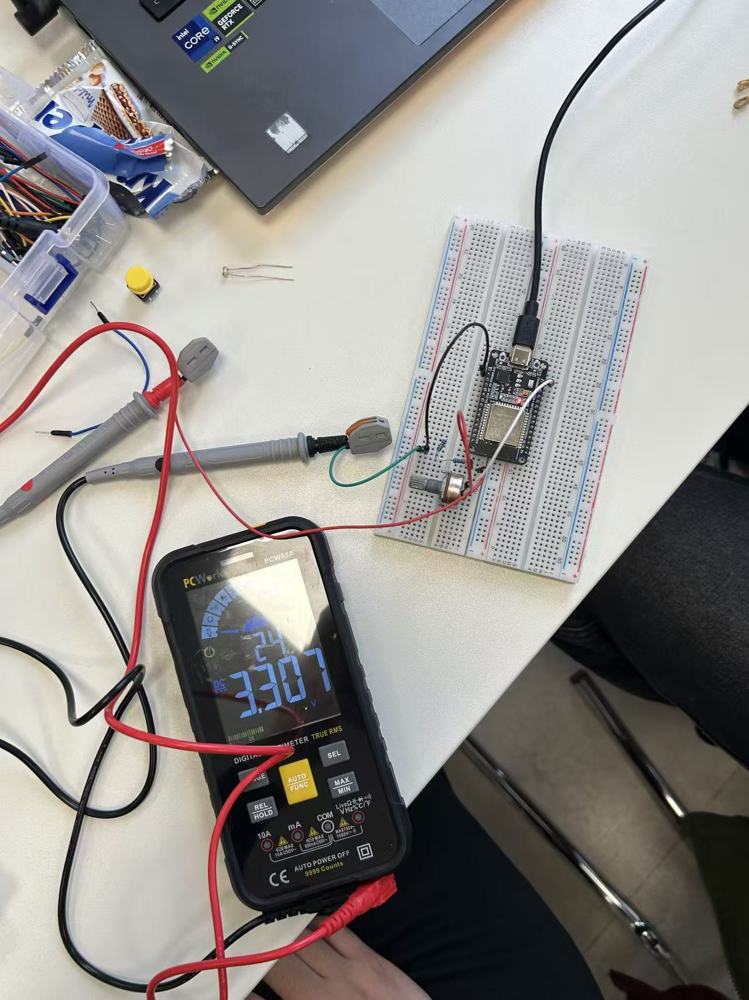
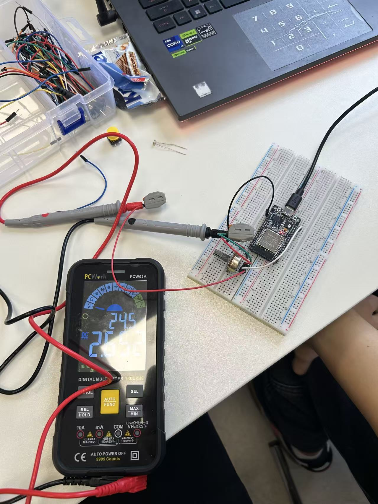

# Task 1 — Original Voltage Measurement Photographs

**Student-confirmed 3.3 V potentiometer measurements: supply 3.307 V, wiper output 2.652 V. The original 5 V fixed-divider verification remains Pending.** [English Task 1 report](../../pins-and-dividers.md). Imported on 2026-11-02 from the student's ZIP; the actual capture date/operator details are not established by this import. The two JPEGs are copied byte-for-byte without cropping, enhancement or recompression.

| Original file | Confirmed measurement | Not established |
|---|---|---|
| [Photo A](Task1_photo_A_multimeter_3V3.jpg) | **ESP32 3V3 supply voltage = 3.307 V**, as confirmed by the student | Meter uncertainty, measurement timing and resistance values |
| [Photo B](Task1_photo_B_potentiometer_output.jpg) | **Potentiometer wiper output voltage = 2.652 V**, as confirmed by the student; this supersedes the initial approximate 2.7 V label | Glare still obscures part of the original display; resistance values and exact knob position are not inferred |

The measurement identities and the corrected Photo B reading are based on the student's explicit confirmation, not newly inferred from the obscured image. Their calculated voltage ratio is `2.652 / 3.307 ≈ 0.8019`, approximately **80.2%**. This is not evidence of simultaneous readings, an exact resistance ratio or a knob position. The experiment uses the 3.3 V supply and a potentiometer; it does not verify the proposed 10 kΩ/12 kΩ fixed-divider design or any 5 V input conversion.

## Photo A

## Photo B

## Integrity

| File | Original JPEG bytes | SHA-256 |
|---|---|---|
| Task1_photo_A_multimeter_3V3.jpg | 262325 | `a7a08605b6f9ba234b415c25eaa9d4e2284e9f4d3c71c09a64ddca5cb0dd726a` |
| Task1_photo_B_potentiometer_output.jpg | 286622 | `d19a71df9bffea1eedb69911b14c0672af85534041d6d2dd0eac3d3bfb59a0a9` |

## Required Follow-up

For this potentiometer experiment, supplement the confirmed supply/wiper readings with a labelled schematic, measurement date and meter range/uncertainty if available. Potentiometer resistance, segment resistance and exact position remain unspecified. For the separate professor-required 5 V fixed-divider task, record actual R1/R2, source limits and paired Vin/Vout measurements with identified nodes. Verify safe output before any ADC connection. Neither fixed-divider completion nor additional measured data is inferred from this update.
