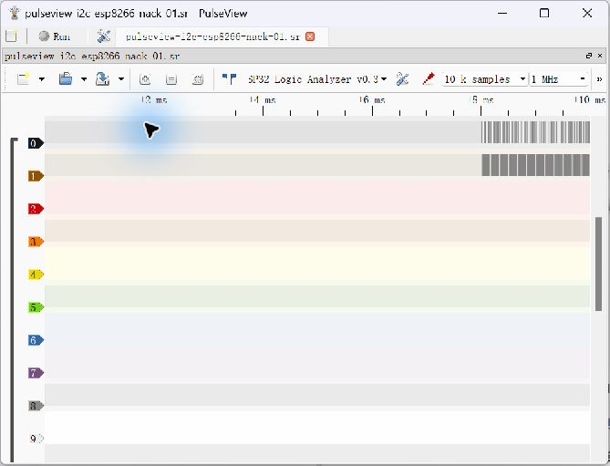
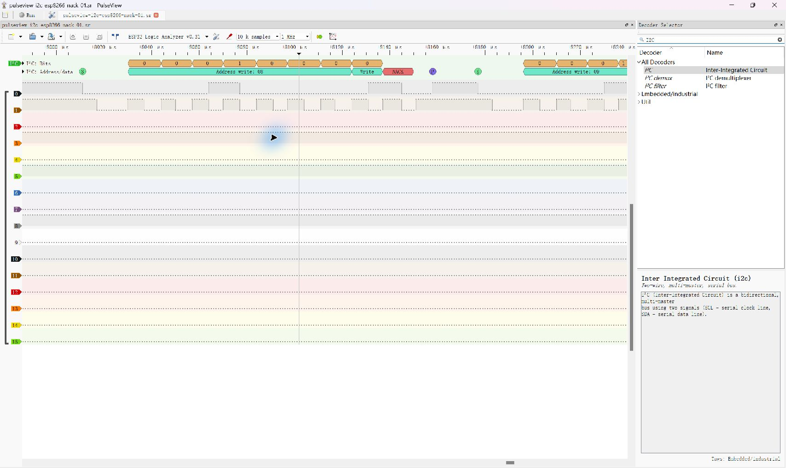

# Task 9 A — ESP8266 I2C NACK Capture Record

**Real NACK-only capture and decoding verified — 2026-10-28.** Sensor ACK/data reading, independent timebase calibration and class decision remain Pending. [Source and wiring](../code/task09_esp8266_i2c_source/README.md) · [Task 9 report](../scope-decision.md).

## Objective and Actual Setup

Capture an I2C scanner with **no sensor attached**, identifying START, address, write bit, ninth-clock NACK and STOP. Transmitted addresses are probes, not discovered devices.

Blue WeMos D1 mini / ESP8266EX used **CH340 COM4**, ESP8266 Core 3.1.2, `esp8266:esp8266:d1_mini`, Serial 115200. Compilation passed; upload identified ESP8266EX / 4 MB flash and reported **Hash of data verified**. Only the blue source was flashed. The black ESP32 retained official LogicAnalyzer v0.31 firmware, **COM3 / 921600, ols/SUMP**.

| Connection / parameter | Actual setup |
|---|---|
| SDA | Blue D2/GPIO4→black GPIO21/CH0 |
| SCL | Blue D1/GPIO5→black GPIO19/CH1 |
| Reference / analyzer clock | Dedicated common GND; black GPIO22→GPIO23 jumper retained |
| Pull-ups | User confirmed requested wiring/pull-up setup; proposed 4.7 kΩ per line to blue 3V3. Actual resistance, voltage and rise time were not independently measured; no wiring photograph supplied |
| Sensor | None, as confirmed by user |
| Source clock request | 100 kHz; not a measured result |
| Capture | 1 MHz requested, 10 k samples, no trigger, RLE off, external clock off, Pattern=None, pretrigger 0% |
| Decoder | PulseView I2C: SDA=CH0, SCL=CH1; default shifted address display, checked against raw address bits |

No board supply outputs were intentionally interconnected. Previous LOW/HIGH/PWM evidence and analyzer firmware remain unchanged.

## Method and Actual Serial Observation

The source starts paused. Sending `s` through COM4 produced this real response:

```text
SCAN_BEGIN: 7-bit addresses 0x08..0x77, empty writes
SCAN_END ACK=0 NACK=112 other_errors=0
Check ninth SCL pulse in the actual capture for ACK/NACK.
```

[Received serial text](task09-esp8266-i2c/source-single-scan-115200.txt). This single scan was separate from the later acquisition; it is not a timestamp-correlated log of every captured frame. Sending `c` enabled continuous scans for PulseView; `p` was sent afterward to pause. The free-running capture contains idle time followed by part of a scan, not all 112 addresses.

## Raw Evidence and Results

[Original `.sr`](task09-esp8266-i2c/pulseview-i2c-esp8266-nack-01.sr) · [Full sample indices and calculations](task09-esp8266-i2c/i2c-nack-measurements.json).

- ZIP integrity passed; metadata: 16 probes, 2 bytes/sample, 1 MHz. Actual logic data: **20,000 bytes / 10,000 samples**. Only CH0/CH1 were controlled and analyzed.
- **12 complete empty-write transactions**, seven-bit addresses **0x08–0x13**, all R/W=0: **12 NACK, 0 ACK**.
- Each counted transaction has START, eight address/RW bits, ninth-clock SDA HIGH (NACK), and STOP. This implementation has a further SCL rise with SDA LOW to prepare STOP; this is not a tenth data bit.
- Within-byte SCL periods: **13–14 samples**, mean **13.4167 samples** over 96 intervals. At the configured uncalibrated 1 MHz rate: nominal 13–14 µs, inverse mean period approximately **74.53 kHz**. **Requested 100 kHz differs from the sample-derived observation.** Software-I2C overhead and clock errors are possible contributors, not separately verified causes.

Archive SHA-256: `dd0ce4991051c673a4b5c3875ca5b08842cbab049ba5dfc10375dd25dd4324d5`.

### Recountable 0x08 Example

Zero-based START index **8011**. First nine SCL rising indices: **8030, 8044, 8057, 8070, 8084, 8097, 8111, 8124, 8137**. SDA bits `00010000 1` give address byte 0x10, seven-bit address **0x08**, write bit **0**, then **1=NACK**. SCL rises at 8151 with SDA LOW for STOP setup; SDA rises while SCL is HIGH at **8158**, completing STOP. These are actual raw-sample calculations, not claimed cursor measurements.

## Genuine Screenshots





[Decoder mapping](task09-esp8266-i2c/i2c-decoder-mapping.jpg) · [Additional decoded transactions](task09-esp8266-i2c/i2c-decoded-transactions.jpg) · [Acquisition settings](task09-esp8266-i2c/i2c-acquisition-settings.jpg). These are unedited screenshots of the real session, not Demo captures. The `.sr` preserves samples; add the I2C decoder with the documented mapping if needed when opening elsewhere.

## Conclusion and Remaining Work

The real setup captured scanner address traffic with NACK, consistent with no attached responder. This verifies the **NACK-only stage**, not sensor discovery, ACK, register readings, electrical compliance or all Task 9 goals. The analyzer timebase is not independently calibrated; digital capture cannot measure analog input voltage/rise time. Exact pull-up values, wiring photography, calibrated timing, sensor ACK/data, long-run repeatability, B-class scope validation and real class adoption/ownership remain Pending.
