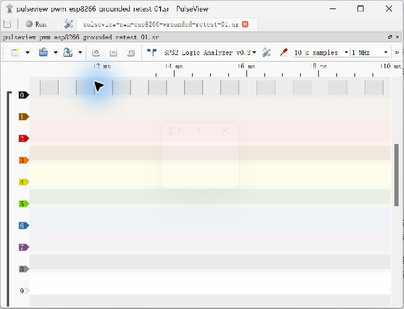
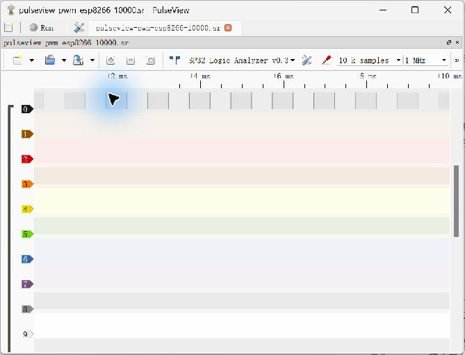
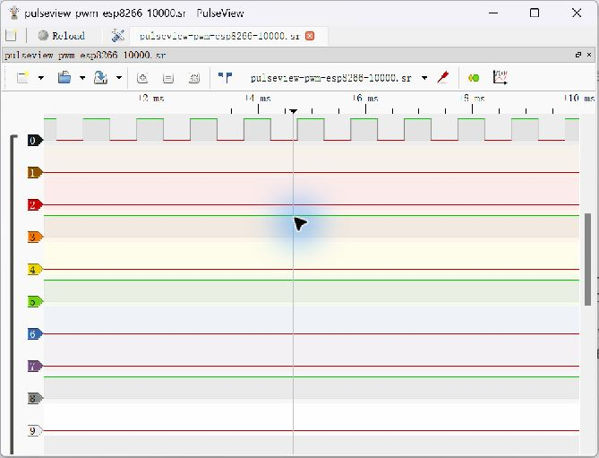

# Task 9 A — ESP8266 PWM Dynamic Capture Record

**Grounded PWM retest verified — 2026-10-28; independent timebase calibration Pending.** [Source and instructions](../code/task09_esp8266_pwm_generator/README.md) · [Task 9 report](../scope-decision.md). Preserved LOW/HIGH files and screenshots are unchanged.

## Wiring Correction and Grounded Retest

After the initial acquisition, the user clarified that the **dedicated B GND→A GND wire had been missing**. The earlier statement that this wire was present was incorrect. The first `.sr`, screenshots and measurement JSON are retained unchanged as historical data; they do not establish the intended complete two-board wiring. A possible return through the USB system was not independently checked. No causal comparison or claim that ground alone fixed a particular capture error is made.

The user then confirmed all three connections: B D1/GPIO5→A GPIO21, B GND→A GND, and analyzer A GPIO22→A GPIO23; the former CH0 static tie was removed. With that confirmed setup, a **new real acquisition** was made in PulseView, saved separately and reopened successfully. Neither board was reflashed for the retest.

| Grounded retest parameter / result | Actual record |
|---|---|
| Device / transport | Real ESP32 Logic Analyzer v0.31, COM3 / 921600 baud |
| Requested capture | 1 MHz, 10 k samples, no trigger; CH0 analyzed |
| Archive validation | ZIP integrity passed; 16 probes, 2 bytes/sample, 20,000 logic bytes / 10,000 samples |
| Complete cycles | 9 rising-to-rising intervals; boundary partial cycles excluded |
| Period | 999–1000 samples, nominal 0.999–1.000 ms |
| Mean period | 999.8889 samples, nominal 0.999889 ms |
| Inverse mean period | Approximately 1000.11 Hz at configured timebase |
| HIGH duration | 500–501 samples, nominal 0.500–0.501 ms |
| Mean per-cycle duty | 50.0500%; per-cycle range 50.000–50.100% |

[New original grounded retest `.sr`](task09-esp8266-pwm/pulseview-pwm-esp8266-grounded-retest-01.sr) · [Full sample indices and calculations](task09-esp8266-pwm/pwm-grounded-retest-01-measurements.json).

Rising indices: **288, 1288, 2288, 3288, 4288, 5288, 6287, 7287, 8287, 9287**. For example, rise=288, fall=789, next rise=1288 gives a 1000-sample period and 501-sample HIGH (50.1%). The mean of per-cycle duty ratios is reported; time/frequency conversions depend on the uncalibrated configured 1 MHz rate. No independent wiring photo, continuity or voltage measurement is supplied.

Archive SHA-256: `ec3f908c0e24304da397b9b3aad66c1bae8168b71be98cba6dee0dcf68c4cbf3`.

Actual live acquisition screenshot (real device, sample count and configured rate visible):

Replay of this new original file, not another capture:

## Setup — Grounded Retest

| Item | Configuration / evidence status |
|---|---|
| Analyzer A | Black classic ESP32, official LogicAnalyzer v0.31 firmware retained; COM3 CP210x / 921600 baud |
| Source B | Blue WeMos D1 mini / ESP8266, USB-SERIAL CH340 / COM4 confirmed by user |
| Board package | ESP8266 Community 3.1.2; LOLIN(WEMOS) D1 R2 & mini (`esp8266:esp8266:d1_mini`) |
| Source output | D1 / GPIO5, range 0–1023, code 512, requested 1000 Hz and approximately 50% duty |
| Source console | 115200 baud, separate from analyzer transport |
| Wiring | B D1→A GPIO21/CH0; B GND→A GND; A GPIO22→A GPIO23 clock jumper retained |
| Safety / confirmation | User confirmed common ground for the retest and removal of former GPIO21 static GND/3V3 tie; separate USB power, no supply-rail interconnection |
| Capture request | 1 MHz, 10 k samples, CH0, no trigger, RLE off, External Clock off, Pattern=None |

Pin wiring/common ground are user-confirmed, not independently photographed or continuity-meter verified. Target parameters are not measured results. No analyzer firmware upload is authorized or required for this experiment.

## Initial Build / Upload / Capture — Historical Evidence (Ground Wire Missing)

- **Compile PASS:** installed ESP8266 Community 3.1.2, `esp8266:esp8266:d1_mini`; 28392 bytes global RAM, 61183 bytes instruction RAM including reserved cache, 237892 bytes flash code.
- **Upload PASS, blue board COM4 only:** the user explicitly confirmed COM4 and wiring before upload. esptool identified ESP8266EX / 4 MB flash, wrote the binary and reported `Hash of data verified`. No upload or firmware change was made to black analyzer A / COM3.
- **Real startup output:** [115200-baud application text](task09-esp8266-pwm/source-serial-115200.txt), read through COM4 after reset. Preceding reset bytes were omitted; only the received application message is saved. It confirms requested parameters, not measured frequency.
- **Original data:** [PulseView `.sr`](task09-esp8266-pwm/pulseview-pwm-esp8266-10000.sr), copied unchanged from the original local acquisition. ZIP integrity passed; metadata has 16 probes, 2 bytes/sample, 1 MHz; logic data has **20,000 bytes / 10,000 samples**. Only CH0 was driven and analyzed; the other stored channels are not validated.
- **Real screenshots:** live capture overview below, plus a separately labelled replay of the same saved file. No synthetic PWM diagram or Demo acquisition is used.
- **Timebase:** requested/stored 1 MHz, **not independently calibrated**. No frequency counter or independent scope was used.

| Run | Actual samples | Rising-edge period(s) | HIGH duration(s) | Frequency from capture timebase | Duty cycle | Variation / missed edges / evidence |
|---|---|---|---|---|---|---|
| Original acquisition | 10,000 | 999–1000 samples = 0.999–1.000 ms at configured rate | 500–501 samples = 0.500–0.501 ms | 1000.000–1001.001 Hz per complete cycle | 50.000–50.100% | Nine complete cycles; edge list in [measurement JSON](task09-esp8266-pwm/pwm-measurements.json) |

Rising edges (zero-based sample index): **729, 1729, 2728, 3728, 4728, 5728, 6728, 7727, 8727, 9727**. There are nine complete rising-to-rising intervals; partial cycles at record boundaries are excluded. Mean period is **999.7778 samples ≈ 0.999778 ms**, giving approximately **1000.22 Hz** from the inverse mean period. Mean HIGH duration is **500.3333 samples**, and the mean of the nine per-cycle duty ratios is **50.0445%**.

Example independently recountable within the original file: rising index 729, falling index 1229, next rising index 1729 → period 1000 points, HIGH 500 points → 1.000 ms and 50.000% using the configured rate. These are calculations from actual sample indices, not manually claimed cursor measurements. At this rate one sample represents a nominal 1 µs; short-record quantization, source software PWM and analyzer timing can all contribute to observed variation. This one record does not prove long-term jitter bounds or zero missed edges.

Archive SHA-256: `94cdc3d80c2f904140df032849705de47dfa47da1441f5b6f7dc0026c5ab0526`. [Full edge indices and per-cycle calculations](task09-esp8266-pwm/pwm-measurements.json).

## Initial Acquisition Screenshots — Ground Wire Missing

Live PulseView acquisition with the real ESP32 device selected, 1 MHz and 10 k samples visible:

Replay of the same saved `.sr`, reopened successfully in PulseView (not another acquisition):

A real two-board wiring photograph and original Arduino IDE/Serial Monitor screenshots have **not** been supplied. Wiring/common ground are user-confirmed; upload and startup text were observed through CLI/serial tools. Do not substitute diagrams or screenshots from upstream for those missing photographs.

For a genuine capture, use multiple adjacent rising edges: `period=(next_index-index)/configured_sample_rate`; `duty=HIGH_samples/period_samples`. Report raw sample counts as well as time conversions. Unless independently calibrated, timing/frequency is an estimate based on the configured analyzer rate; both source and analyzer clock errors can contribute. ESP8266 uses software PWM, so observed jitter and load effects must be recorded rather than assumed absent.

## Conclusion and Remaining Work

With the dedicated ground wire confirmed for the retest, the ESP8266 source produced a repeated signal captured by the unchanged ESP32 analyzer, with sample-derived period and duty consistent with the approximately 1 kHz / 50% target. This verifies one dynamic PWM acquisition, not absolute timing calibration or all analyzer channels/rates. I2C capture, long-term repeatability, independent reference comparison, wiring photography and final class decision remain Pending.
