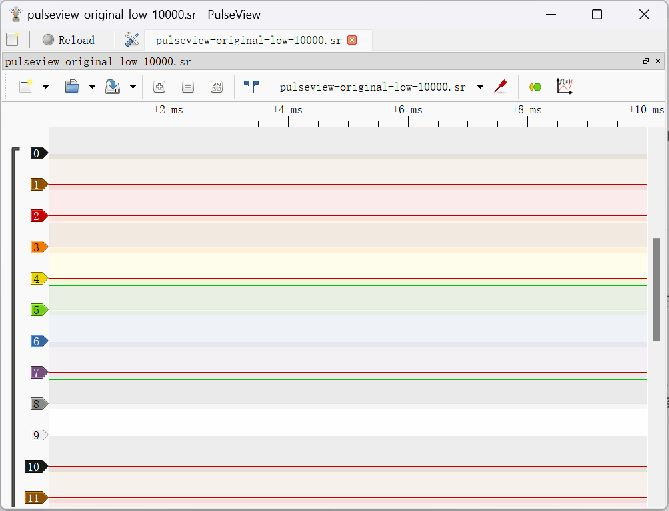
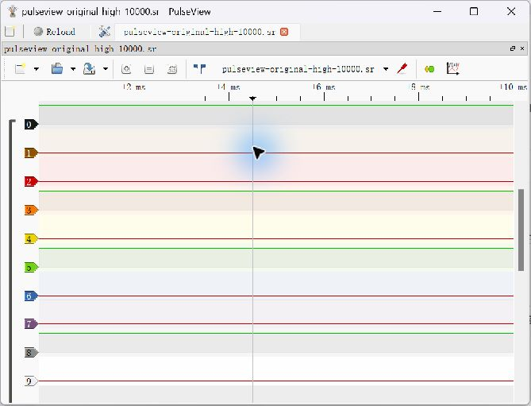

# Task 9 A — Real Static LOW/HIGH Acquisition Evidence

**Stage verified: CH0/GPIO21 static digital input acquisition. PWM, I2C decoding, independent timebase calibration and class decision remain Pending.** [English report](../../scope-decision.md) · [Further measurement record](../task09-logic-analyzer-record.md).

The experiments took place on 2026-10-28 using one classic ESP32. GPIO22→GPIO23 remained the analyzer-local clock jumper. The user connected GPIO21 only to GND for LOW, then powered off and moved GPIO21 only to 3V3 for HIGH. The assistant operated PulseView and checked saved data; no individual contribution is attributed to Felix and no class presentation is claimed.

## Original Acquisitions

| Original file | Stored logic bytes / samples | CH0 LOW | CH0 HIGH | Stored rate |
|---|---|---|---|---|
| [LOW `.sr`](pulseview-original-low-10000.sr) | 20,000 / 10,000 16-bit samples | 10,000 | 0 | 1 MHz, configured |
| [HIGH `.sr`](pulseview-original-high-10000.sr) | 20,000 / 10,000 16-bit samples | 0 | 10,000 | 1 MHz, configured |

These two archives were copied byte-for-byte from the original local diagnostic files. Each is only 515 bytes compressed: its ZIP contains metadata and **20,000 actual logic-data bytes**, not an empty capture. Repetitive static values compress strongly. The archives each store 16 channels, but this experiment validates **only CH0**; the other inputs were not controlled or validated.

Verification: ZIP integrity, metadata `unitsize=2`, 16 probes, 1 MHz label, data length and bit 0 of every little-endian 16-bit word. [Machine-readable verification and SHA-256 hashes](capture-verification.json). Hashes identify these preserved files; they do not calibrate the analyzer.

| File | SHA-256 |
|---|---|
| LOW | `53f009914f607017fff600efdb31a2b1a06bc637be6623cb9b612c294a16f6cf` |
| HIGH | `a0a57b18c0b99e5f6310bf6d3aec07d482541cfb11145bb0450ebb0e1aafd2f7` |

## Genuine PulseView Replay Screenshots

No separately saved original acquisition-time screenshots were found. The following are **unedited screenshots of the real PulseView application displaying the preserved captures during evidence organization**, not fresh hardware acquisitions or upstream example images. Both original files were reopened successfully. Replay mode may omit the live COM/rate toolbar; acquisition parameters are supported separately by metadata and the recorded test session. The screenshots supplement the raw files, which are the primary evidence.

LOW replay — CH0 is the channel labelled `0`, not a displayed numeric measurement:

HIGH replay:

## Configuration and Provenance Limits

- Windows 11; Arduino IDE 2.3.10; classic ESP32 Dev Module; analyzer identity **ESP32 Logic Analyzer v0.31**, 16 digital channels.
- Silicon Labs CP210x USB-to-UART bridge on **COM3**; SUMP/OLS, **921600 baud / 8N1**; PulseView **0.5.0-git-e2fe9df x64**, runtime libsigrok **0.6.0-git-883c2ac**.
- Requested **1 MHz**, **10 k samples**, no trigger; External Clock off, RLE off, Pattern=None. No trigger and serial settings are session observations/user-confirmed settings, not fields asserted to be present in the `.sr` metadata.
- The user reported successful IDE compilation/upload and `Hash of data verified`. No original upload/build/wiring screenshot was supplied. Separately, an actual CLI build of unchanged upstream commit `5c4f2b9fd85ac09aca3e42596e6e7e0b640cdab3` with Core **3.3.7**, Dev Module and Debug=None passed: 298391 bytes flash / 118440 bytes global RAM.
- The running board was reported to contain the official unmodified firmware. Recovery and both captures occurred **without an assistant reflash**. Optional locally prepared fixes and the earlier repository clock-retune patch were not flashed for these runs. No independent flash-readback hash/version attestation is claimed.
- Static levels establish input-state discrimination and sample transfer at the tested settings. They do not establish actual voltage accuracy, edge fidelity, measured sample rate, PWM frequency/duty, I2C decoding, 20 MS/s operation or the full Task 9 completion.
