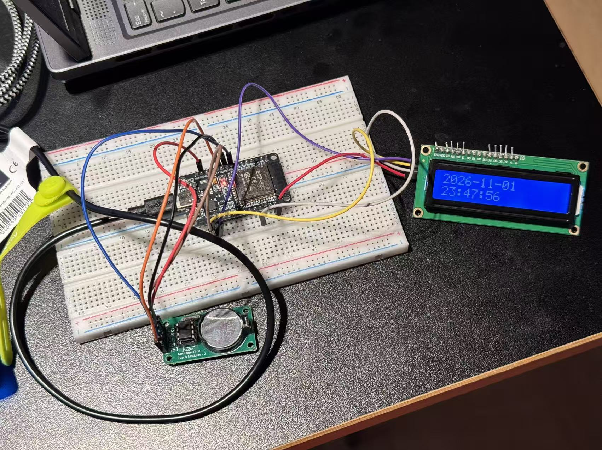

# Task 6 — Read Through the Library, Then Read the Register

**Software prepared and compiled; the required I²C sensor measurements and register comparison remain unverified.** Current-hardware diagnostics were actually run on COM3: all three rounds reported **BUS_BLOCKED**, with SDA/GPIO21 and SCL/GPIO22 LOW. No wiring was changed, no address probe was sent, and no sensor reading or agreement is claimed.

## Objective

The professor's [Task 6](https://github.com/iotempire/iotempire-teaching/blob/main/full-classes/hsbi-sensors-actuators-10d/modules/02-i2c-and-sensor-addressing.md#-task-6-read-through-the-library-then-read-the-register) requires (1) real sensor-library values, (2) direct Wire reads and datasheet reconstruction, and (3) comparison/explanation. Compilation and a blocked-bus diagnosis are useful preparation, not completion of those three measurement requirements.

This report reuses the existing Task 6 path and empty comparison table. The original [library adapter](code/task06_library_template/README.md) and [generic register adapter](code/task06_register_template/README.md) are preserved unchanged. Two distinct, standalone sketches now implement the requested diagnostic and one concrete teaching example; they are not duplicate reports.

## Hardware and Software

| Item | Actual information |
|---|---|
| Current board / port | Classic ESP32 Dev Module, COM3 (Silicon Labs CP210x); uploader identified ESP32-D0WD-V3 revision v3.1 |
| Host / tools | Windows 11; Arduino IDE 2.3.10; installed Espressif Arduino Core 3.3.12; Arduino CLI |
| Bus / console | GPIO21 SDA / GPIO22 SCL; requested 100000 Hz; Serial 115200 baud, 8N1 |
| Current peripheral inventory | LCD1602 + student-identified PCF8574, VCC reported on ESP32 3V3; DS1302 RTC is three-wire, not I2C |
| Physical verification limit | Circuit retained unchanged; no new wiring check or measured VCC/SDA/SCL voltage. Digital reads do not prove electrical safety |
| Selected additional teaching sensor | **Bosch BME280**, temperature channel only; not provided in the current inventory, not wired or hardware verified |
| Installed dependencies | Adafruit BME280 Library 2.3.0; Adafruit BusIO 1.17.4; Adafruit Unified Sensor 1.1.15 |

PCF8574 is an I/O expander for the LCD, not a temperature/humidity sensor. DS1302 DAT/CLK/RST must not be treated as SDA/SCL or as a DS3231. No LCD display or RTC timestamp is part of Task 6.

## Current-Hardware Diagnostic

Open [task06_current_hardware_diagnostic.ino](code/task06_current_hardware_diagnostic/task06_current_hardware_diagnostic.ino), in its same-name sketch folder. It is also open in Arduino IDE 2.3.10. The CLI compiled and uploaded it to COM3; the previous Task 5 firmware was replaced with permission, but its source/logs and all Task 9 evidence were preserved.

The sketch waits for `g`, then performs exactly three rounds. It uses INPUT_PULLUP with 50 samples per input, two milliseconds apart, and records counts. Internal weak pull-ups are diagnostic aids, not a qualified replacement for external I2C pull-ups. If either line is not consistently HIGH it prints BUS_BLOCKED and sends no address probes. Only an idle bus reaches Wire.begin and a bounded 0x08–0x77 address scan; each transaction has a 50 ms timeout and scanning stops on a bus error/non-idle condition. An ACK alone is labelled identity UNVERIFIED, not automatically PCF8574. After the three rounds, Wire is ended if started and both pins return to ordinary INPUT; no automatic retries or recovery pulses occur.

## Library-Based Reading

Open [task06_library_vs_register.ino](code/task06_library_vs_register/task06_library_vs_register.ino). **Prepared / Not Hardware Verified; compiled only, not uploaded.** It requires an additional genuine, electrically compatible BME280 breakout and a functioning bus, outside the unchanged current circuit.

The example checks the datasheet candidate addresses 0x76/0x77 for chip ID 0x60 before calling Adafruit_BME280.begin. These are candidate configurations, not addresses found in this experiment. On an idle bus without a matching ID, it prints SENSOR_NOT_FOUND; on a blocked bus it instead prints BUS_BLOCKED and labels sensor presence NOT_TESTED. Neither message was actually observed from this unuploaded sketch.

The library configures temperature x1, pressure/humidity skipped, filter off and sleep mode. Direct readback checks the selected mode. Each comparison requests a forced temperature conversion, bounds its own status polling to 100 ms, then calls the real library readTemperature API. No preset or random readings are used.

## Direct Register Reading

The same sketch implements checked Wire reads: write the register pointer, endTransmission(false) for repeated START, request the exact byte count, reject status errors/short reads and never decode uninitialized bytes. It independently reads calibration and raw temperature rather than reading library-private coefficients. It prints raw bytes, reconstructed ADC code, library/direct temperatures and direct-minus-library difference only after valid direct reads and a finite library result.

## Register Address and Data Format

These are **datasheet definitions for the prepared BME280 example**, not observed register contents.

| Register(s) | Meaning / format |
|---|---|
| 0xD0 | Chip ID; BME280 identifier 0x60 |
| 0x88–0x89 | dig_T1, unsigned 16-bit little-endian |
| 0x8A–0x8B, 0x8C–0x8D | dig_T2 / dig_T3, signed 16-bit little-endian |
| 0xF2, 0xF4, 0xF5 | Humidity control, measurement control, configuration |
| 0xF3 | Measuring / calibration-update status |
| 0xFA–0xFC | Temperature MSB, LSB, XLSB; unsigned 20-bit ADC code in the upper 20 bits |

## Conversion Formula

With bytes b0,b1,b2 in wire order: `adc_T=(b0<<12)|(b1<<4)|(b2>>4)`. Reject the skipped-temperature code 0x80000. Decode signed calibration explicitly from two's complement. Bosch's floating-point compensation is:

```text
v1 = (adc_T / 16384 - dig_T1 / 1024) * dig_T2
v2 = (adc_T / 131072 - dig_T1 / 8192)^2 * dig_T3
temperature_C = (v1 + v2) / 5120
```

This is calibrated compensation, not a fixed ADC-to-degree scale. See Bosch datasheet sections 4.2.3, 5.3–5.4 and Appendix A, particularly temperature compensation. The library uses integer arithmetic and 0.01 °C reporting; numerical rounding can differ from the direct double-precision method. No calibration coefficients or temperatures are filled with made-up values.

## Comparison Method

Use one completed forced conversion, then keep the device asleep while reading it through both paths. Raw bytes are read before and after the library call; a changed code or read failure suppresses the comparison. Log timestamps/configuration and compute `difference_C = direct_C − library_C`. Explain signedness, little-endian calibration versus MSB-first ADC data, bit shifts and integer rounding. Establish a justified tolerance from numerical precision and actual observations; no measured tolerance or agreement is asserted here. Agreement of software paths would not independently prove sensor accuracy or ambient-temperature accuracy.

## Actual Compilation Results

Both sketches compiled for `esp32:esp32:esp32` with Core 3.3.12. The standard installed board partition CSV was supplied in each temporary build folder; no course or Core partition configuration was changed. Logs below are actual CLI output, not expected-output examples.

| Sketch | Flash bytes | Global RAM bytes | Actual build log |
|---|---:|---:|---|
| Current hardware diagnostic | 295276 | 23500 | [Compile log](evidence/task06-library-vs-register/compile-current-hardware-20261102.txt) |
| BME280 library versus register | 304116 | 23700 | [Compile log](evidence/task06-library-vs-register/compile-library-vs-register-20261102.txt) |

[Installed library versions](evidence/task06-library-vs-register/library-versions-20261102.txt). Library installation and compilation do not prove a sensor is physically present.

## Actual Hardware Test Results

The diagnostic upload succeeded on COM3, with **Hash of data verified**: [real upload log](evidence/task06-library-vs-register/upload-current-hardware-20261102.txt). A command-line SerialPort capture sent `g` and saved [all received original serial bytes](evidence/task06-library-vs-register/current-hardware-serial-20261102.txt). No physical adjustment was performed.

| Round | SDA LOW / samples | SCL LOW / samples | Actual outcome | Address probes / ACK / NACK |
|---|---|---|---|---|
| 1 | 50 / 50 | 50 / 50 | BUS_BLOCKED | 0 / unavailable / unavailable |
| 2 | 50 / 50 | 50 / 50 | BUS_BLOCKED | 0 / unavailable / unavailable |
| 3 | 50 / 50 | 50 / 50 | BUS_BLOCKED | 0 / unavailable / unavailable |

The log includes SESSION_BEGIN, all ROUND_BEGIN/ROUND_END records and SESSION_END. The configured 100 kHz is not a measured clock; because Wire.begin was skipped on this blocked run, no 100 kHz transaction was generated. No PCF8574 address was identified. BME280 physical absence is based on the provided inventory, not a fabricated NACK scan. The sensor example was not uploaded, so no library initialization, raw register measurement, temperature or difference was obtained.

### Actual Comparison — Pending

| Date / model / datasheet revision | 7-bit address | Library/version/mode | Register pointer/bytes | Raw bytes in wire order | Signed reconstruction/formula | Library value/unit | Direct value/unit | Difference / timing / uncertainty | Evidence |
|---|---|---|---|---|---|---|---|---|---|
| | | | | | | | | | |

## Limitations and Troubleshooting

- Current hardware has no suitable I2C measurement sensor and the existing bus remains blocked; software cannot satisfy the core measurement requirements under the no-rewiring constraint. No further physical action is requested in this stage.
- LOW input values and weak-pull-up behavior do not identify a unique short, wiring error, device fault or actual voltage. No forced recovery, push-pull HIGH, device removal or Task 5 restart was attempted.
- The Adafruit library's begin implementation polls calibration status without its own overall deadline; the example's 100 ms bound covers our conversion polling, not all third-party library calls. Its readTemperature API also lacks a separate transport-success flag. Validated surrounding direct reads and chip/configuration checks improve diagnostics but cannot guarantee every library-internal transaction. The prepared program therefore still needs actual sensor/error-path verification before use.
- Temperature-only comparison is deliberate; pressure/humidity compensation is not implemented in the direct path. Breakout supply/pull-ups, chip identity, address and sensor calibration values must be verified for a future physical BME280 experiment. No assumed address is presented as measured.

## Evidence

[Original serial log](evidence/task06-library-vs-register/current-hardware-serial-20261102.txt) · [Upload log](evidence/task06-library-vs-register/upload-current-hardware-20261102.txt) · [Compile logs and dependencies](evidence/task06-library-vs-register/) · [SHA-256 and result verification](evidence/task06-library-vs-register/verification-20261102.json) · [Chinese operation guide](wiring-zh.md#task-6库读取与直接寄存器读取).

The original Task 6 diagnostic run did not produce a wiring photo or sensor screenshot. A subsequently supplied original RTC/LCD photograph is included below as a separate additional demonstration; no synthetic measurement image was generated. Task 5 and Task 9 originals remain unchanged.

## Additional Hardware Demonstration



*Physical demonstration of DS1302 three-wire RTC communication and LCD1602 I²C display output.*

The original user-supplied photograph visibly shows the assembled ESP32/DS1302/LCD1602 setup and LCD date **2026-11-01**, time **23:47:56**. It is archived here at original quality, without cropping, recompression or display-content editing. The photo's displayed time is a separate visual observation; it is not inserted into the earlier serial log or treated as a synchronized screenshot of an identical logged sample. [Related real RTC/LCD extension report and logs](evidence/ds1302-lcd-extension/README.md).

**This is not verification evidence for the Task 6 I²C sensor library-versus-register comparison.** DS1302 uses a three-wire interface, not I2C; PCF8574 drives the LCD and is not the BME280 sensor. The photograph does not validate sensor register reads, compensation or library/direct agreement. All original Task 6 diagnostic measurements, empty comparison results and unverified sensor-comparison status remain unchanged.

## Completion Status

| Requirement | Actual status |
|---|---|
| Prepare two runnable Arduino sketches and compile | Completed, 2/2 builds passed |
| Upload/run current-hardware diagnostic and capture at least three rounds | Completed, three real blocked rounds saved |
| Library-based real sensor readings | Pending / required sensor unavailable |
| Direct raw register readings and physical-unit reconstruction on hardware | Pending / not run |
| Actual comparison and explanation of measured difference | Pending / no measured values |

**Software prepared and compiled; the required I²C sensor measurements and register comparison remain unverified.** For the professor's three core measurement outcomes, **0/3 are hardware verified**. This is not an instructor-assigned completion percentage or grade.

## References

- [Professor Module 2, Task 6](https://github.com/iotempire/iotempire-teaching/blob/main/full-classes/hsbi-sensors-actuators-10d/modules/02-i2c-and-sensor-addressing.md).
- [Bosch BME280 datasheet](https://www.bosch-sensortec.com/media/boschsensortec/downloads/datasheets/bst-bme280-ds002.pdf), cover revision 1.24, February 2024. Some inner page footers retain revision 1.23; follow the linked document's actual register/compensation sections.
- [Adafruit BME280 Library 2.3.0 source](https://github.com/adafruit/Adafruit_BME280_Library/tree/2.3.0) and [Wire reference](https://docs.arduino.cc/language-reference/en/functions/communication/wire/).
