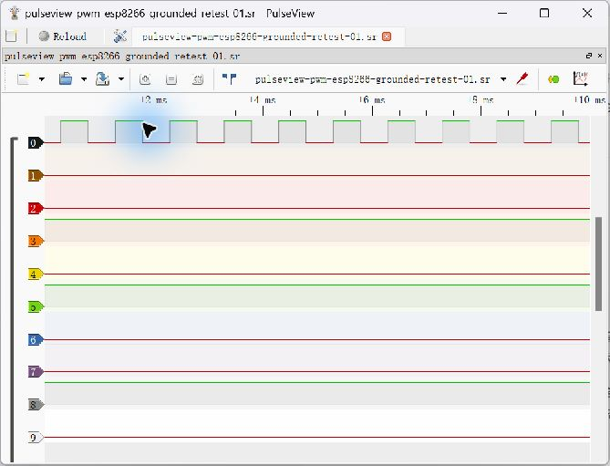

# Task 9 — Scope / Logic Analyzer Decision Record

**Stages verified: CH0 static LOW/HIGH and a real PWM capture from a WeMos D1 mini (ESP8266), each with 10,000 samples. I2C capture, independent timebase calibration and class decision remain Pending.** The user reported successful IDE compilation/flashing; the assistant checked real serial transfers and PulseView acquisitions without reflashing. Proposed pairing remains digital SUMP plus browser analog scope; final adoption and instruction ownership require an actual class decision. [Original research sources](references.md#r11-instrument-candidates) · [Original captures, replay screenshots and verification](evidence/task09-logic-analyzer/README.md).

## Project Objective

Prepare and evaluate a classic ESP32 digital analyzer for known PWM and I2C traffic with PulseView on Windows 11. A one-board static LOW/HIGH check is now documented as an intermediate stage; it does not replace the required dynamic tests. The professor also requires actual setup effort and a class agreement on 1–2 instruments. [Chinese step-by-step manual](task09-logic-analyzer-guide-zh.md) · [Build/source audit](task09-analyzer-build.md) · [Further measurement/class record](evidence/task09-logic-analyzer-record.md).

## Candidate Comparison

| Item | A: ESP32_LogicAnalyzer + PulseView | B: ESP32 Web Oscilloscope |
|---|---|---|
| Source | [lmcapacho/ESP32_LogicAnalyzer](https://github.com/lmcapacho/ESP32_LogicAnalyzer/tree/5c4f2b9fd85ac09aca3e42596e6e7e0b640cdab3) | [GUELORD-MWENDERWA/esp32-web-oscilloscope](https://github.com/GUELORD-MWENDERWA/esp32-web-oscilloscope/tree/2d4c39d7568e394391ee14a5b4629574d7ae76ba) |
| Commit reviewed | 5c4f2b9fd85ac09aca3e42596e6e7e0b640cdab3 | 2d4c39d7568e394391ee14a5b4629574d7ae76ba |
| Role | Digital bus capture, SUMP transport to host decoder | Single-channel analog waveform display in browser, not an I2C decoder |
| Project claims / configuration | Up to 20 MHz capture, 8/16-bit operation, 128000 samples configured, RLE; none measured here | 100 S/s–50 kS/s design targets, 12-bit ADC, 512-sample frames, triggers/prehistory; none measured here |
| Toolchain stated upstream | Arduino Core 3.3.7 or PlatformIO espressif32@6.11.0, debug output off | PlatformIO espressif32@6.10.0, Arduino Core 2.0.x; local Core 3.3.12 is not a directly compatible replacement |
| Host / install | PulseView + ols/SUMP driver, USB-serial driver, source-configured 921600 baud | PlatformIO source build or a separately verified release binary, browser for Wi-Fi UI; Chromium-family Web Serial if browser flashing is chosen |
| GPIO | Captured channels below; GPIO22/23 reserved for clock loop; LED2 and UART0 used | ADC1 GPIO34 input, GPIO25 1 kHz test output, Wi-Fi active |
| Input limit | Bare GPIO: 3.3 V logic only, no negative or 5 V input; project PCB/level-shifter design is separate and under validation | Positive low-voltage ADC signal only, useful range depends on attenuation/nonlinearity; keep test amplitude comfortably below 3.0 V after verified conditioning |
| Main limitations | Digital levels only; no calibrated analog rise-time/amplitude measurement; claimed maximum rate needs reference tests | Wi-Fi/analogRead timing jitter and ADC error; requested rate is not an independently measured rate; cannot resolve 100 kHz I2C with its claimed analog rates |
| Current status | Original source compiled with Core 3.3.7; real CH0 LOW/HIGH and ESP8266-source PWM captures verified; I2C/calibrated timebase Pending | Source inspected; compatibility choice/build/flash/analog validation Pending |

These are project statements or code constants, **not our measured specifications**. The browser project's own README states its interface image uses a simulated capture and its timing figures are unvalidated design targets. No upstream image is imported as student evidence.

## Selected Analyzer and Repository Version — Provisional Evaluation

A-class evaluation uses lmcapacho/ESP32_LogicAnalyzer, fetched master commit **5c4f2b9fd85ac09aca3e42596e6e7e0b640cdab3**. The LOW/HIGH runs used the board's user-reported **official unmodified firmware**; no assistant reflash was performed. Our [Core 3 clock-retuning patch](patches/task09-core3-clock-retune.patch) and later local diagnostic fixes are prepared alternatives, **not the firmware credited with these captures**. This is an evaluation candidate, not the final class decision. Existing B-class research is retained, not newly validated. The user performed the reported wiring changes; no experiment or presentation contribution is invented for the other group member.

## GPIO Pin Mapping and Conflict Gate

Source checked: [LogicAnalyzerConfig.h](https://github.com/lmcapacho/ESP32_LogicAnalyzer/blob/5c4f2b9fd85ac09aca3e42596e6e7e0b640cdab3/ESP32_LogicAnalyzer/LogicAnalyzerConfig.h).

| Analyzer channel | GPIO | Analyzer channel | GPIO |
|---|---|---|---|
| CH0 | 21 | CH8 | 14 |
| CH1 | 19 | CH9 | 27 |
| CH2 | 18 | CH10 | 26 |
| CH3 | 5 | CH11 | 25 |
| CH4 | 4 | CH12 | 33 |
| CH5 | 15 | CH13 | 32 |
| CH6 | 13 | CH14 | 35 |
| CH7 | 12 | CH15 | 34 |

**Reserved on analyzer board A: GPIO22 is CLK_OUT (LEDC output), GPIO23 is CLK_IN; upstream requires 22→23 loopback. They are not probe inputs.** GPIO2 is the capture LED; UART0 is the host transport. Some channels are strapping pins and can affect boot if externally driven; confirm the physical module before using them. The initial plan uses CH0/CH1 rather than those straps.

Completed one-board static test wiring:

| Connection | LOW run | HIGH run |
|---|---|---|
| Analyzer GPIO22 → GPIO23 | Clock jumper retained | Clock jumper retained |
| Analyzer GPIO21 / CH0 | Connected only to GND | Moved only to 3V3 after power-off |
| Separate target board | Not used | Not used |

No potentiometer or generated PWM was involved. GPIO21 was never intentionally connected to GND and 3V3 simultaneously. Wiring is user-confirmed; no wiring photograph or DMM voltage measurement is supplied.

Proposed two-board **future I2C** capture, only after board/pin/voltage verification:

```text
Target board T (Task 9 scanner)        Analyzer board A (SUMP firmware)
T GPIO21 SDA -------------------------- A CH0 / GPIO21 (input)
T GPIO22 SCL -------------------------- A CH1 / GPIO19 (input)
T GND -------------------------------- A GND
                                        A GPIO22 output --> A GPIO23 clock input ONLY
```

**Never connect T's SCL to A's GPIO22. Never run the default scanner and this analyzer on the same physical ESP32 with unchanged maps.** Reassigning one side requires source review and a new map; a second board is the simpler evaluation arrangement. Two power supplies need reviewed grounding; do not tie 3V3 outputs together. Actual board availability and physical wiring checks: Pending.

## Build and Installation

1. External firmware/builds stay outside this portfolio. The official complete sketch, headers and C++ files were prepared locally and checked against the pinned master source. The unchanged project compiled with **Core 3.3.7 / ESP32 Dev Module / Debug=None**; the user confirmed IDE compilation, upload and `Hash of data verified`. No original build/upload screenshot was supplied. No upstream firmware/binary is bundled here. Earlier Core 3.3.12 preparation and patches remain documented separately; do not infer that a compiled patch was flashed or needed to obtain these static captures.
2. Digital candidate: install the compatible upstream board package/toolchain, build the original sketch/project and keep debug prints off UART0. Its README specifications have a **912600 typo**; config.h and the PulseView example use **921600**. Confirm that value in the firmware actually flashed. Close Serial Monitor before PulseView opens the same COM port. COM3 is a previous portfolio port, not necessarily the analyzer's current port.
3. Windows x64 PulseView **0.5.0-git-e2fe9df**, runtime libsigrok **0.6.0-git-883c2ac**, identified **ESP32 Logic Analyzer v0.31 / 16 channels** through **Openbench Logic Sniffer & SUMP compatibles (ols)** on **COM3, Silicon Labs CP210x**, at **921600/8n1**. Real static LOW/HIGH acquisitions and saved-file reopening now work. This is limited compatibility evidence, not certification of every rate/feature. The sigrok website was unavailable during earlier research; local program/driver checks are recorded in the build audit.
4. Analog candidate: upstream platformio.ini pins espressif32@6.10.0. src/main.cpp calls ledcSetup/ledcAttachPin, which were removed in Core 3. Choose a separately installed compatible environment or prepare/test a Core 3 port; neither has been done here. [Espressif migration note](https://docs.espressif.com/projects/arduino-esp32/en/latest/migration_guides/2.x_to_3.0.html).
5. GPIO34 is ADC1, suitable for a candidate using Wi-Fi, but voltage calibration/nonlinearity remains unverified. For a proposed 3.3 V PWM source use a verified 10k/10k divider to approximately 1.65 V, check node voltage before connecting and evaluate loading/bandwidth. Do not blindly copy the upstream high-voltage/biased input drawing or treat a 0–3.3 V rail test as calibrated amplitude. Viewing an AP-hosted page differs from Web Serial flashing; record browser/OS and actual route used.
6. The web sampler uses a micros()-paced loop; capture metadata is calculated from requested period, not measured timestamps for every ADC conversion. Its main.cpp header mentions a hardware timer, while sampler.cpp implements the polling loop. Inspect working code and measure real timing rather than trusting either label.

## PWM Capture — Grounded ESP8266 Retest, Uncalibrated Timebase

On 2026-10-28 the source was **blue WeMos D1 mini / ESP8266**, running the [independent ESP8266 sketch](code/task09_esp8266_pwm_generator/task09_esp8266_pwm_generator.ino): D1=GPIO5, range 1023, frequency request 1000 Hz, duty code 512, Serial 115200. ESP8266 Community 3.1.2 / `esp8266:esp8266:d1_mini` compiled successfully; upload to user-confirmed **COM4 / CH340** identified ESP8266EX and verified the flash hash. Black analyzer **COM3 retained its official firmware** throughout.

**Correction:** the user subsequently reported that the dedicated common-ground wire had been missing during the first PWM acquisition. Its original files remain unchanged as historical evidence; the earlier claim of complete ground wiring was incorrect. An indirect USB return path was not verified. After the user confirmed **B D1→A GPIO21/CH0, B GND→A GND, and A GPIO22→A GPIO23**, a new real PulseView acquisition was saved and reopened. The old static tie was removed; USB power rails were not interconnected. Wiring is user-confirmed, without a supplied photograph/continuity measurement. No firmware upload was needed for this retest.

PulseView used the real ESP32 ols device, COM3 / 921600 baud, **1 MHz requested, 10 k samples, no trigger**. The [grounded retest and retained initial-run evidence](evidence/task09-esp8266-pwm.md) include original `.sr` files, real screenshots and separate calculations. The new archive contains 20,000 logic bytes / 10,000 16-bit samples; only CH0 is validated.

| Grounded retest result | Observation |
|---|---|
| Complete cycles | 9 |
| Period | 999–1000 samples; mean 999.8889, nominal 0.999889 ms |
| HIGH duration | 500–501 samples |
| Duty | 50.000–50.100%; mean per-cycle ratio 50.0500% |
| Inverse mean period | Approximately 1000.11 Hz at configured analyzer timebase |

Example: rise=288, fall=789, next rise=1288 gives 1000-point period, 501-point HIGH and 50.1% duty. These are raw-sample calculations, not claimed cursor readings. The configured timebase remains uncalibrated; this short record does not establish absolute frequency accuracy, long-term jitter bounds or zero missed edges. The [ESP32 GPIO25 source](code/task09_pwm_reference/README.md) remains an untested alternative.



## I2C Protocol Decoding — Pending

Target T instead runs the independent [Task 9 I2C capture source](code/task09_i2c_capture_source/README.md), with SDA21/SCL22 and configured 100 kHz; Task 5 code is preserved. Wire T21→A21/CH0, **T22→A19/CH1**, and common ground, retaining A22→A23. Use only verified target-side 3.3 V pull-ups. A sensor is optional for NACK traffic; a genuine ACK test requires a compatible real device.

Enable CH0/CH1, request at least 1 MS/s, start with 16k samples and RLE off. A short capture may miss the scan interval: arm a supported LOW-level SCL trigger or request a scan with `s` on target T's separate 115200 console. Assign I2C decoder SDA=CH0, SCL=CH1; identify START, seven-bit address, write bit, ninth-clock ACK/NACK and STOP. Empty-write scans do not contain sensor measurements. Save actual serial results and original acquisition; no device address or decoded result is pre-filled.

## Sampling Rate and Limitations

The upstream README claims up to 20 MS/s, 128k samples, RLE and 8/16-bit operation. The inspected source explicitly configures 16-bit I2S and marks alternate 8-bit setup unimplemented. Therefore neither 8-bit functionality nor maximum depth/rate is asserted as working. Finite DMA/RLE memory, host channel-group accounting and serial transfer limit usable records. Use a short baseline and the options actually offered by the detected device.

An important Core 3 issue was found: repeated ledcAttach calls reject an attached pin, so later requested sample rates may leave the original clock. Our source-reviewed, compile-checked patch uses ledcChangeFrequency after first attach; actual timing and failure behavior require hardware comparison. The host's displayed rate, requested LEDC rate and independently measured effective rate must remain separate. Simple stage-0 HIGH/LOW triggering is source-supported; advanced edge/multi-stage/pretrigger behavior is not assumed. Digital input levels do not measure analog amplitude/rise time, and 921600-baud transfer is not real-time 20 MS/s streaming.

## Windows 11 / PulseView Compatibility

User environment: Windows 11, Arduino IDE 2.3.10, classic ESP32. Exact Core 3.3.7 compilation was checked separately from the earlier Core 3.3.12 preparation. COM3 CP210x transport, SUMP identification, PulseView static capture and saved-file reopening were observed. I2C decoding and independent dynamic timing calibration remain **Pending**; the later real ESP8266 PWM acquisition is documented above. The successful transfers provide no basis for declaring the CP210x driver generally incompatible; no driver replacement or baud downgrade was performed. The analyzer port is exclusive to PulseView; close conflicting monitors and reconnect/rescan after a USB power cycle. Do not use Zadig to replace the working UART driver.

## Actual Static LOW/HIGH Captures — Verified Stage

Date: **2026-10-28**. One ESP32 only, CH0=GPIO21, GPIO22→GPIO23 clock jumper. Requested settings: **1 MHz, 10 k samples, no trigger**; RLE off, External Clock off, Pattern=None. The `.sr` metadata independently records 16 probes, 2 bytes/sample and the 1 MHz label; the remaining settings come from the actual session and user confirmation.

| Run | Input connection | Original data | Verified CH0 result |
|---|---|---|---|
| LOW | GPIO21 → GND | [Original LOW `.sr`](evidence/task09-logic-analyzer/pulseview-original-low-10000.sr), 20,000 logic bytes / 10,000 samples | 10,000 LOW; 0 HIGH |
| HIGH | GPIO21 → 3V3 | [Original HIGH `.sr`](evidence/task09-logic-analyzer/pulseview-original-high-10000.sr), 20,000 logic bytes / 10,000 samples | 0 LOW; 10,000 HIGH |

ZIP integrity and every CH0 bit were rechecked; archive SHA-256 values and the exact method are in the [evidence index](evidence/task09-logic-analyzer/README.md) and [verification JSON](evidence/task09-logic-analyzer/capture-verification.json). Both original files were copied without modification and reopened in PulseView. Only CH0 was electrically controlled; the other 15 stored channels are not validated.

### Fault Investigation and Recovery

1. The user reported `Capture failed — generic/unspecified error` despite successful device identification. Identification alone did not establish a working acquisition.
2. COM3 initially opened without a SUMP response, then temporarily disappeared. After the USB connection was restored and a controlled ESP32 reset performed, it returned the real SUMP ID `1ALS`.
3. Direct SUMP tests on the original running firmware returned 2048 bytes for 1024 LOW samples and then 20,000 bytes for 10,000 LOW samples at the requested 1 MHz setting. PulseView subsequently captured/saved the LOW run.
4. Following the user's power-off wiring change to 3V3, the old PulseView connection yielded no savable logic data and COM3 access was denied to another process. Releasing that connection, resetting and reselecting the **real ESP32 ols device** restored transfer. No Demo acquisition was performed or used as evidence. Direct SUMP and PulseView then returned/saved 10,000 HIGH samples.
5. External Clock and RLE were checked off, Pattern=None. No CP210x driver change or assistant reflash was used. The observations support a transient USB/serial/firmware-session state problem; they do **not uniquely identify the original fault**, prove every previous failure had the same cause, or establish that firmware patches fixed it.

Code review did identify repeated Core 3 LEDC attachment, unchecked fixed-delay SUMP parameter reads, unbounded DMA completion waiting, missing allocation/init checks and per-sample serial flushing as robustness concerns. Local reversible fixes were compiled with Core 3.3.7 but **not flashed**. Their effectiveness is not an experimental result here. The untouched official local backup was preserved; this evidence commit does not add those untested local fixes or change firmware.

## Capture Test Plan

The actual PWM test used the [ESP8266 WeMos source](code/task09_esp8266_pwm_generator/README.md) on D1/GPIO5. The earlier [ESP32 Core 3 PWM reference](code/task09_pwm_reference/README.md), GPIO25, remains an alternative preparation, not the source used in the preserved capture. Source console parameters are configuration targets, not independent frequency measurements.

- Digital baseline: capture a known PWM signal at several sample settings; measure period/duty stability, missing edges and duration. Start conservatively; check maximum claims against a reference if available.
- I2C: run the scanner at configured 100 kHz and decode SDA/SCL on correct channels. Course rule of thumb: at least 1 MS/s for 100 kHz and 4 MS/s for 400 kHz, subject to real sample reliability and decoder behavior. This is a margin recommendation, not a demonstrated acquisition rate or analog edge-quality guarantee.
- Analog: capture a conditioned PWM/slow RC signal at several requested rates, compare amplitude with a meter and timebase with an independent reference. A 50 kS/s analog claim cannot decode 100 kHz I2C.
- Optional OneWire: actual DS18B20/reset/presence capture if hardware is available. No device ownership or capture is assumed.
- Time actual setup from install to first usable capture; save errors as evidence. If instrument firmware fails, document the failure rather than marking adopted.

| Date / candidate / exact source+patch | Board / pins / input protection | Host OS/browser/version | Requested rate | Independently checked effective rate/timebase | PWM result | I2C decoder result | Setup minutes / failures | Evidence |
|---|---|---|---|---|---|---|---|---|
| Pending | Pending | Pending | Pending | Pending | Pending | Pending | Pending | Pending |

## Evidence and Screenshots

[Original raw files, hashes and genuine replay screenshots](evidence/task09-logic-analyzer/README.md) are available. No saved student screenshot from the original acquisition instant was found; the following unedited images were taken from PulseView displaying the preserved real captures during this organization session. They are **replay screenshots**, not new hardware tests or upstream example images. No wiring/upload screenshot is supplied. [Further hardware/class record](evidence/task09-logic-analyzer-record.md).


## Experimental Results and Limits

**Verified:** acquisition/USB transfer/storage of 10,000 CH0 LOW samples and 10,000 CH0 HIGH samples under the stated settings. This is stronger than identification alone, but only a static input check. **Later PWM stage:** the WeMos source produced a real dynamic CH0 record with sample-derived period/duty as reported above. **Still not measured:** independent input voltage, calibrated effective sample rate/timebase, independently referenced edge timing/frequency, I2C ACK/NACK, throughput/rate limits, setup-to-first-capture duration or reliability over extended repetition. The 1 MHz label and nominal 10 ms record are configuration-derived; static levels cannot calibrate timing. The PWM capture is now available; I2C capture, calibration, class demo/decision and remaining Task 9 learning goals remain incomplete. Keep the blank dynamic comparison table above for future observations.

## Class Decision and Conclusion — Pending

Provisional research preference: A for bus decoding, B for slow analog exploration. This is **not a class adoption decision**.

- Actual demo/date/participating pods: TODO.
- Agreed one or two solutions and reasons: TODO.
- Maintainers of install instructions: TODO; do not assign contributions to Mei/Felix without agreement.
- Captures, actual performance, limitations and fallback decision: TODO.
- If time is short: record an actual class decision and carry captures into portfolio time, as permitted by the course; no decision is fabricated here.
