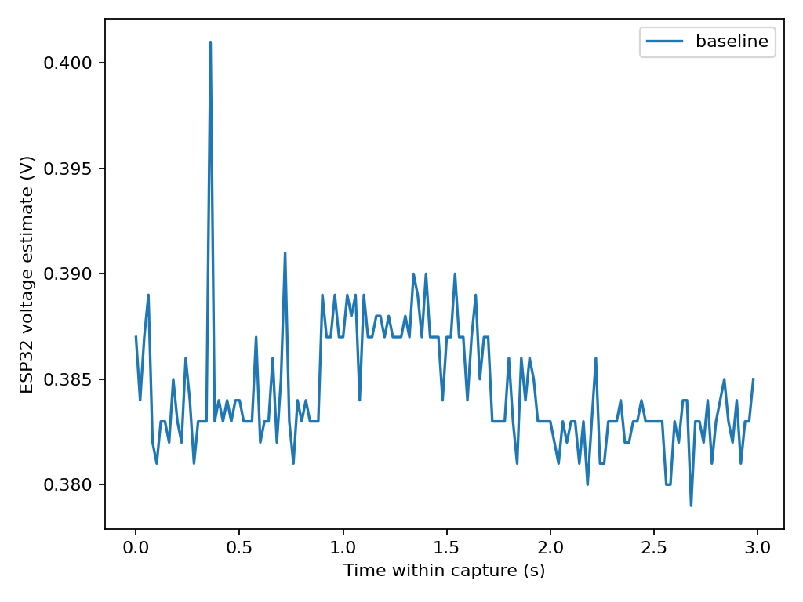

# Task 1 — The LDR's transfer function

**Status: Initial bench capture verified. Controlled light ladder pending.**

## Objective

Measure how the LDR's resistance changes with illumination. Compare a power law with a straight-line model on the same light levels.

## Circuit and wiring

The user reported connecting 3V3 → LDR → divider node → 10 kΩ → GND, with the node at GPIO34 (ADC1). This orientation predicts a higher node voltage when light increases. The supply and node have not yet been independently checked with a multimeter in this run.

## Hardware and software

ESP32 Dev Module (ESP32-D0WD-V3), GPIO34, 12-bit ADC, 11 dB attenuation, Arduino-ESP32 Core 3.3.12 on Windows 11, COM3 at 115200 baud. The [sketch](../code/analog_capture/analog_capture.ino) compiled and was flashed. The uploader verified all four written regions. See the [build output](../evidence/task01-ldr/compile.txt) and [upload log](../evidence/task01-ldr/upload.txt), with the hardware identifier and absolute paths removed.

## Experimental procedure

Send `t` to collect 150 samples at a nominal 20 ms interval. Each row includes the raw ADC code and a separate `analogReadMilliVolts()` conversion. Save the original UART output and the extracted CSV. The [PowerShell collector](../code/capture_ldr.ps1) automates capture on a free serial port. For the ladder, keep the lamp setting and angle fixed, record actual distance after placement, and allow the reading to settle.

## Raw ADC measurements

| Condition | Samples | Minimum | Maximum | Mean | Sample SD | Mean ADC-estimated voltage |
|---|---:|---:|---:|---:|---:|---:|
| Initial uncontrolled light | 150 | 285 | 302 | 295.227 | 2.956 | 0.384493 V |

The voltage estimates ranged from 0.379 to 0.401 V. Neither ADC rail code was observed. This establishes serial communication and a varying ADC input, with deliberate light response still to be tested.

## Voltage and resistance calculation

For the stated divider, `R_LDR = R_fixed × (Vs − Vout) / Vout`. The initial estimate is 75.83 kΩ using nominal 3.3 V and nominal 10 kΩ, with the ESP32 mean voltage estimate as Vout. The manifest identifies the provenance of each input. Prefer a measured supply and a DMM node reading for each condition when available.

## Six light conditions

| Planned distance | Capture |
|---:|---|
| 10 cm | Pending |
| 15 cm | Pending |
| 20 cm | Pending |
| 30 cm | Pending |
| 40 cm | Pending |
| 60 cm | Pending |

Cover/uncover response is pending. The initial trace has no measured light level or distance and is excluded from the transfer fit.

## Power-law fitting

Pending controlled distances. With no lux readings, use relative illuminance `E = (d_min / d)^2` under the point-source approximation and fit `log(R) = log(A) − γ log(E)`. Record gamma, residuals and R² in resistance units. A fit from fewer than six valid levels is provisional.

## Linear model comparison

Pending. Compare the linear resistance model with the power law on the same eligible rows using residuals, RMSE and R² in ohms.

## Repeatability

Pending. Reposition the lamp independently at the same distance for three total captures. Compare the range and sample SD of the three resistance estimates. The initial within-capture ADC SD does not measure repositioning repeatability. Compare with a local one-code resistance change once the ADC slope is measured.

## Limitations and uncertainty

The ADC voltage is a calibrated estimate from a separate conversion and has ADC noise, calibration error and nonlinearity. The nominal supply and resistor add uncertainty to inferred resistance. Ambient light, flashlight beam shape, distance and alignment limit the inverse-square approximation. Saturated ADC samples are excluded from resistance fits unless an independent valid DMM node reading is available.

## Results and conclusion

The ESP32 acquisition path responded at COM3 and produced 150 usable initial samples. Light response, controlled transfer fitting and independent repeatability remain pending.

## Evidence

- [Original UART output](../evidence/task01-ldr/baseline.serial.txt) and [extracted samples](../evidence/task01-ldr/baseline.csv)
- [Bench manifest](../evidence/task01-ldr/manifest.csv), [run summary](../figures/task01-ldr/run-summary.csv), [machine-readable results](../figures/task01-ldr/summary.json) and [analysis script](../analyze_ldr_run.py)
- Rebuild with `python Module03/analyze_ldr_run.py Module03/evidence/task01-ldr/manifest.csv Module03/figures/task01-ldr`.

