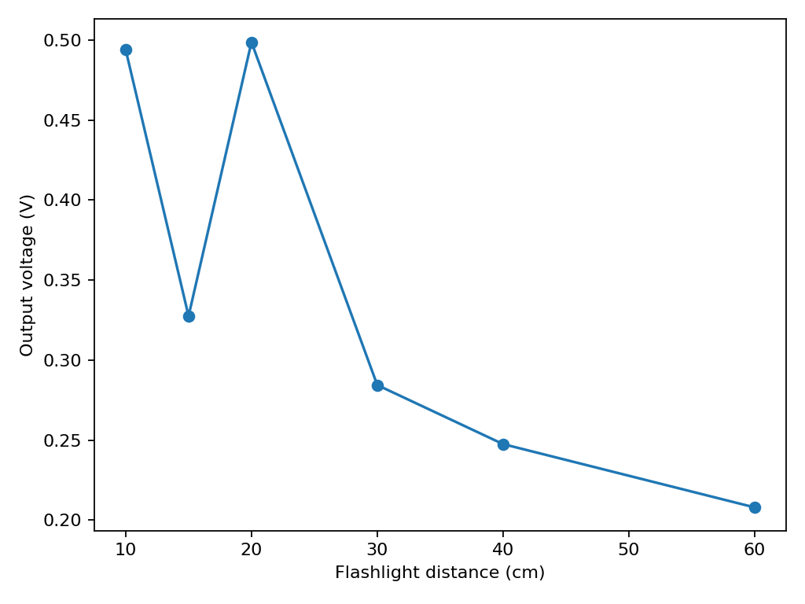
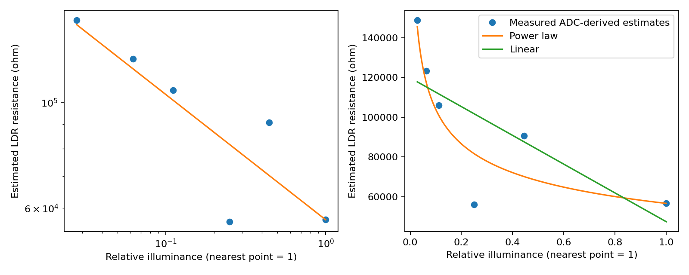

# Task 1 — The LDR's transfer function

**Status: Six-distance ADC ladder and three independent 30 cm placements captured. DMM and lux reference measurements pending.**

## Objective

Measure how the LDR's resistance changes with illumination. Compare a power law with a straight-line model on the same light levels.

## Circuit and wiring

The user reported connecting 3V3 → LDR → divider node → 10 kΩ → GND, with the node at GPIO34 (ADC1). This orientation predicts a higher node voltage when light increases. The supply and node have not yet been independently checked with a multimeter in this run.

## Hardware and software

ESP32 Dev Module (ESP32-D0WD-V3), GPIO34, 12-bit ADC, 11 dB attenuation, Arduino-ESP32 Core 3.3.12 on Windows 11, COM3 at 115200 baud. The [sketch](../code/analog_capture/analog_capture.ino) compiled and was flashed. The uploader verified all four written regions. See the [build output](../evidence/task01-ldr/compile.txt) and [upload log](../evidence/task01-ldr/upload.txt), with the hardware identifier and absolute paths removed.

## Experimental procedure

Send `t` to collect 150 samples at a nominal 20 ms interval. Each row includes the raw ADC code and a separate `analogReadMilliVolts()` conversion. Save the original UART output and the extracted CSV. The [PowerShell collector](../code/capture_ldr.ps1) automates capture on a free serial port. For the ladder, keep the lamp setting and angle fixed, record actual distance after placement, and allow the reading to settle.

## Raw ADC measurements

| Condition | Samples | Minimum | Maximum | Mean | Sample SD | Mean ADC-estimated voltage |
|---|---:|---:|---:|---:|---:|---:|
| Initial uncontrolled light | 150 | 285 | 302 | 295.227 | 2.956 | 0.384493 V |
| LDR covered by operator | 150 | 0 | 0 | 0 | 0 | 0.142 V (ADC API floor) |
| 10 cm | 150 | 407 | 432 | 428.113 | 2.982 | 0.494007 V |
| 15 cm, second attempt | 150 | 215 | 249 | 226.253 | 9.978 | 0.327553 V |
| 20 cm | 150 | 419 | 443 | 434.273 | 3.364 | 0.498713 V |
| 30 cm, first placement | 150 | 167 | 183 | 173.507 | 2.328 | 0.284427 V |
| 40 cm | 150 | 125 | 135 | 128.647 | 1.194 | 0.247533 V |
| 60 cm, second attempt | 150 | 77 | 87 | 80.040 | 0.776 | 0.207973 V |

The initial voltage estimates ranged from 0.379 to 0.401 V. Covering the LDR brought the raw input to the ADC floor for all samples. The API's 142 mV output in that condition is unsuitable for inferring resistance. The serial capture succeeded after releasing the Arduino serial monitor's COM3 handle.

## Voltage and resistance calculation

For the stated divider, `R_LDR = R_fixed × (Vs − Vout) / Vout`. The initial estimate is 75.83 kΩ using nominal 3.3 V and nominal 10 kΩ, with the ESP32 mean voltage estimate as Vout. The manifest identifies the provenance of each input. Prefer a measured supply and a DMM node reading for each condition when available.

## Six light conditions

| Distance | Relative illuminance | Estimated resistance (kΩ) | Fit residual (kΩ) |
|---:|---:|---:|---:|
| 10 cm | 1.0000 | 56.80 | +0.10 |
| 15 cm | 0.4444 | 90.75 | +20.55 |
| 20 cm | 0.2500 | 56.17 | −25.50 |
| 30 cm | 0.1111 | 106.02 | +4.93 |
| 40 cm | 0.0625 | 123.32 | +5.70 |
| 60 cm | 0.0278 | 148.67 | +3.08 |

The 10 cm flashlight reading exceeded the initial ambient-light reading, and covering the LDR brought the ADC to its lower limit. The first 15 cm capture rose from a first-block mean of 326 to a last-block mean of 687. The first 60 cm capture rose during acquisition and included two zero codes. Both attempts were retained and excluded from the fit. The 15 cm recapture declined from about 244 to 222 across the first and last 30-sample blocks. Its full-run mean was retained, so the fit remains provisional.

## Power-law fitting

With no lux readings, relative illuminance was estimated as `E = (10 cm / d)^2` under the point-source approximation. A log-space fit of `log(R) = log(A) − γ log(E)` gives **γ = 0.263** and **A = 56.71 kΩ**. The residuals above are observed minus predicted in resistance units. The 20 cm observation has the largest absolute power-law residual.

## Linear model comparison

| Model | RMSE (kΩ) | R² on resistance scale |
|---|---:|---:|
| Power law fitted in log space | 13.78 | 0.832 |
| Linear resistance versus relative illuminance | 23.18 | 0.524 |

Both metrics use the same six rows and the original resistance scale. The power law fits these observations better by both metrics. The non-monotonic 20 cm observation was retained. Neither the fit nor its R² establishes accuracy on independent data.

## Repeatability

| 30 cm placement | Samples | ADC mean | ADC sample SD | Mean ADC voltage estimate | Estimated resistance |
|---:|---:|---:|---:|---:|---:|
| 1 | 150 | 173.507 | 2.328 | 0.284427 V | 106.02 kΩ |
| 2 | 150 | 139.667 | 4.149 | 0.256913 V | 118.45 kΩ |
| 3 | 150 | 143.540 | 2.009 | 0.259873 V | 116.98 kΩ |

Across placements the mean resistance estimate was **113.82 kΩ**, the sample SD **6.79 kΩ**, and the range **12.43 kΩ**. This spread includes setup variation. A comparison against the resistance change for one local ADC code remains pending until the voltage-per-code slope is measured.

## Limitations and uncertainty

The ADC voltage is a calibrated estimate from a separate conversion and has ADC noise, calibration error and nonlinearity. The nominal supply and resistor add uncertainty to inferred resistance. Ambient light, flashlight beam shape, distance and alignment limit the inverse-square approximation. Saturated ADC samples are excluded from resistance fits unless an independent valid DMM node reading is available.

## Results and conclusion

The bench run produced 12 captures of 150 samples each, including six usable distance groups for a provisional transfer fit and three 30 cm placements. The overall trend was higher resistance at greater distance, with deviations between individual points. The DMM supply and node readings, direct lux measurements and one-code repeatability comparison are still missing. Share the ladder and repeat results with the class if a shared table is available.

## Evidence

- [Original UART output](../evidence/task01-ldr/baseline.serial.txt) and [extracted samples](../evidence/task01-ldr/baseline.csv)
- Covered LDR [original UART output](../evidence/task01-ldr/covered.serial.txt) and [extracted samples](../evidence/task01-ldr/covered.csv)
- [All original logs and per-run CSVs](../evidence/task01-ldr/) and [fit residuals](../figures/task01-ldr/fit-residuals.csv)
- [Bench manifest](../evidence/task01-ldr/manifest.csv), [run summary](../figures/task01-ldr/run-summary.csv), [machine-readable results](../figures/task01-ldr/summary.json) and [analysis script](../analyze_ldr_run.py)
- Rebuild with `python Module03/analyze_ldr_run.py Module03/evidence/task01-ldr/manifest.csv Module03/figures/task01-ldr`.

## Supplementary Simulation — Not Hardware Measurement

The [supplementary quantization analysis](../simulation/supplementary/task01-quantization/README.md) recalculates the six real operating-point means, then models a one-code voltage change and its effect on inferred resistance. A hypothetical 3.3 V span gives 0.805664 mV/code; the Task 3a endpoint secant is 0.815961 mV/code. The latter is extrapolated below its calibration range here and is not a measured local LDR-session ADC step. The derivative dR/dV = -Rfixed Vs/V² explains why a low node voltage is more sensitive to voltage error.

The simulated code ladder and sensitivity plots are separate from the raw evidence. No DMM measurements have been added. Independent supply/node validation and a justified local ADC voltage-step comparison remain pending. Original distance anomalies, excluded failed runs and repeatability results remain unchanged.
