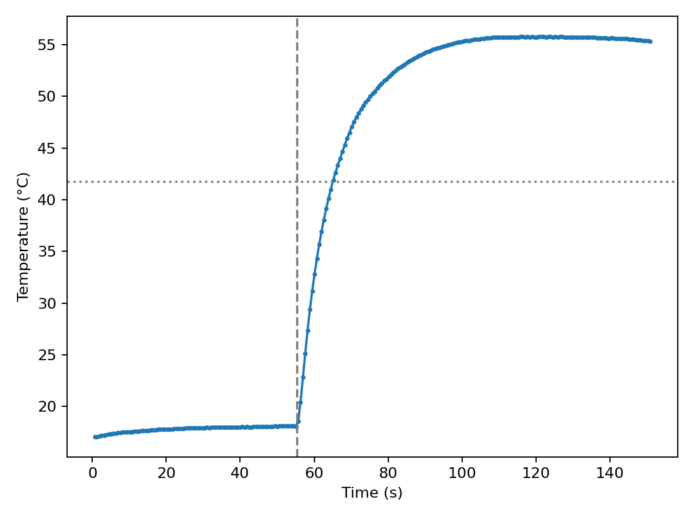
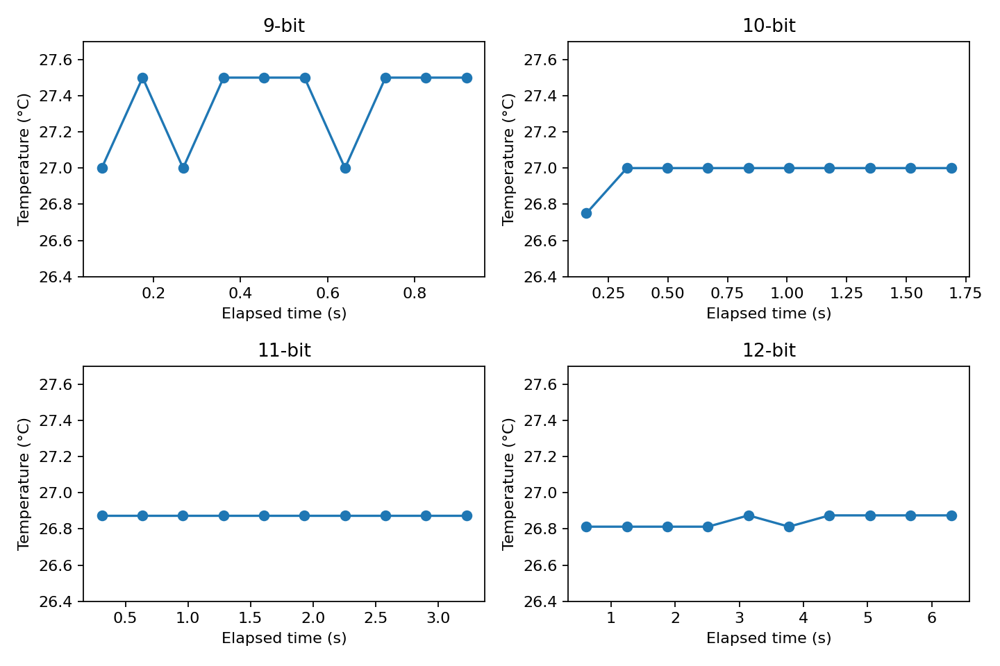

# Task 2 — DS18B20 resolution, accuracy and response time

**Status: Single-probe bench capture verified at all four resolutions. Water step captured with a trace-derived timing estimate. Reference, field and still-air measurements pending.**

## Objective

Compare measured temperature, resolution, conversion time and thermal response with the datasheet and a reference thermometer.

## Wiring and materials

Use an externally powered DS18B20 with verified pinout, an ESP32 Dev Module, a 4.7 kΩ resistor and a reference thermometer. Use a sealed probe for the two stirred water baths. A second or third probe is optional. Disconnect USB and check GPIO18 is free before wiring.

| DS18B20 connection | ESP32 connection |
|---|---|
| VDD | 3V3 |
| GND | GND |
| DQ | GPIO18 |
| Pull-up resistor | 4.7 kΩ between DQ and 3V3. Check for an existing pull-up on a breakout first. |

For multiple probes, parallel VDD, GND and DQ and use one bus pull-up. Verify the probe pinout with the supplier before trusting cable colors.

For the 2026-11-04 trial the operator authorized the assumed mapping red → 3V3, blue → GND and yellow → GPIO18. The wire functions, supply compatibility and physical installation of the 4.7 kΩ pull-up were unverified.

## Datasheet reference

| Resolution (bits) | Step (°C) | Maximum conversion time (ms) |
|---:|---:|---:|
| 9 | 0.5 | 93.75 |
| 10 | 0.25 | 187.5 |
| 11 | 0.125 | 375 |
| 12 | 0.0625 | 750 |

The manufacturer specifies ±0.5 °C from −10 to +85 °C. The specified maximum active current is 1.5 mA at VDD = 5 V, and the standby maximum is 1 µA under the stated datasheet conditions. The code step controls quantization and conversion time limits logging cadence. At 12 bits, the accuracy specification is larger than one code step. The probe assembly and medium determine the thermal lag. [Analog Devices datasheet](https://www.analog.com/media/en/technical-documentation/data-sheets/DS18B20.pdf)

## Capture and reference comparison

**Final-audit gap against the current brief.** The current Task 2.4 requires at least 20 readings at each resolution during a slow temperature change, checking the return from `setResolution(address, ...)` and printing the per-address `getResolution(address)`. Existing runs contain ten readings per setting, and the sketch checks `getResolution(address)` but does not print it or check the setter return. The archived experiment verifies a narrower ten-reading test. The expanded sweep and configuration-output evidence are pending.

Open [the DS18B20 sketch](../code/ds18b20_capture/ds18b20_capture.ino) with ESP32 Dev Module selected. Use Serial Monitor at 115200 baud. Send `r` for the CRC-validated 64-bit ROM list. Send `9`, `a`, `b` or `c` for ten conversion cycles at 9, 10, 11 or 12 bits. Each cycle reports sample index, elapsed milliseconds, ROM, resolution, temperature and read status.

Save the original serial transcript under the [evidence index](../evidence/README.md). Copy the CSV header and its rows to one CSV per run. Preserve diagnostic rows and marker messages in the original transcript. Only rows with status `ok` contribute to temperature and timing statistics. A disconnected or invalid scratchpad read has a blank temperature, and an exact 85 °C reading is flagged because it can be the power-on value. Use `python Module03/analyze.py repeat RUN.csv OUT --kind ds` to summarize readings by ROM and resolution.

## Conversion time

The logger measures elapsed milliseconds from the conversion command to the first observed bus-ready poll. The reading includes polling overhead and represents all probes in a broadcast cycle. A missing busy signal or timeout leaves conversion time blank. The measured timings below apply to this probe and firmware.

Place the probe and reference thermometer together in one stable location. Record at least ten readings per unit plus the reference instrument and its uncertainty in the [temperature reference template](../data/temperature-reference.csv). Compare unit means, sample SDs and signed errors against the reference. With one probe, use the class table for the unit comparison when available. For the outdoor transect, record one or two assigned locations, times, ROM, temperatures, co-located reference, height or depth, and conditions. Assess whether the apparent differences exceed the accuracy limits.

## Thermal step and analysis

1. Equilibrate the sealed tip in cold stirred water. Send `s` for 240 conversions at 12 bits and record several stable baseline samples.
2. Move the tip into warm stirred water at comparable depth. Send `m` at transfer, ideally with a second person operating the computer. Keep recording until the temperature reaches a stable plateau. Keep the ESP32 and connectors dry, and use warm water below boiling.
3. Repeat the cold-to-warm step in still air. Keep mounting consistent and record the medium, reference temperatures, setup and any marker delay.
4. Convert the marker milliseconds to seconds, select a stable final window, and run the command below with separate output directories for water and air.

```text
python Module03/analyze.py step RUN.csv OUT --rom ROM --step-s TRANSFER_SECONDS --final-start-s STABLE_TAIL_SECONDS
```

The analysis uses pre-step and tail means and interpolates the first crossing of 63.2% of the observed change after transfer. It reports τ, the approximate 4–5τ settling range and an observed 5% settling time if the trace supports it. Report missing crossings or an unstable tail as unverified. If the run ends before stabilization, lengthen it and repeat. Discuss marker timing, conversion cadence, stirring, probe housing, reference lag and differences in heat transfer.

### Water step — 2026-11-04

Two separate 10-sample cold-water checks averaged 6.450 °C and 6.5375 °C. The continuous run started at 17.0625 °C and approached 18.1 °C before the observed rise. The reason for the difference is unverified, so the step analysis uses the continuous run's own baseline. The run recorded 240 valid 12-bit samples over about 151 s.

The last sample near the pre-rise level was 18.0625 °C at 55.064 s. The next sample was 18.5625 °C at 55.697 s, followed by a sustained rise. Their time midpoint, 55.3805 s, was used as a detectable onset estimate. The firmware marker at 68.127 s records the operator's chat confirmation and arrived after the rise began. The physical immersion time was not independently measured.

| Result | Value |
|---|---:|
| Mean before inferred onset | 17.83 °C |
| Mean from 115 s to end | 55.66 °C |
| Observed 63.2% response time from inferred onset | 9.67 s |
| Observed sustained 5% settling time | 32.33 s |
| First-order rule-of-thumb settling interval, 4–5τ | 38.68–48.36 s |

The terminal window ranged from 55.3125 to 55.8125 °C, so the bath or probe may still have drifted slightly. The estimate includes probe housing and water conditions. Onset detection and the roughly 0.63 s logging cadence limit timing precision. No independent bath thermometer reading was recorded.

Reproduce from the repository root:

```text
python Module03/analyze.py step Module03/evidence/task02-ds18b20/water-step/20261104-173236.csv Module03/figures/task02-ds18b20/water-step --rom 28E55FA300000007 --step-s 55.3805 --final-start-s 115
```

[Cold-water checks](../evidence/task02-ds18b20/cold-water-baseline/) · [Original step UART log](../evidence/task02-ds18b20/water-step/20261104-173236.serial.txt) · [Step CSV](../evidence/task02-ds18b20/water-step/20261104-173236.csv) · [Calculated results](../figures/task02-ds18b20/water-step/summary.json)



## Results

**Historical initial attempt.** The ESP32-D0WD-V3 compiled with ESP32 Core 3.3.12 and uploaded on COM3. The uploader verified the written flash. At 115200 baud, one explicit `r` command returned `DS18B20_COUNT=0` and `NO_DS18B20`. The firmware counts only ROMs with family code 0x28 and a valid ROM CRC. This result does not distinguish absent bus presence from a search or ROM validation failure. No temperature rows were obtained in that attempt. Successful later results appear below.

**Historical follow-up after adding a pull-up.** At that stage the operator reported adding a resistor between GPIO18 and 3V3, with its resistance and probe polarity still unverified. Windows enumerated COM3 and the sketch compiled offline. The serial port was left unopened in that follow-up. The next section records the later confirmed wiring and successful capture.

### Verified-wiring run

The operator confirmed red to 3V3, blue to GND, yellow to GPIO18 and a multimeter-checked 4.7 kΩ pull-up from GPIO18 to 3V3. COM3 uploads passed flash verification. An explicit scan returned one family-0x28 ROM with valid CRC, **`28E55FA300000007`**.

The first capture returned five valid rows and five `no_busy_signal` rows at each resolution. The firmware was then changed to wait 2 ms before the first busy poll. A single retest gave ten valid rows per resolution, with no diagnostic rows. The initial alternating results are retained. The retest demonstrates the observed improvement under these conditions, while the exact cause of the initial pattern remains unconfirmed.

| Resolution | Valid samples | Mean temperature (°C) | Sample SD (°C) | Mean conversion (ms) | Conversion sample SD (ms) |
|---:|---:|---:|---:|---:|---:|
| 9 bit | 10 | 27.3500 | 0.2415 | 77.2 | 0.42 |
| 10 bit | 10 | 26.9750 | 0.0791 | 154.1 | 0.32 |
| 11 bit | 10 | 26.8750 | 0.0000 | 308.0 | 0.00 |
| 12 bit | 10 | 26.8438 | 0.0329 | 615.1 | 0.32 |

The runs were sequential and had no simultaneous reference thermometer. The means and spread describe observed readout, while absolute accuracy and unit-to-unit variation remain unmeasured. Zero spread in the 11-bit run means all ten readings returned the same code.

| Evidence | Result |
|---|---|
| ROM scan and plausible first reading | Verified for one CRC-valid ROM |
| Four resolutions and ten readings per probe | Verified, ten valid samples per resolution in the retest |
| Current brief's 20-reading temperature sweep and printed per-probe configuration | Pending |
| Reference error and unit comparison | Pending hardware or class data |
| Outdoor transect | Pending field work |
| Water plot, τ and settling | Captured. Timing estimated from the trace |
| Still-air plot and water/air comparison | Pending hardware |
| Build and synthetic Python checks | [Software verification](../evidence/verification.md) |

### Bench evidence

- [Compile log](../evidence/task02-ds18b20/compile.txt)
- [Upload log](../evidence/task02-ds18b20/upload.txt), with absolute paths and board MAC redacted
- [Original COM3 scan response](../evidence/task02-ds18b20/scan.serial.txt)
- [Verified wiring initial capture, including diagnostic rows](../evidence/task02-ds18b20/verified-wiring/)
- [Timing retest logs, CSVs and summary](../evidence/task02-ds18b20/timing-retest/)


