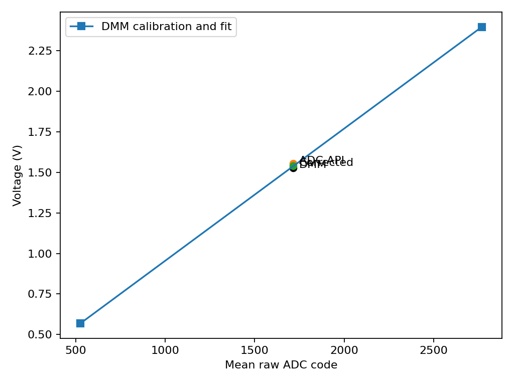
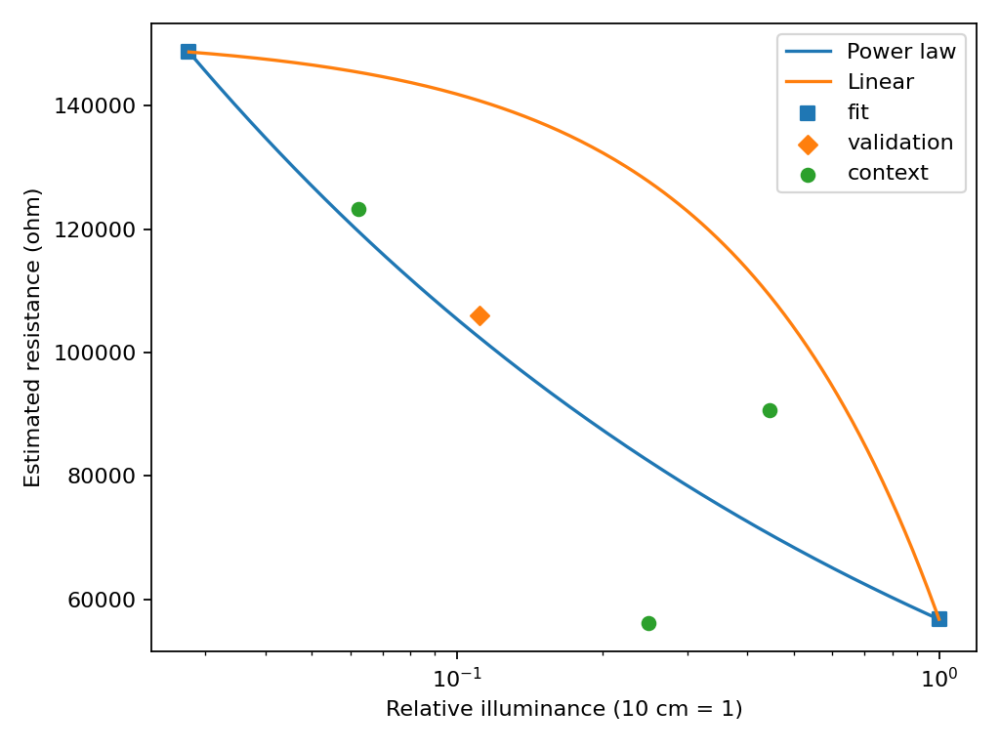
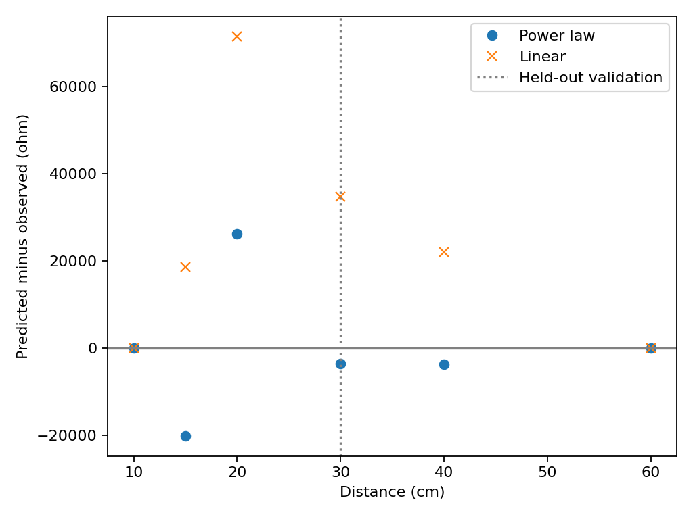

# Task 3 — Two-point calibration and validation

[Course brief](https://github.com/iotempire/iotempire-teaching/blob/main/full-classes/hsbi-sensors-actuators-10d/modules/03-sensor-characterization-and-calibration.md) · [Module 03](../README.md)

## Objective

Calibrate the ADC chain, the LDR transfer model, and the digital temperature offset. Keep the validation observation outside the fit and calculate signed residuals as prediction minus reference.

## Task 3a — ADC two-point calibration

**Status: Two-point calibration and independent validation completed.** The [GPIO34 sketch](../code/adc_calibration/adc_calibration.ino) compiled and flashed on COM3. The operator wired the potentiometer across 3V3 and GND with the wiper on GPIO34 and reported a supply of 3.296 V. The rail measurement documents the setup. The fit uses the DMM wiper voltages.

| Point | DMM voltage | Samples | Mean raw code | Raw sample SD | ADC API mean voltage |
|---|---:|---:|---:|---:|---:|
| Calibration 1 | 0.568 V | 150 | 526.427 | 25.441 | 0.577013 V |
| Calibration 2 | 2.398 V | 150 | 2769.180 | 20.229 | 2.415087 V |
| Independent validation | 1.526 V | 150 | 1716.427 | 21.282 | 1.553560 V |

Each DMM voltage was confirmed immediately before triggering a capture at the held wiper position. The paired high-point value is the new 2.398 V reading. The earlier 2.389 V reading was supplied before this capture session. The serial logger used 115200 baud, 12-bit ADC and 11 dB attenuation. Raw code and API millivolts come from separate conversions. No raw samples reached either rail. The low-point series includes brief low samples of 321 and 359, retained in the mean and the archive.

The fit was `code = 1225.548270 × V − 169.684750`, equivalent to `V = 0.000815961333 × code + 0.138456195`. The 1.526 V observation was held out from fitting.

| Independent check | Predicted voltage | Signed error vs DMM |
|---|---:|---:|
| Before correction, ADC API | 1.553560 V | +27.560 mV |
| After two-point correction | 1.538994 V | +12.994 mV |

The absolute error decreased by 52.85% at this held-out point. ADC scatter, DMM uncertainty and possible voltage changes after reading the meter limit the comparison. The DMM model, range and accuracy specification were not supplied. This calibrates the ADC chain over the measured range and checks its performance at one interior voltage.

[Original logs, sample CSVs and paired data](../evidence/task03-calibration/adc/) · [Calibration parameters](../figures/task03-calibration/adc/summary.json)

The operator reported four photos for the supply, low point, earlier high point and validation point. The image files are pending. A photo of the earlier 2.389 V reading would document that reading, while 2.398 V is the reference paired with the ADC capture.

## Task 3b — LDR power-law calibration

**Status: Completed using existing Task 1 ADC data.** Recomputed mean voltage from each original 150-row capture. Selected the 10 cm and 60 cm recapture as the non-clipped endpoints spanning the ladder. The first 30 cm capture is a distinct, interior observation, excluded from both fits. Additional ladder observations appear as context in the plots and CSV. They did not influence the coefficients. This is a held-out observation from the same bench session.

| Point | Relative illuminance | Mean ADC code | Converted resistance | Notes |
|---|---:|---:|---:|---|
| Calibration 1 | 1.000000 | 428.113 | 56.801 kΩ | 10 cm |
| Calibration 2 | 0.027778 | 80.040 | 148.674 kΩ | 60 cm recapture |
| Validation | 0.111111 | 173.507 | 106.023 kΩ | First 30 cm capture |

Using `E = (10 cm / d)^2`, the power law is `R = 56.800718 kΩ × E^(-0.26850934)`. The linear model over the same endpoints is `R = 151.299145 kΩ − 94.498427 kΩ × E`.

| Model | 30 cm prediction | Signed residual | Relative error |
|---|---:|---:|---:|
| Power law | 102.465 kΩ | −3.558 kΩ | −3.36% |
| Linear | 140.799 kΩ | +34.776 kΩ | +32.80% |

The power law had the smaller absolute error at the designated validation point. This supports its use for interpolation on this setup, with further checks needed before applying it at a decision threshold. In the same dataset the 15 cm recapture is closer to the linear prediction, and the 20 cm resistance is slightly below the 10 cm resistance. The other points' residuals are included.

The first 15 cm run drifted strongly, its recapture retained some initial drift, and the first 60 cm run contained two ADC floor codes and a transient. Both original runs remain in the Task 1 archive. The 60 cm recapture had no rail codes and a raw sample SD of 0.776. Repeating 15 and 20 cm with fixed lamp geometry would help explain the inconsistent intermediate points.

**Validation uncertainty.** The leading unquantified contributors are the distance-to-illuminance approximation (beam geometry and ambient light) and the divider resistance estimate (ADC voltage, nominal rail and resistor). The three 30 cm placements in Task 1 had a 6.79 kΩ sample SD, a measure of observed placement repeatability. Absolute lux and DMM voltage references are unavailable. Peer check and class-table comparison remain pending.

[Original Task 1 captures and manifest](../evidence/task01-ldr/) · [Computed points and signed residuals](../figures/task03-calibration/points.csv) · [Coefficients and validation JSON](../figures/task03-calibration/summary.json)

Reproduce from the repository root with `python Module03/analyze_calibration.py Module03/evidence/task01-ldr/manifest.csv Module03/figures/task03-calibration`.

## Task 3c — DS18B20 offset calibration

**Status: Reference Pending.** ROM `28E55FA300000007`. The [12-bit bench run](../evidence/task02-ds18b20/timing-retest/resolution-12.csv) and [cold-water checks](../evidence/task02-ds18b20/cold-water-baseline/) are sensor-only observations. The second cold check spanned one DS18B20 temperature code step. The [water response run](../evidence/task02-ds18b20/water-step/20261104-173236.csv) contains a dynamic transition. Its terminal plateau is also sensor-only and shows some drift. None of these runs provides a paired independent reference.

| Point | Sensor and independent reference | Offset / residual |
|---|---|---|
| Cold outdoor spot | Pending paired readings | Cold offset pending |
| Indoor or greenhouse reference | Pending paired readings | Indoor offset pending |
| Stirred ice-water validation | Pending fresh stabilized reading and bath reference | Before and after residuals pending |

### Initial Task 3c capture — 2026-11-04

The existing Task 2 sketch compiled and flashed successfully on COM3. At 115200 baud it discovered one CRC-valid ROM, `28E55FA300000007`. Ten consecutive 12-bit readings over the capture all returned **9.125 °C** (sample SD 0.000 °C at this resolution). Mean conversion time was 620 ms. Elapsed sample times are recorded in the CSV. The location and independent reference were not recorded with this capture, so it is a stability check and remains outside the calibration fit.

[Original UART log](../evidence/task03c-ds18b20/initial-environment.serial.txt) · [Raw CSV](../evidence/task03c-ds18b20/initial-environment.csv) · [Statistics](../evidence/task03c-ds18b20/summary.json) · [Compile log](../evidence/task03c-ds18b20/compile.txt) · [Upload log](../evidence/task03c-ds18b20/upload.txt)

Keep the existing DS18B20 wiring. At the cold outdoor spot and then indoors, place the reference thermometer next to the probe, allow both to stabilize, record the reference, and send `c` in the [Task 2 sketch](../code/ds18b20_capture/ds18b20_capture.ino) for ten 12-bit readings. Record time, site, ROM and reference uncertainty. Apply only the cold offset `T_ref,cold − T_probe,cold`; compare it with the indoor offset.

For independent validation, make a stirred slurry of crushed ice and water with ice still present. Immerse only the sealed tip near the reference and clear of the cup walls and bottom. Keep the connector and ESP32 dry. Wait for stabilization, then capture a fresh run. Record the reference thermometer reading if available, or document the ice-point realization as a nominal 0 °C reference and state its uncertainty. Use [the existing calibration template](../data/temperature-calibration.csv) and `python Module03/analyze.py calibrate RUN.csv OUT --kind temperature`. Evaluate the signed before/after ice residuals and whether the correction is useful near 2 °C.

## Peer validation

Use these calibration records for [Task B](class-exchange.md). Neighbouring pod reviewer, date, reference uncertainty checks and sign-off are pending.
