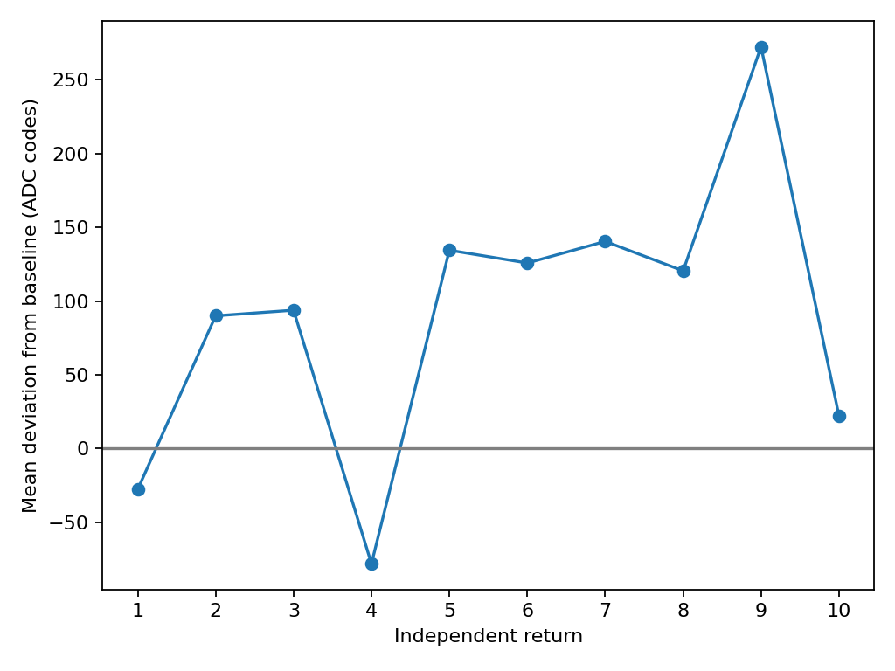
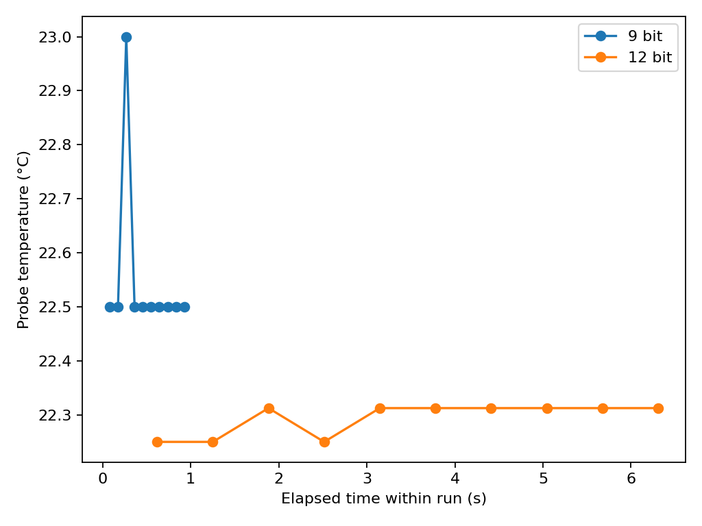
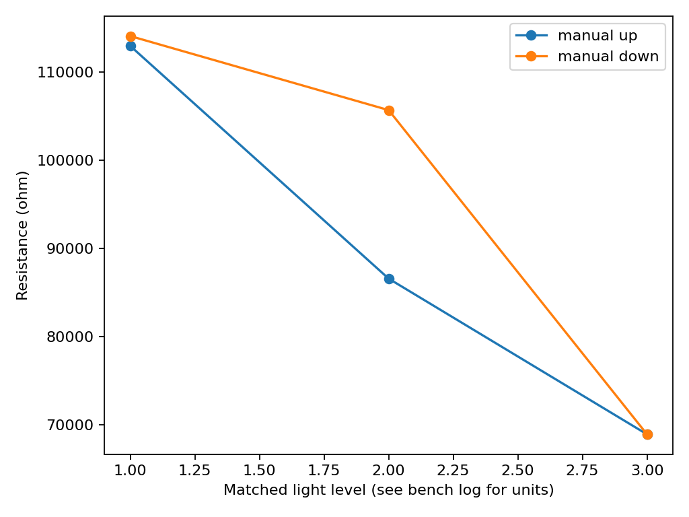

# Task 4 — Hysteresis and repeatability

## Objective

Distinguish the spread after a mechanical return from within-position ADC scatter, compare DS18B20 quantization at two resolutions, and check for direction-dependent LDR response.

## 4b — Potentiometer repeatability

**Hardware verified.** The potentiometer outer terminals were connected to 3V3 and GND and its wiper to GPIO34. The [ADC sketch](../code/adc_calibration/adc_calibration.ino) was compiled and flashed on COM3. After establishing a marked baseline, the operator moved away and returned ten times. A [serial collector](../code/capture_pot_repeat.ps1) triggered 150 samples only after each operator confirmation. Raw ADC and separate API voltage conversions were captured at 115200 baud.

| Statistic | Result |
|---|---:|
| Baseline mean / within-capture SD | 3179.59 / 21.44 codes |
| Mean of ten return means | 3268.96 codes |
| Sample SD of ten return means | 98.17 codes |
| Range of ten return means | 350.57 codes |
| Mean signed deviation from baseline | +89.37 codes |
| Largest absolute deviation | 272.43 codes |
| API voltage estimate across return means | Mean 2.7539 V, SD 0.0579 V, range 0.2043 V |

Within-return sample SDs ranged from 2.05 to 30.82 codes. The larger between-return variation describes the repeatability of the full marked-position procedure. Mechanical play, return direction, alignment of the mark and electrical/ADC variation were not isolated. The voltages are ADC API estimates. The Task 3a fit was not extrapolated to this higher voltage range.

[Original runs and timestamps](../evidence/task04b-pot/) · [Per-return statistics and signed deviations](../figures/task04b-pot/return-deviations.csv) · [Summary](../figures/task04b-pot/summary.json)

Reproduce the statistics with `python Module03/analyze.py repeat Module03/evidence/task04b-pot/trials.csv Module03/figures/task04b-pot --kind pot-adc`.

## 4c — DS18B20 resolution and repeatability

**Hardware verified for one probe.** The [DS18B20 sketch](../code/ds18b20_capture/ds18b20_capture.ino) was compiled and flashed on COM3. On GPIO18 the logger identified one family-0x28 ROM, `28E55FA300000007`, and validated its CRC. It requested and polled a new conversion for each row. Runs were sequential with no commanded change of environment. No independent thermometer or environmental stability trace was available.

| Resolution | Valid samples | Quantization step | Mean | Sample SD | Range | Mean conversion |
|---|---:|---:|---:|---:|---:|---:|
| 9 bit | 10 | 0.5 °C | 22.5500 °C | 0.1581 °C | 0.5000 °C | 78.0 ms |
| 12 bit | 10 | 0.0625 °C | 22.2938 °C | 0.0302 °C | 0.0625 °C | 616.1 ms |

Each run spanned one code step. The smaller 12-bit step describes quantization. The observed spread does not establish absolute accuracy or exclude changes between runs. Directional temperature hysteresis and a multi-probe comparison remain pending.

[Original runs and scan](../evidence/task04c-ds18b20/) · [Statistics](../figures/task04c-ds18b20/summary.json)

## 4a — LDR hysteresis and light history

**Hardware verified for one manual sweep.** The operator switched GPIO34 from the potentiometer to the LDR divider node, wired as 3V3 → LDR → node → 10 kΩ → GND. The [analog capture sketch](../code/analog_capture/analog_capture.ino) was compiled and uploaded on COM3. A fixed lamp and marked card positions provided relative low, medium and high light settings. Command `t` captured 150 samples per setting, with separate raw ADC and API voltage conversions. The high setting was the shared turning point. Only low and medium were independently revisited on the return path.

| Relative setting | Up mean code | Down mean code | Up estimate | Down estimate | Down minus up |
|---|---:|---:|---:|---:|---:|
| Low | 153.73 | 150.77 | 112.93 kΩ | 114.05 kΩ | +1.12 kΩ |
| Medium | 243.11 | 174.57 | 86.58 kΩ | 105.66 kΩ | +19.08 kΩ |
| High, shared turn | 335.93 | — | 68.95 kΩ | — | — |

The maximum observed gap between independent captures was **19.08 kΩ** at the medium setting. Resistance was calculated as `R_fixed × (Vs − Vout) / Vout` using nominal 3.3 V, nominal 10 kΩ and the ADC API voltage estimate. Card position was a relative setting with no lux measurement. The medium setting differed by 56.37 mV between directions. Positioning variation, ambient light, sensor lag and illumination history may all contribute. Dwell times were not controlled or independently logged, so the gap cannot isolate static hysteresis. Controlled fast, slow and paused sweeps remain pending.

The first diagnostic serial capture had framing artifacts and was retained as an unparsed log. Its retry had a floor code. The first low setting clipped to zero, and the adjusted low setting initially fluctuated. The subsequent held capture was used for the up-sweep low point. All these captures are preserved.

[Raw captures, flash logs and sweep input](../evidence/task04a-ldr/) · [Maximum gap](../figures/task04a-ldr/summary.json)

Reproduce with `python Module03/analyze.py repeat Module03/evidence/task04a-ldr/sweep.csv Module03/figures/task04a-ldr --kind ldr`.

## Conclusion

The potentiometer test measured marked-position return spread, with individual sources unresolved. The temperature test measured short-run repeatability and quantization on one probe. The LDR test measured a direction-dependent difference at matched card marks under one manual procedure.
