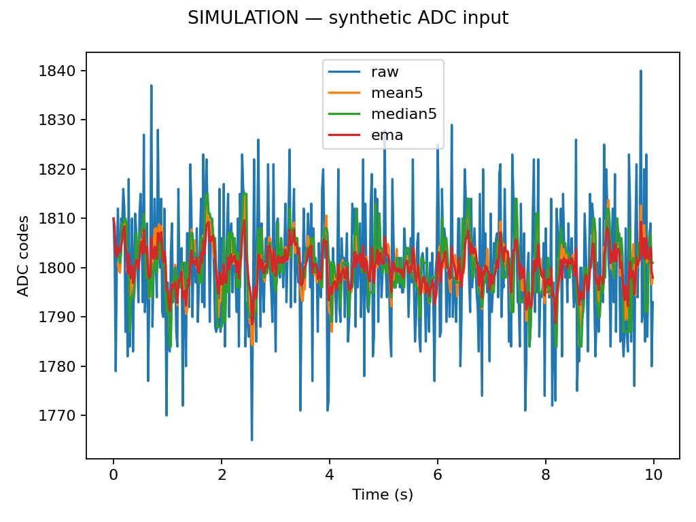
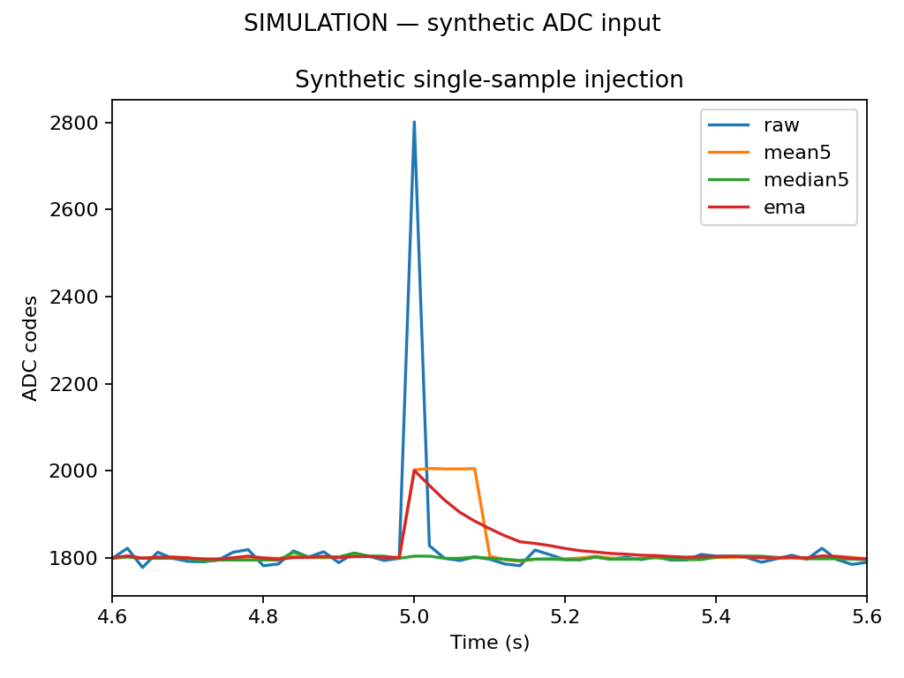
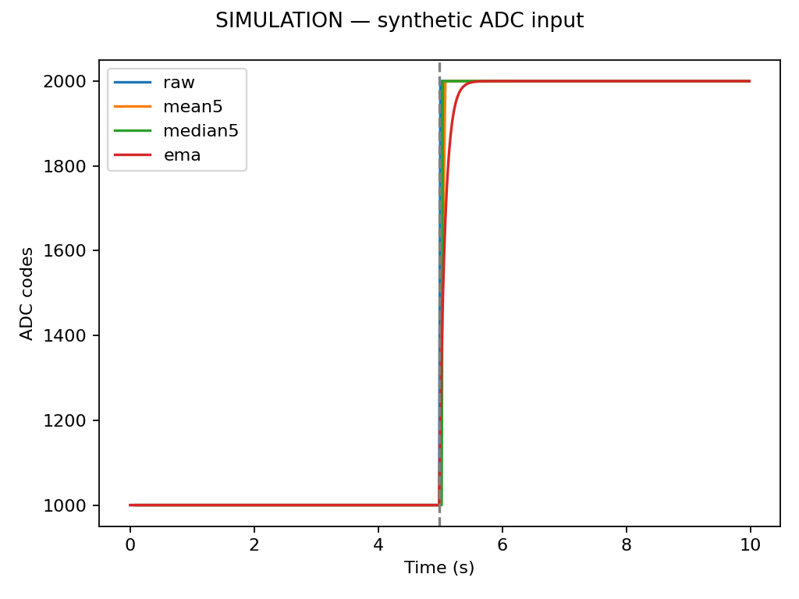
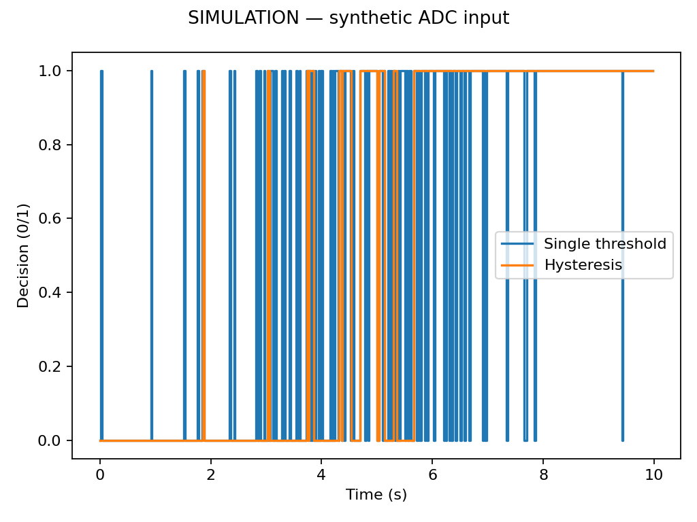
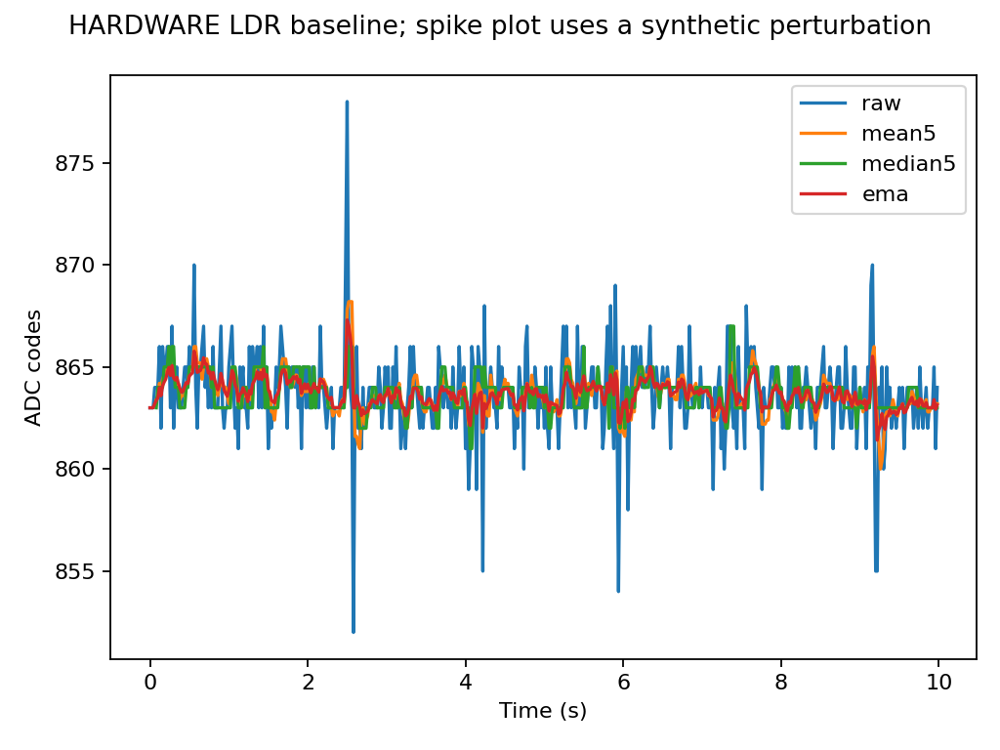
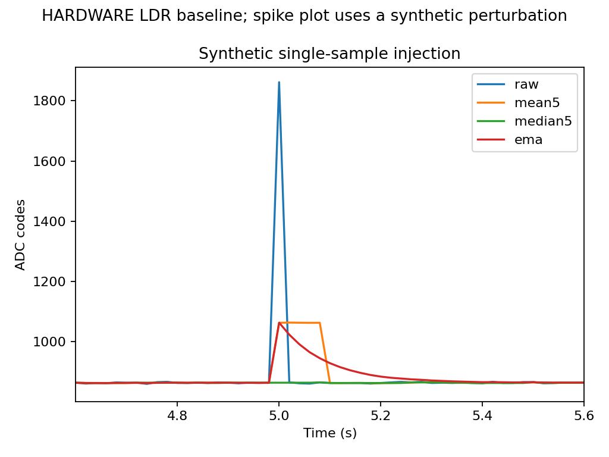

# Task 5 — Noise and filtering

## Objective

Measure fixed-input ADC scatter, compare three causal filters on the same new capture, and quantify the cost in response time when the potentiometer step is measured.

## Hardware setup

The operator reported 3V3 → LDR → GPIO34 node → 10 kΩ → GND, with the potentiometer disconnected from GPIO34. The ESP32 Dev Module uses 12-bit ADC, 11 dB attenuation and 115200 baud. The [existing analog sketch](../code/analog_capture/analog_capture.ino) was compiled with ESP32 Core 3.3.12 and uploaded on COM3.

## Task 5.2 — LDR noise measurement

The first 32-sample hardware check returned raw ADC code 0 for every sample, and the voltage API returned 142 mV. The acquisition guard stopped before the 500-sample command because the input was at the ADC floor. This record is preserved.

After the operator reported fixing the illumination, a second 32-sample check also returned zero raw codes and a constant 142 mV API estimate. Independent voltage measurements were unavailable. The operator then requested a software simulation.

### Hardware recovery and fresh 500-sample run — 2026-11-09

The [minimal GPIO34 diagnostic sketch](../code/adc_diagnostic/adc_diagnostic.ino) confirmed 30 zero codes, including separate direct-light and covered tests. After the operator reconnected the divider, the diagnostic returned nonzero values. Direct phone-light illumination produced a mean of 620.37 codes and 653.8 mV; covering the LDR returned zero codes. This demonstrated a real light response. The exact earlier connection fault was not isolated.

The analog capture sketch was then compiled and uploaded on COM3, with flash verification. The operator held the phone light and LDR fixed for a new 500-sample capture. There were no ADC rail codes. The sample interval averaged 20.0000 ms (observed range 19.962–20.093 ms), and the record spanned approximately 9.98 s.

| Raw hardware measurement | Result |
|---|---:|
| Samples | 500 |
| Mean ADC code | 863.690 |
| Sample SD | 2.00548 codes |
| Minimum / maximum / range | 852 / 878 / 26 codes |
| Mean API voltage estimate | 0.851632 V |

The means of five consecutive 100-sample blocks were 864.26, 863.60, 863.53, 863.79 and 863.27 codes. The setup was held fixed by the operator, but independent illuminance stability was not measured. The small changes between blocks and the ADC outliers are included in the noise statistics.

[Original 500-row hardware CSV](../evidence/task05-noise/hardware-ldr/ldr-fixed-500.csv) · [Raw UART bytes](../evidence/task05-noise/hardware-ldr/ldr-fixed-500.serial.txt) · [Diagnostic history](../evidence/task05-noise/adc-diagnostic/) · [Compile and upload logs](../evidence/task05-noise/hardware-ldr/)

## Simulation results — synthetic input

**Earlier software simulation, retained for comparison.** The [reproducible generator](../simulate_noise.py) uses seed 20261109 and creates three 500-sample synthetic inputs at a nominal 20 ms interval. The fixed input is 1800 codes plus rounded Gaussian noise with sigma 12. The step is an ideal 1000-to-2000-code change. The slow drift is 1785 to 1815 codes plus rounded Gaussian noise with sigma 6. The generator assigns no voltage or resistance reference.

The fixed-input 500-row mean was 1800.09 codes, sample SD 12.001 codes, minimum 1765, maximum 1840 and range 75. For the common valid interval, excluding the first four rows from every trace:

| Signal | Samples | Mean (codes) | Sample SD (codes) | SD reduction |
|---|---:|---:|---:|---:|
| Synthetic raw | 496 | 1800.107 | 12.004 | 0% |
| Mean-5 | 496 | 1800.114 | 5.107 | 57.45% |
| Median-5 | 496 | 1799.968 | 6.213 | 48.24% |
| EMA, alpha 0.2 | 496 | 1800.141 | 3.687 | 69.28% |



In a separate copy, a single +1000-code perturbation at index 250 caused peak deviations of 200 codes for mean-5, 3 codes for median-5, and 200 codes for EMA. These differences compare each perturbed output with its unperturbed counterpart. Median-5 suppressed the isolated spike most strongly in this example. EMA gave the lowest fixed-input SD at these settings, while mean-5 outperformed median-5 on the Gaussian input.



On the synthetic ideal step, half-step crossing delays relative to raw were 40 ms for mean-5, 40 ms for median-5 and 52.34 ms for EMA. These are software timing estimates for this generated waveform. A real potentiometer step still needs measurement. On the synthetic slow drift, the single-threshold decision made 125 transitions and the two-threshold decision made 19 transitions using center 1800 and half-width 8 codes.





Reproduce with `python Module03/simulate_noise.py`. [Synthetic inputs, parameters, CSV statistics and plots](../simulation/task05/) are stored separately from the [real serial evidence](../evidence/task05-noise/). The chosen noise distribution and ideal step do not establish how the present LDR or ADC hardware behaves.

## Task 5.3 — Filter comparison

The [Python analysis](../analyze.py) implements a trailing mean of five samples, a trailing median of five samples and EMA with alpha 0.2. The first four rows are excluded from every comparison statistic, including the raw comparison, so all filters use the same 496 timestamps in a 500-row run. The EMA starts at the first raw code. All original samples remain archived.

Reproduce the hardware analysis with:

```text
python Module03/analyze.py noise Module03/evidence/task05-noise/hardware-ldr/ldr-fixed-500.csv Module03/figures/task05-noise/hardware-ldr --spike-codes 1000 --label "HARDWARE LDR baseline; spike plot uses a synthetic perturbation"
```

The statistics include sample SD and its percentage decrease relative to raw over the shared interval. The 500-sample raw summary is reported separately. Firmware and Python replay differences are also recorded.

| Hardware-data replay | Samples compared | Mean (codes) | Sample SD (codes) | SD reduction |
|---|---:|---:|---:|---:|
| Raw | 496 | 863.6935 | 2.01280 | 0% |
| Mean-5 | 496 | 863.6944 | 0.93651 | 53.47% |
| Median-5 | 496 | 863.6875 | 0.89956 | 55.31% |
| EMA, alpha 0.2 | 496 | 863.6941 | 0.68330 | 66.05% |

EMA achieved the lowest SD with these settings. Median-5 slightly outperformed mean-5 on this trace, which included brief excursions. The maximum replay differences versus the firmware columns were zero for mean-5 and median-5 and 0.00020 codes for EMA, consistent with floating-point rounding.



[CSV filter statistics](../figures/task05-noise/hardware-ldr/noise-statistics.csv) · [All filtered rows](../figures/task05-noise/hardware-ldr/filtered.csv) · [Summary](../figures/task05-noise/hardware-ldr/summary.json)

## Synthetic spike test

The command above adds 1000 codes to a single sample in an independent software copy. The exported synthetic CSV identifies the original and perturbed values. Peak filter deviations compare each perturbed output with its own unperturbed output. The synthetic plot is labeled explicitly. The original serial CSV remains the hardware record.

For this hardware baseline, the artificial spike at index 250 caused a peak change of 200 codes in mean-5, 3 codes in median-5, and 200 codes in EMA. Median-5 suppressed this isolated perturbation most effectively. Mean-5 distributed it over five outputs; EMA spread it into a decaying tail. The measured fixed-input SD and this injected-spike result describe different disturbance cases. Smoothing also delays response; real potentiometer step latency remains to be measured.



[Labeled spike test CSV](../figures/task05-noise/hardware-ldr/synthetic-spike.csv)

## Limitations

Fixed lamp placement and shielding do not establish perfectly constant illumination. Drift, flicker, sensor physics, source impedance and ADC electronics can all contribute. The separate API voltage conversion estimates node voltage and does not provide an independent DMM reference. Fixed-input SD reduction alone does not establish the latency on a real step.

## Pending potentiometer measurements

Task 5.1 and 5.4 are **Pending Hardware**. At the later wiring change, disconnect USB and detach the LDR node from GPIO34. Connect the pot outer terminals to 3V3 and GND and the wiper to GPIO34. Keep the current LDR circuit for this session.

Use the same sketch and collector for both future potentiometer runs. The GPIO34 channel is named LDR in the existing sketch; the actual circuit connected determines the source.

```text
powershell -File Module03/code/capture_ldr.ps1 -OutputDirectory Module03/evidence/task05-noise -Run pot-fixed-500 -Samples 500
powershell -File Module03/code/capture_ldr.ps1 -OutputDirectory Module03/evidence/task05-noise -Run pot-step-1000 -Samples 1000
python Module03/analyze.py noise POT_FIXED.csv POT_FIXED_OUTPUT
python Module03/analyze.py noise POT_STEP.csv POT_STEP_OUTPUT --step-s OBSERVED_STEP_SECONDS
```

For the step, hold the first voltage during the initial baseline, turn quickly to a second voltage, then hold it for the rest of the capture. The 1000-point window targets 20 seconds. Use the trace and actual timestamps to identify onset. The Python script compares half-step crossing delays relative to raw. A five-point mean has a nominal two-sample group delay (about 40 ms at this cadence). EMA and median latency depend on the waveform and must be measured.

Task 5.5 is **Software Prepared**. The existing `--threshold` and `--band` arguments replay a two-threshold decision. A real slow crossing and justified thresholds are pending. A dead zone can instead retain the previous output until the absolute input change exceeds a chosen band.

## Figures and raw data

[Compile, upload and original captures](../evidence/task05-noise/)
