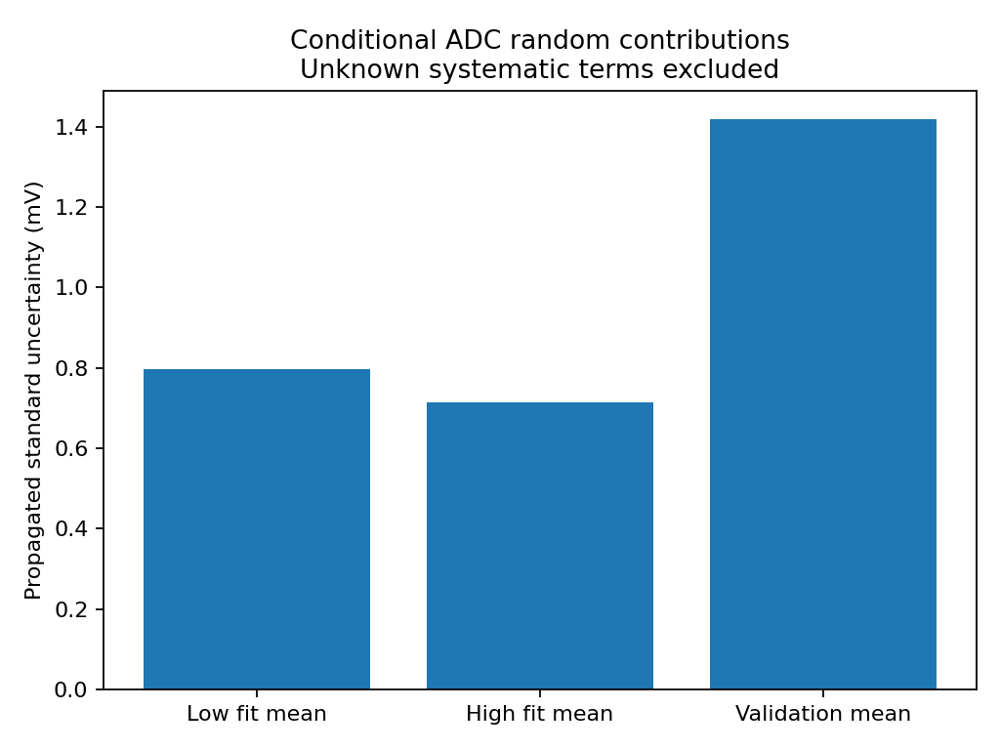
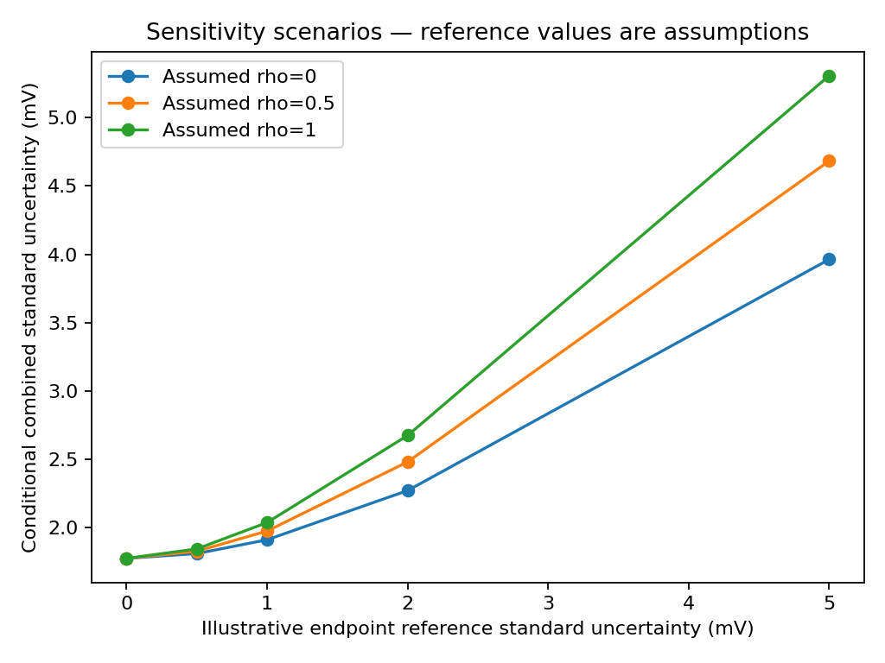
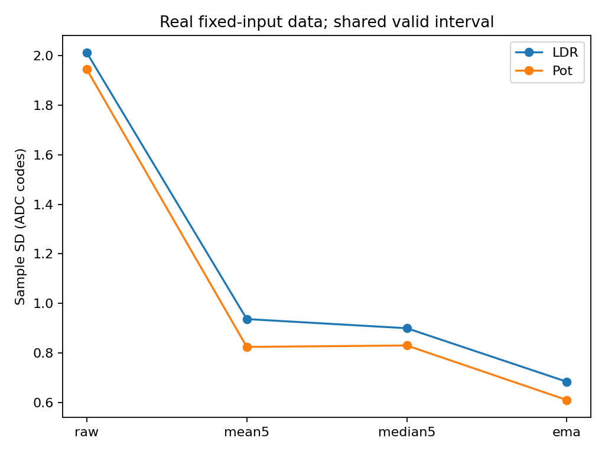

# Task 6 — Uncertainty and filtering

## Objective

Use the measured ADC voltage calibration to quantify the supported part of uncertainty, identify missing terms, and compare filtering by noise, spike rejection and latency. Task 6 is the course stretcher. This report completes the available-data analysis with a **conditional partial budget**. A full uncertainty statement remains pending.

## Existing experimental evidence

The analysis rereads original CSVs. [The evidence review](../data/task06-analysis/evidence-review.json) records recomputed results across Tasks 1–5.

| Task | Evidence and its relevance |
|---|---|
| 1 | Six LDR distance groups yield gamma 0.26314; three 30 cm resistance estimates have SD 6.79 kΩ. Voltages are ADC estimates and the supply/resistor are nominal. |
| 2 | One DS18B20 has ten valid readings per resolution. A 240-row water trace contains a dynamic transition. There is no independent temperature reference. |
| 3a | Three 150-row ADC captures pair raw codes with operator-confirmed DMM values. This is the primary uncertainty dataset. |
| 3b | Two-point LDR calibration gives gamma 0.26851; the held-out resistance residual is −3.56 kΩ. |
| 3c | No paired reference temperature rows are available. Offset calibration remains Reference Pending. |
| 4 | Ten pot return means have SD 98.17 codes. They include positioning error at a different voltage, so they cannot be inserted into the Task 3a budget. The LDR sweep has an observed 19.08 kΩ maximum gap. DS18B20 repetition uses one probe. |
| 5 | Fresh 500-row LDR and pot noise captures and a 5553-row unclipped descending transition support noise/latency comparisons. Artificial spikes and drift copies are labeled separately. |

## Measurement model

The measurand is the voltage inferred from the **150-sample mean** at the Task 3a validation setting. With endpoint means x1 and x2, validation mean x, and DMM endpoint readings V1 and V2,

```text
w = (x − x1) / (x2 − x1)
y = V1 + (V2 − V1) w = m x + c
m = 0.000815961333 V/code
c = 0.138456195 V
```

The original means are x1 = 526.426667, x2 = 2769.180000 and x = 1716.426667 codes. DMM endpoint readings are 0.568 V and 2.398 V. The held-out DMM reading is 1.526 V. Recalculation yields y = **1.538993987 V**, API baseline = 1.553560 V and signed validation error = **+12.993987 mV**. The validation reference is excluded from fitting.

Sensitivity coefficients are m(w−1), −mw, m, 1−w and w for x1, x2, x, V1 and V2 respectively. The [sensitivity CSV](../data/task06-analysis/sensitivities.csv) gives their numerical values. Raw codes are converted with this local fitted slope, without assuming 3.3/4095 V per code.

## Type A and Type B uncertainty

For a stationary set of independent readings, the Type A standard error of a mean is s/sqrt(n). The raw-code SDs are 25.4406, 20.2292 and 21.2815 codes at the low, high and validation points. With n = 150, their standard errors are 2.0772, 1.6517 and 1.7376 codes. Outliers are retained.

Independence is conditional. Lag-one correlations are 0.128, −0.140 and 0.179. These short traces cannot establish stationarity or long-term independence. As a sensitivity check, nonoverlapping batches of 10, 15, 25, 30 and 50 observations give partial k=2 results spanning 3.14–3.80 mV. This range describes dependence on the batching choice, with as few as three batches at the largest size.

Type B evaluation requires a justified bound or specification. A rectangular half-width a gives standard uncertainty a/sqrt(3). A one-code uniform rounding model corresponds to m/sqrt(12) = about 0.236 mV for a single observation. The observed raw scatter already contains quantization, so this term is not added again.

These methods follow the treatment of Type A, Type B and covariance in sections 4–6 of the [GUM](https://doi.org/10.59161/JCGM100-2008E).

## Uncertainty budget

All output uncertainties below are standard uncertainties in mV. Empty entries in the [complete budget CSV](../data/task06-analysis/uncertainty-budget.csv) mean unquantified or already included.

| Contribution | Estimate / distribution | Standard contribution | Basis and treatment |
|---|---|---:|---|
| Low calibration mean noise | s/sqrt(150), independent-sample approximation | 0.796 | Measured scatter, conditional Type A |
| High calibration mean noise | s/sqrt(150), independent-sample approximation | 0.715 | Measured scatter, conditional Type A |
| Validation mean noise | s/sqrt(150), independent-sample approximation | 1.418 | Measured scatter, conditional Type A |
| Reference accuracy and calibration | Unknown | Unknown | UT139B is visible, but range accuracy, calibration status and uncertainty are unavailable |
| ADC quantization | 0.236 mV single-reading model | Already in scatter | Uniform rounding assumption; no additional independent variance |
| Independent reset repeatability | Unknown | Unknown | No matched repeated Task 3a calibrations; Task 4 returns include a different positioning process |
| Coefficient uncertainty | Propagated endpoint code means | Already in first two rows | Keep slope/intercept covariance |
| Nonlinearity and validation residual | Observed +12.994 mV error | Unassigned | One error does not define a standard uncertainty or bound over the range |
| Supply variation | One reported 3.296 V reading | Unknown | No simultaneous rail time series or sensitivity characterization |
| Component tolerance/loading | Nominal pot resistance is absent from the model | Unknown for loading/contact effects | Resistance tolerance is not an independent voltage-input term |
| Temperature dependence and drift | Unknown | Unknown | No controlled temperature or long-term runs |
| Reference timing and settling | Unknown | Unknown | DMM was read before the ADC burst |
| Self-heating | Unknown | Unknown | No appropriate measured or specified bound |



## Combined standard uncertainty

The conditional calculation treats the three ADC bursts as independent of each other and initially assumes independent readings within each burst. Endpoint reference values are held fixed only for this partial calculation. Then

```text
uc,partial = sqrt(sum((sensitivity_i × SE_i)^2)) = 1.776 mV
```

The fitted slope and intercept are correlated. Propagation of the endpoint code means gives covariance(m,c) = −1.77168e−9 in the corresponding mixed units and correlation −0.86695. The full matrix is in [summary.json](../data/task06-analysis/summary.json). Computing [x,1] Cov(m,c) [x,1]^T plus m² Var(x) reproduces the direct input propagation. Treating m and c as independent would misstate the result. Unknown correlated DMM offset/gain errors cannot be evaluated from these records.

## Expanded uncertainty (k=2)

For the mean, the supported conditional statement is **y = 1.538994 V, U_partial = 0.003552 V at k = 2**. It includes only the random contributions specified above. The +12.994 mV reference discrepancy exceeds this partial interval, which shows why the omitted terms matter. No full accuracy or 95% coverage claim follows from this partial result.

For a hypothetical single validation reading with the same observed scatter, while retaining the calibration means, the corresponding partial uc is 17.398 mV and k=2 result is 34.796 mV. This illustrates why a single reading and a 150-reading mean need different budgets.

The [reference sensitivity scenarios](../data/task06-analysis/illustrative-reference-sensitivity.csv) assign hypothetical equal endpoint reference standard uncertainties from 0 to 5 mV and correlations 0, 0.5 and 1. The reference contribution is ((1−w)² + w² + 2 rho w(1−w)) u_ref². These values are assumptions for sensitivity only.



## Filtering comparison

The script recomputes all filters from the original 500-row hardware CSVs and uses the same 496 rows after discarding the first four outputs for every method. EMA starts at the first raw code.

| Method | LDR SD, codes | LDR reduction | Pot SD, codes | Pot reduction | Real transition delay |
|---|---:|---:|---:|---:|---:|
| Raw | 2.01280 | 0% | 1.94559 | 0% | 0 ms |
| Mean-5 | 0.93651 | 53.47% | 0.82400 | 57.65% | 37.45 ms |
| Median-5 | 0.89956 | 55.31% | 0.82980 | 57.35% | 40.03 ms |
| EMA, alpha 0.2 | 0.68330 | 66.05% | 0.60951 | 68.67% | 68.90 ms |

Latency uses the common 50% crossing on the original unclipped descending pot trace, with the same pre-85 s and terminal windows as Task 5. The input is a finite manual transition sampled about every 20 ms. Reported interpolation decimals do not imply sub-millisecond instrument accuracy.

For a **synthetic +1000-code single-sample spike** added to a copy, mean-5 and EMA each show a 200-code peak deviation from their unperturbed output. Median-5 gives 3 codes on the LDR trace and 0 on the pot trace. The original raw values remain intact. [Recomputed comparison CSV](../data/task06-analysis/filter-comparison.csv) · [Latency CSV](../data/task06-analysis/latency.csv)



## Noise vs latency trade-off

EMA provides the strongest smoothing here, together with the largest observed delay. Median-5 is useful when isolated spikes dominate. Mean-5 has predictable memory and smoothing, but spreads a spike over five outputs. Filtered samples are correlated, so their lower SD cannot automatically be divided by sqrt(150) to claim an independent-mean improvement.

## Engineering recommendations

The validation mean noise is the largest **quantified partial** contribution. The dominant contribution to total uncertainty remains unknown. More samples or appropriate filtering can improve random precision when the signal is stable. Reference calibration, controlled measurement timing, supply checks and independent points across the ADC range address errors that averaging cannot establish or remove.

The first priority for voltage accuracy is a documented DMM reference and matched repeated calibration/validation observations, followed by circuit and supply stability checks. Software smoothing is useful for the measured ADC noise, but cannot eliminate a systematic offset or a nonlinear transfer error.

For a frost alarm, consider spike rejection when needed, followed by only as much smoothing as the permitted delay allows, and separate heater-on/off thresholds chosen with temperature uncertainty. The ADC replay supports the algorithm trade-off; a deployed temperature controller needs its own validation. DS18B20 experiments confirmed one ROM, resolution steps, repeatable readout and a water response. They do not establish absolute accuracy near 2 °C. The manufacturer's ±0.5 °C specification over −10 to +85 °C is a specification, while 0.0625 °C at 12 bits is a code step. [DS18B20 datasheet](https://www.analog.com/media/en/technical-documentation/data-sheets/DS18B20.pdf)

## Limitations

No full uncertainty can be assigned while reference accuracy, systematic model error and drift remain unquantified. One validation residual is insufficient for a nonlinearity distribution. Task 3c has no independent temperature reference. Task 4c has one probe. Class discussions, peer sign-off and Discord sharing have no evidence and remain pending. The existing synthetic spike and drift artifacts remain labeled as software demonstrations.

## Conclusion

The available-data Task 6 analysis is complete. It supplies a transparent partial budget and covariance-aware result, compares noise and latency on real captures, and identifies the missing measurements needed for a complete metrological statement.

## Reproducibility

Run `python Module03/analyze_uncertainty.py` from the repository root with the existing NumPy/Matplotlib environment. Outputs are under [data/task06-analysis](../data/task06-analysis/) and [figures/task06-analysis](../figures/task06-analysis/). The script checks analytic sensitivities against finite differences and verifies the two equivalent covariance calculations. Its [SHA-256 source inventory](../data/task06-analysis/source-hashes.csv) checks that original CSV bytes stay unchanged during execution.

## Supplementary Simulation — Not Hardware Measurement

The [supplementary index](../simulation/supplementary/README.md) adds sensitivity examples without altering the real budget or filter results. Task 1 models resistance sensitivity to a voltage step, and Task 3c illustrates offset sensitivity to assumed reference bounds. The [existing ADC reference-uncertainty grid](../data/task06-analysis/illustrative-reference-sensitivity.csv) already varies hypothetical reference uncertainty and correlation. All these scenarios remain separate from the conditional result above. They supply no missing DMM accuracy, drift bound or full metrological traceability; systematic terms remain Unknown/Pending.
