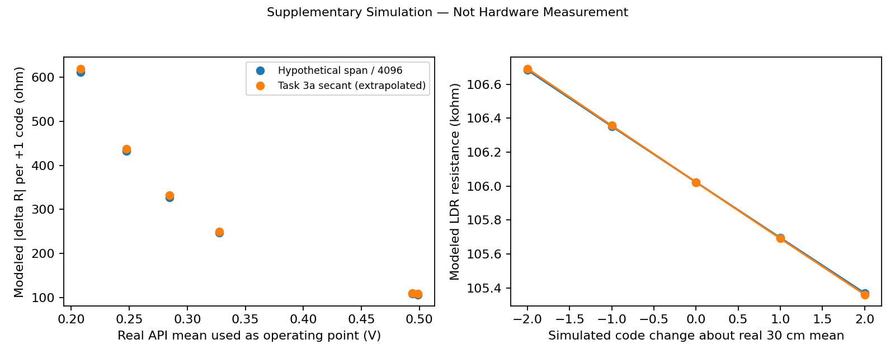

# Supplementary Simulation — Not Hardware Measurement

## Inputs and method

The six operating voltages are freshly averaged from the original Task 1 ladder CSVs. Resistance uses the recorded nominal rail and 10 kohm resistor, not new DMM measurements. The two step scenarios are a hypothetical 3.3 V ADC span divided by 4096 (**0.805664 mV/code**) and the measured Task 3a two-point secant (**0.815961 mV/code**).

For R = Rfixed(Vs/V - 1), dR/dV = -Rfixed Vs/V². The CSV evaluates finite +1-code changes and a -2 to +2 code ladder. Lower node voltages amplify the resistance effect of the same voltage step. A nominal supply does not establish the ADC's effective full-scale span.

## Results and limits

The modeled +1-code resistance magnitude spans **106.72–620.11 ohm** across these points and scenarios. These are sensitivity calculations, not observed individual ADC transitions. The Task 3a secant is used below its 0.568–2.398 V calibration range and does not validate local ADC linearity. Nominal rail, resistor uncertainty, ADC API error and point-source illumination limits remain. Independent LDR-session DMM verification remains **Pending External Evidence**.

[One-code sensitivity CSV](modeled-one-code-sensitivity.csv) · [Synthetic code steps](simulated-code-steps.csv)

The static LDR fit is also recomputed from these six means for Task 4: A = 56705.542472 ohm, gamma = 0.263143314, with Erel = (10 cm / d)². This is an empirical relative-light model; original failed captures and non-monotonic points remain in the hardware archive. No point is removed to improve this supplementary fit.
