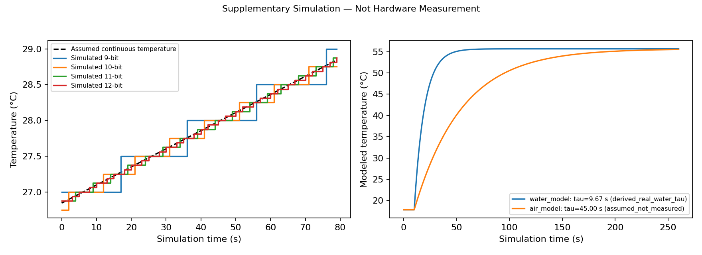

# Supplementary Simulation — Not Hardware Measurement

## Parameters and provenance

There are **80 synthetic readings per resolution** (320 total). The assumed linear ramp starts at the real 12-bit bench mean, 26.843750 °C, and rises by 2.0 °C. This anchor is an observed sensor indication, not a known bath truth. No new ROM, configuration readback or physical conversion is claimed.

The [DS18B20 Rev 6 datasheet](https://www.analog.com/media/en/technical-documentation/data-sheets/DS18B20.pdf), configuration register and conversion-time table, specifies 0.5/0.25/0.125/0.0625 °C steps and maximum conversion durations 93.75/187.5/375/750 ms for 9/10/11/12 bits. The 1 s simulated interval exceeds all four limits. Rounding models quantization; it does not model conversion scheduling jitter, internal filtering, or establish accuracy.

## Thermal model

T(t) = Tinitial + (Tfinal - Tinitial)[1 - exp(-(t - tstep)/tau)] after the ideal bath step, and Tinitial before it. The model uses archived water-run endpoints 17.826149 and 55.660560 °C. Its **water tau = 9.671086 s** is the previously estimated real-water parameter, not a new measurement. The original onset was inferred and the bath had no independent reference. The **air tau = 45.0 s is wholly assumed**. Both curves here are simulated; no air response was recorded. The common ideal temperature step isolates model time constants and does not describe a measured air environment or prove stirring was controlled in the real water run.

The model compares an idealized well-mixed/stirred water bath with still air. This mixing assumption belongs only to the simulation; it is not documented for the real water experiment. The model reaches 63.2% after one tau; air is slower solely because that parameter was chosen. A sealed probe's actual heat transfer depends on its housing, immersion, flow and mounting. A single first-order law need not fit the whole trace.

[Warming CSV](simulated-warming-resolutions.csv) · [Thermal model CSV](simulated-water-air-response.csv) · [Original water summary](../../../figures/task02-ds18b20/water-step/summary.json)

## Completion boundary

Simulation Completed. The additional real 20-reading warming/configuration checks, independent temperature reference, field observations and air test remain outstanding. These models do not fulfill those hardware requirements.
