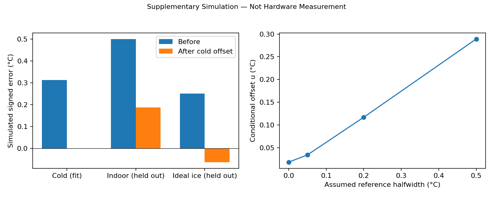

# Supplementary Simulation — Not Hardware Measurement

## Hypothetical experiment

All values in this folder are synthetic. Assumed true reference scenarios are cold **5 °C**, indoor **20 °C**, and ideal ice **0 °C**. They are not readings from an actual thermometer or bath. The assumed indication before quantization is T + 0.300 + 0.015(T - 5) °C, rounded to a 12-bit step of 0.0625 °C.

The synthetic cold indication is 5.3125 °C, giving offset **-0.3125 °C**. Only this point sets the correction; the indoor and ideal-ice points are excluded from calibration.

| Synthetic scenario | Reference (°C) | Before (°C) | Corrected (°C) | Error before (°C) | Error after (°C) |
|---|---:|---:|---:|---:|---:|
| cold_calibration | 5.0000 | 5.3125 | 5.0000 | +0.3125 | +0.0000 |
| indoor_validation | 20.0000 | 20.5000 | 20.1875 | +0.5000 | +0.1875 |
| ideal_ice_validation | 0.0000 | 0.2500 | -0.0625 | +0.2500 | -0.0625 |

## Reference sensitivity and limitations

For an assumed rectangular reference bound ±a, uref = a/sqrt(3). With an independently varying rounding phase, uq = 0.0625/sqrt(12). The chart combines these two under the stated independence assumption. Rounding at a fixed temperature may be deterministic, so this is an illustrative uncertainty scenario, not a measured Type A uncertainty. A systematic reference error transfers directly into the offset; repeating the same biased reference cannot remove it. A constant offset also leaves the model's temperature-dependent bias. Real calibration needs simultaneous stable readings and an independent validation condition.

No reference-instrument accuracy, certificate or measured uncertainty is supplied. This model does not improve the real probe's verified accuracy. The formal Task 3c status remains **Reference Pending / Hardware Partially Completed**, even though this supplementary simulation is complete. A real ice bath has not been certified as 0 °C.

[Simulation CSV](simulated-calibration-validation.csv) · [Illustrative reference sensitivity](illustrative-reference-sensitivity.csv)

