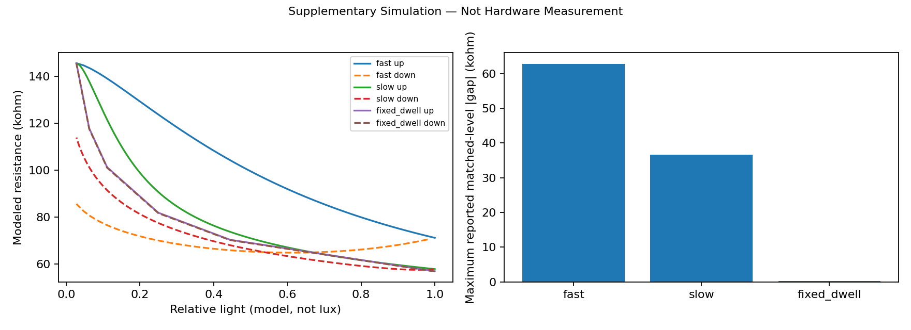
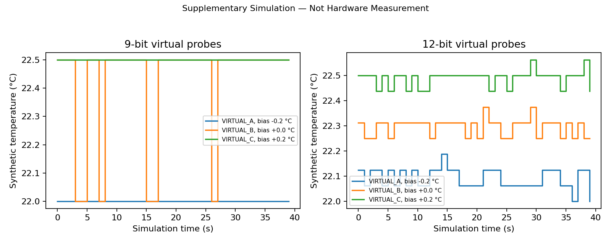

# Supplementary Simulation — Not Hardware Measurement

## LDR dynamics: data-based equilibrium, assumed time constant

The equilibrium law R = 56705.542472 Erel^(-0.263143314) is refitted to all six accepted real Task 1 ladder points. Erel = (10 cm / distance)² is a geometry approximation, not lux. Non-monotonic hardware points and failed original captures remain disclosed in Task 1. A **wholly assumed tau = 2.0 s** is used in dR/dt = (Req(E) - R)/tau. Each integration step uses the exact exponential solution for a locally constant input.

Fast and slow legs last 5 and 30 s. The staircase waits 10 s per level, reporting its endpoint. All start at low-light equilibrium. This model produces rate-dependent apparent hysteresis, not intrinsic static hysteresis; it cannot identify what caused the real manual-card gap. Interpolation matches the same commanded light levels. At the fast/slow turnaround the same observation is shared, so it is not an independent repeat. The fixed-dwell trial includes a second high-light hold.

| Synthetic protocol | Maximum matched-level absolute gap (ohm) |
|---|---:|
| fast | 62866.665 |
| slow | 36622.913 |
| fixed_dwell | 300.748 |

Longer dwell reduces the modeled directional gap because the assumed dynamic state approaches equilibrium. The dwell curves and bar use only the endpoint of each hold; all intermediate samples are retained in the CSV. These times and gains are not recovered from the hardware sweep. Sensitivity to real light geometry, sensor asymmetry and history remains unknown.

[Sweep CSV](simulated-ldr-rate-sweeps.csv) · [Matched-level CSV](simulated-matched-level-gaps.csv)

## Virtual DS18B20 units

The real single-probe 12-bit mean (22.293750 °C) only anchors a synthetic bath. It is not an independent true temperature. Three virtual units have assumed biases -0.2/0/+0.2 °C and independent Gaussian pre-quantization noise SD 0.03 °C. Each produces 40 observations at both 9 and 12 bits, spaced 1 s apart (longer than the datasheet conversion maxima). Seed 73421 fixes the noise. Labels VIRTUAL_A/B/C are not ROM IDs.

The two charts separate quantization, short-run scatter and persistent bias. A constant quantized code can have zero repeatability SD while remaining biased. Finer resolution can expose noise without worsening accuracy. The assumed biases are examples, not a model of the real probe population or a certified ±0.5 °C distribution.

[Virtual readings](simulated-virtual-probes.csv) · [Virtual statistics](simulated-virtual-probe-statistics.csv)

**Simulation Completed; Hardware Partially Completed.** Actual evidence still contains one probe, ten real potentiometer returns and one manual LDR sweep. Controlled sweep-speed and real multi-probe evidence remain missing.
