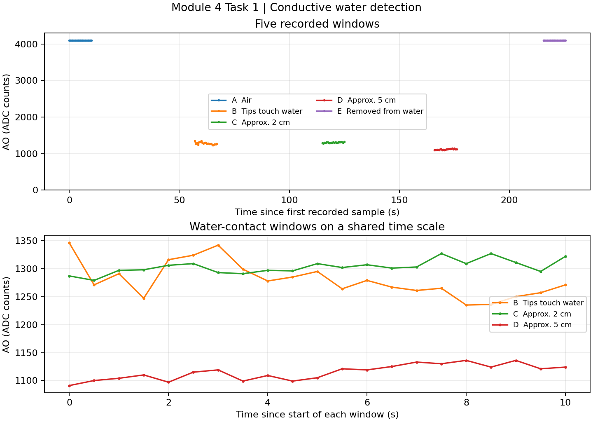
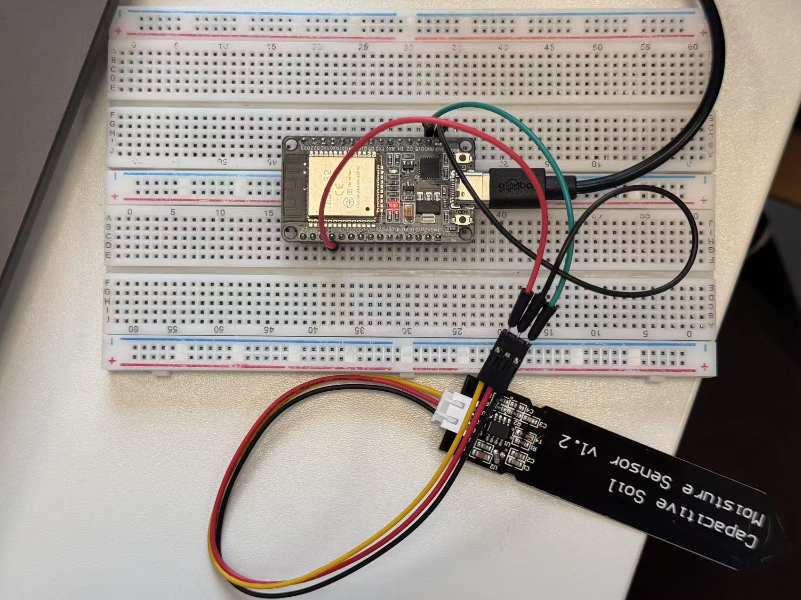
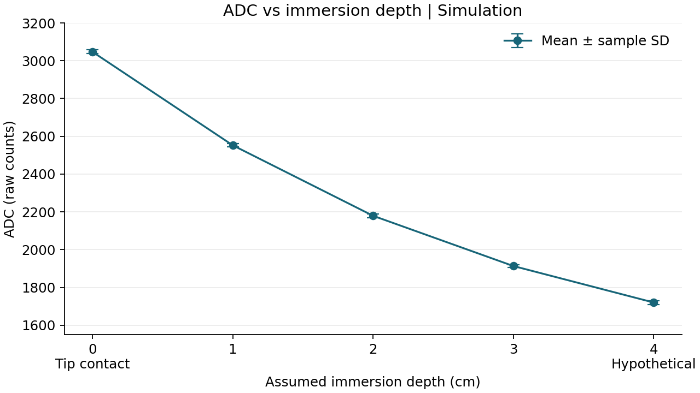
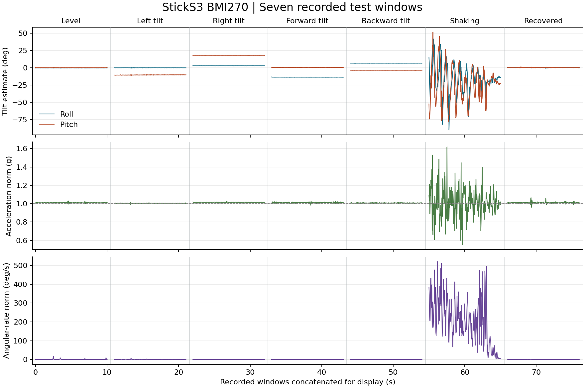
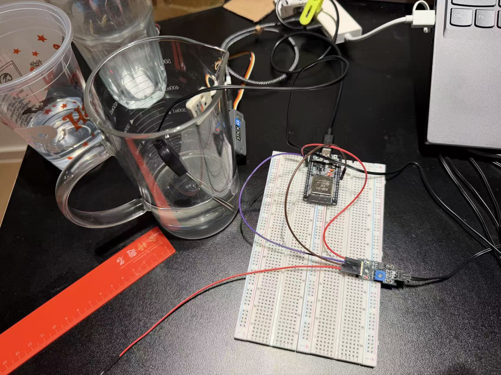
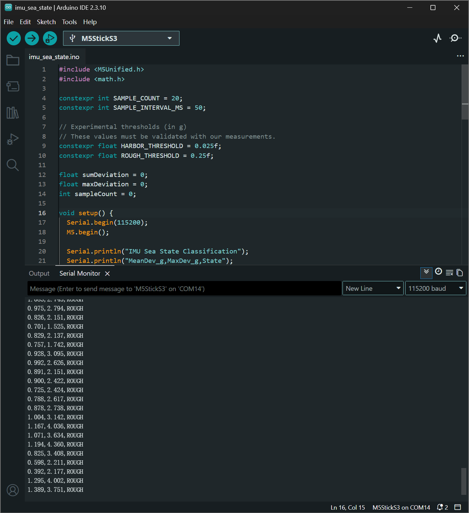
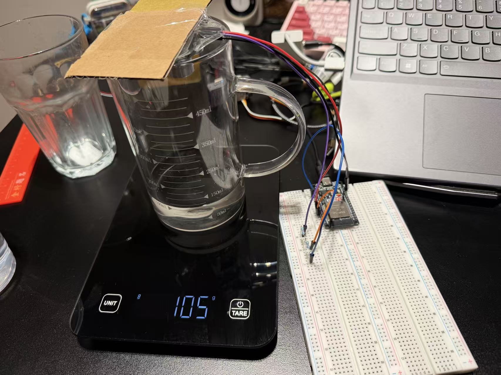
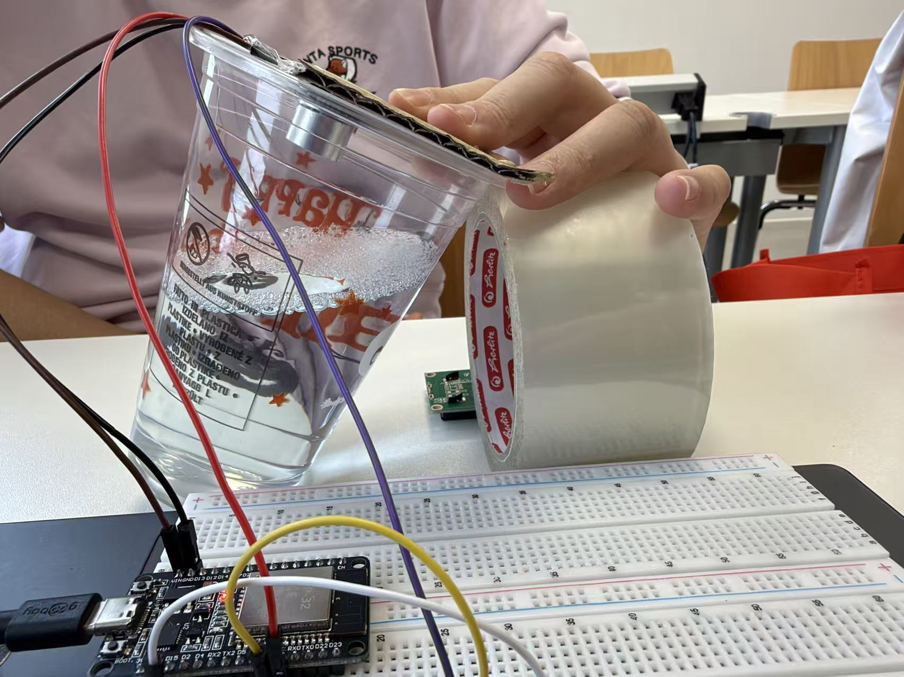

# Module 4 — Liquid Measurement & Sensor Selection

## Module Overview

This portfolio compares water-presence detection, continuous liquid-level estimation, and motion measurement in a tabletop setup. Tasks 1–3 are Mei Zhengyong’s experiments. Sections 4–6 present LudwigMo’s reference experiments and tank-selection proposal. The numbering is for portfolio navigation.

| Section | Main result | Evidence source |
|---|---|---|
| [1. Conductive water detection](#task-1--conductive-water-level-detection) | Dry and wet states separated in five recorded conditions | Mei’s serial captures |
| [2. Capacitive level measurement](#task-2--capacitive-liquid-level-measurement) | Two-point depth model evaluated at one held-out depth, with unresolved acquisition provenance | Mei’s bench diagnostics, simulation, and supplied readings |
| [3. Six-axis IMU](#task-3--six-axis-imu-measurement) | Seven windows capture static tilt, shaking, and return to rest | Mei’s StickS3 serial captures |
| [4. Binary water detection](#section-4--binary-water-detection) | Threshold switching and debounce demonstrated on the partner’s HD-38 | LudwigMo’s result table, setup photo, and serial screenshot |
| [5. Sea-state classification](#section-5--imu-motion-detection-and-sea-state-classification) | Laboratory motion classified by distance from 1 g, with a boundary case | LudwigMo’s reported results and screenshots |
| [6. Four-tank decision sheet](#section-6--decision-sheet-for-four-tanks) | Primary sensors and independent alarms selected by tank function | LudwigMo’s design proposal and supporting bench evidence |

## Learning Objectives

- Distinguish a binary water alarm from a continuous liquid-level measurement.
- Evaluate calibration, repeatability, and the effects of conductivity, probe placement, and motion on sensor readings.
- Explain how acceleration and angular rate can identify conditions that may reduce confidence in a level reading.
- Select a primary and backup sensing principle for each tank based on the measurement decision and likely failure modes.

## Equipment

| Work | Equipment |
|---|---|
| Task 1 | ESP32 DevKit, LM393 module, two conductive probes, water |
| Task 2 | ESP32 DevKit, V1.2 capacitive soil-moisture probe, breadboard, jumper wires, clear plastic cup, water |
| Task 3 | M5Stack StickS3 with BMI270 and USB serial connection |
| Partner reference | ESP32 with an HD-38 conductive module, StickS3 with BMI270, and an HC-SR04 ultrasonic setup referenced in the tank decisions |

## Task 1 – Conductive Water Level Detection

The ESP32 logged the LM393 module’s analog output on GPIO34 and digital output on GPIO18 at 500 ms intervals. Each of the five windows contains 21 samples. The observed dry/wet polarity is specific to this wiring and comparator setting.

| Condition | Mean AO (ADC counts) | AO range | DO throughout the window |
|---|---:|---:|---:|
| Air | 4095.00 | 4095–4095 | 1 |
| First contact | 1279.95 | 1235–1346 | 0 |
| About 2 cm immersion | 1303.14 | 1279–1327 | 0 |
| About 5 cm immersion | 1115.10 | 1091–1136 | 0 |
| Removed from water | 4095.00 | 4095–4095 | 1 |

DO clearly distinguished the tested air and water conditions. The ADC reached full scale in air. The first-contact and 2 cm ranges overlapped, and the means did not vary monotonically with depth. The data support a point-level alarm under these conditions. A continuous depth calibration would require repeatable readings over the full range.

*Figure 1. Mei’s 105 conductive-probe samples. Gaps separate the five recorded windows.*

[Report](Task01_WaterLevel/experiment-report.md) · [Arduino sketch](Task01_WaterLevel/Task01_WaterLevel.ino) · [CSV records](Task01_WaterLevel/data/) · [AO time series](Task01_WaterLevel/ao-time-series.png) · [Setup guide](Task01_WaterLevel/README.md)

## Task 2 – Capacitive Liquid Level Measurement

The V1.2 capacitive probe senses changes in the dielectric environment around its electrodes. The ESP32 recorded raw 12-bit ADC counts from AOUT on GPIO34 with the module powered from 3.3 V.

*Figure 2. Mei’s wiring close-up shows the breadboard, jumper leads, and V1.2 probe. The [water-cup setup photo](Task02_Capacitive/images/experimental_setup.jpg) shows the apparatus in use.*

| Evidence source | Result | Interpretation |
|---|---|---|
| Initial serial diagnostics | ADC = 0 in air and at approximately 1 cm | These captures establish the fault observed during the initial check. |
| Synthetic example | 147 samples across seven conditions | The declining response was assigned by the model and illustrates the analysis method. |
| Supplied ADC lists | A fit using 1 and 3 cm predicts 2.139 cm at the reported 2 cm point | A preliminary error of +0.139 cm for that dataset. The lists lack timestamps. |
| Supplied timestamped CSV | A separate fit predicts 2.135 cm at the reported 2 cm point | A preliminary error of +0.135 cm for that dataset. The 200 ms spacing differs from the sketch’s 500 ms setting, and the ADC entries differ from those in the lists. |

*Figure 3. Simulation of ADC versus immersion depth. The 4 cm case is hypothetical.*

The relationship between the two supplied datasets and the recorded bench run remains unresolved. The setup photos document the hardware arrangement. Hardware acquisition and tank-volume calibration still need independent validation.

[Report](Task02_Capacitive/experiment-report.md) · [Arduino sketch](Task02_Capacitive/Task02_Capacitive.ino) · [Diagnostic and supplied CSVs](Task02_Capacitive/data/) · [Synthetic CSV](Task02_Capacitive/simulation/synthetic-capacitive-water-level.csv) · [Setup photo](Task02_Capacitive/images/experimental_setup.jpg) · [Simulated depth plot](Task02_Capacitive/images/adc_vs_depth.png) · [Simulated time plot](Task02_Capacitive/images/adc_over_time.png)

## Task 3 – Six-Axis IMU Measurement

The StickS3 recorded 1,749 frames across seven conditions in 10 s windows. Roll and pitch were estimated from the gravity direction inferred from the accelerometer. The gyroscope independently provided three-axis angular rate. Left and right tilt mainly changed pitch (−10.330° and +17.639°). Forward and backward tilt mainly changed roll (−13.523° and +6.755°).

*Figure 4. Mei’s seven recorded test windows. The shaking interval shows larger acceleration and angular-rate excursions.*

During shaking, acceleration magnitude ranged from 0.553 to 1.619 g. Linear acceleration changes the apparent gravity direction, so the resulting tilt variations include estimator error as well as rotation. After the device returned to rest, the mean roll and pitch differed from their initial values by +0.236° and +0.438°. A reference inclinometer was unavailable, so absolute angle accuracy was not evaluated.

[Report](Task03_IMU/experiment-report.md) · [Arduino sketch](Task03_IMU/Task03_IMU.ino) · [Seven CSVs](Task03_IMU/data/) · [Test overview](Task03_IMU/figures/imu-test-overview.png) · [Shaking detail](Task03_IMU/figures/imu-shaking-detail.png)

## Section 4 – Binary Water Detection

LudwigMo used an HD-38 on GPIO27 and recorded a switching depth of approximately 0.3 cm and a 300 ms software debounce. The switching depth and debounce are specific to that reference setup. Task 1 provides separate wet/dry observations using the local wiring. The partner archive supplies the result table and screen capture.

*Figure 5. LudwigMo’s HD-38 reference setup with the probe, container, ESP32, and adjustable comparator module.*

[Partner report and recorded results](partner_reference/README.md#4-binary-water-detection) · [Arduino sketch](partner_reference/code/water_sensor_binary.ino) · [Setup photo](partner_reference/pictures/binary_sensor_setup.jpg) · [Serial output](partner_reference/pictures/binary_sensor_output.png)

## Section 5 – IMU Motion Detection and Sea-State Classification

LudwigMo classified laboratory motion using the mean absolute deviation of acceleration magnitude from 1 g over a short window. The reported thresholds are 0.025 g and 0.25 g. A gentle-motion window near the lower threshold was classified as stationary. These thresholds complement Task 3’s direct tilt and angular-rate measurements. The partner archive supplies summary values and screenshots for the three motion classes.

*Figure 6. LudwigMo’s laboratory classifier output for rough motion. This image is a software capture. The harbor and moving captures are linked below.*

[Partner report and classification results](partner_reference/README.md#5-imu-motion-detection-and-sea-state-classification) · [IMU measurement sketch](partner_reference/code/imu_motion_test.ino) · [Classifier sketch](partner_reference/code/imu_sea_state.ino) · [Harbor capture](partner_reference/pictures/imu_harbor.png) · [Moving capture](partner_reference/pictures/imu_moving.png) · [Rough capture](partner_reference/pictures/imu_rough.png)

## Section 6 – Decision Sheet for Four Tanks

LudwigMo’s decision sheet assigns a primary sensor and failsafe according to what the operator needs to know. The proposals below are for the coursework boat scenario. The supporting photos document laboratory setups.

| Tank | Primary measurement | Independent alarm or backup | Installation issue |
|---|---|---|---|
| Diesel | Continuous fuel-compatible sender | Low-level float switch | Sloshing and fuel compatibility |
| Fresh water | Ultrasonic distance converted to volume | Low-level float switch | Foam, tilt, and reflections |
| Waste water | Non-contact capacitive high-level switch | High-level float switch | Wall thickness, fouling, and deposits |
| Bilge | Low-level water presence detector | Higher emergency float switch | Corrosion, salt, and contamination |

| LudwigMo’s ultrasonic calibration | LudwigMo’s foam and tilt apparatus |
|---|---|
|  |  |
| **Figure 7.** Physical apparatus for comparing ultrasonic distance with a water-volume reference. | **Figure 8.** Physical setup for changing tilt and surface conditions during ultrasonic measurement. |

The partner’s calibration used seven volume reference points and reported a 2.36% relative deviation at one independent check. The foam and tilt test produced transient distance changes while both surface conditions and geometry changed. That result shows why mounting and filtering matter, and the separate contributions of foam and tilt remain unresolved. The ultrasonic experiments and IMU classification were recorded separately.

[Partner decision sheet and recommendations](partner_reference/README.md#6-decision-sheet--sensor-selection-for-four-tanks) · [Binary and IMU evidence](partner_reference/README.md#related-arduino-sketches) · [Partner ultrasonic calibration and setup](https://github.com/LudwigMo/sensorik-aktorik-portfolio/blob/a91cfa6491b854ff9ea7858242c6c1142b48ca65/Module04/README.md#2-volume-calibration-and-validation)

## Overall Discussion

The two conductive demonstrations support wet/dry detection in their respective setups. Probe depth, conductivity, and comparator adjustment affect the switching point, so LudwigMo’s trigger depth should be checked before using it with the local circuit. A continuous estimate also needs a validated relation between the sensor reading, depth, and tank volume. The capacitive analysis illustrates that relation at a few depth points, while LudwigMo’s ultrasonic reference uses several known volumes and documents a separate foam and tilt test. Neither set supplies synchronized liquid-level and motion readings. That test would show when a motion flag or extra settling time improves the tank display.

## Conclusion

The portfolio demonstrates binary water detection and six-axis motion logging. A calibrated continuous volume display still needs measurements at known fill volumes and independent validation. The tank-selection proposal uses distinct primary and backup principles because the four tanks have different decisions and failure modes.

## References and Contributions

- Mei Zhengyong contributed the Task 1–3 sketches, acquisition records, analyses, and reports.
- Sections 4–6 retain LudwigMo’s original text, reported results, sketches, and images in the partner archive, including the source license. Measurements and recommendations there are credited to LudwigMo. No standalone partner CSV was supplied for these sections. [Partner reference and license](partner_reference/README.md)
- The ultrasonic setup photos come from LudwigMo’s Sections 2 and 3 and are reproduced as supporting evidence for the tank decision. Mei’s original cup photograph and wiring close-up accompany Task 2. [Partner calibration and disturbance tests](https://github.com/LudwigMo/sensorik-aktorik-portfolio/blob/a91cfa6491b854ff9ea7858242c6c1142b48ca65/Module04/README.md#2-volume-calibration-and-validation)
- The course workbook defines the learning goals and the joint decision sheet and demonstration deliverables. [HSBI Module 4 workbook](https://github.com/iotempire/iotempire-teaching/blob/main/full-classes/hsbi-sensors-actuators-10d/modules/04-liquid-measurement-and-sensor-selection.md)
