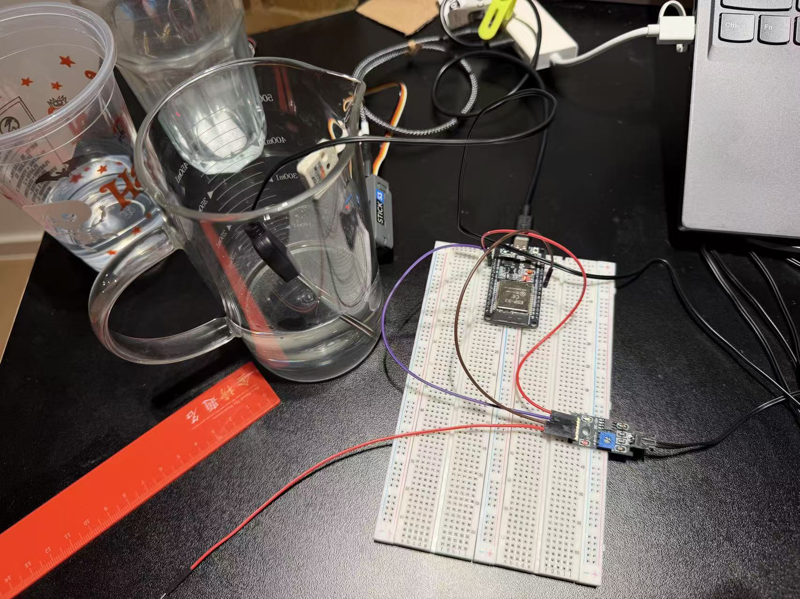
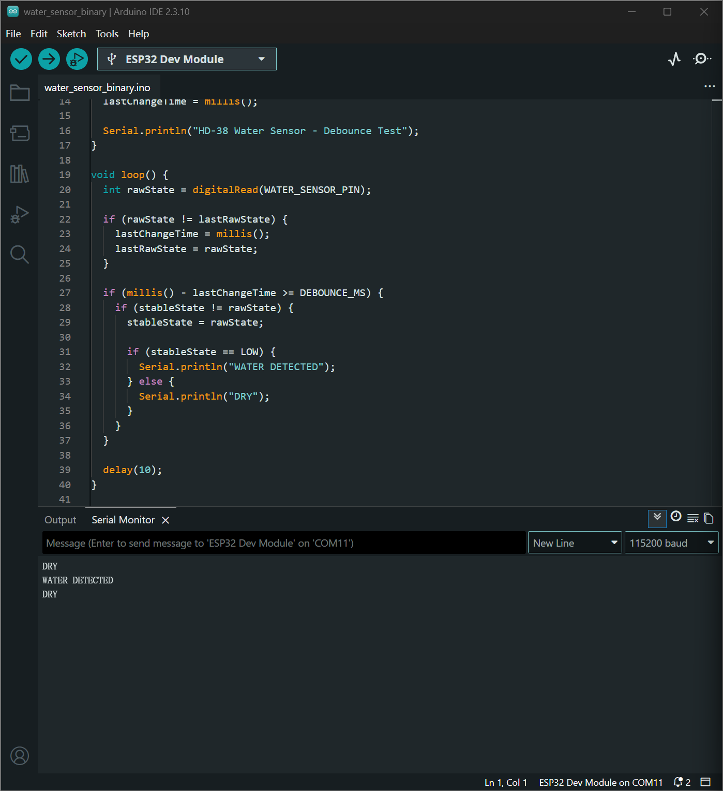
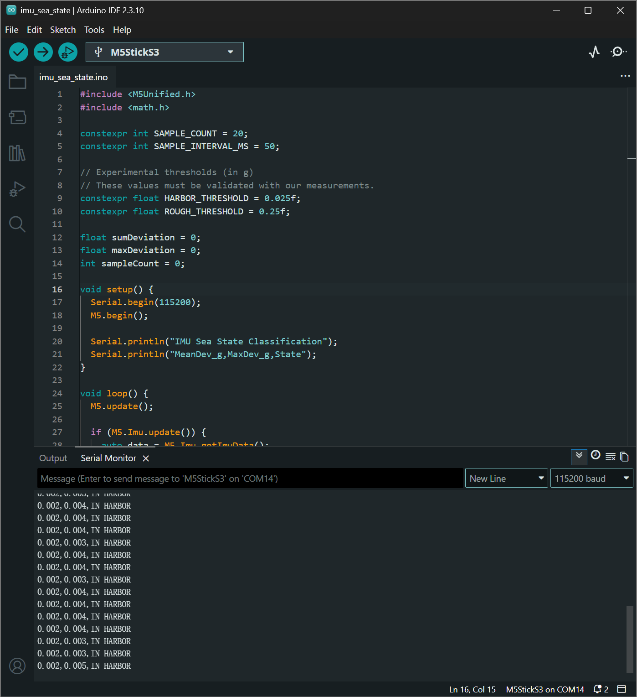
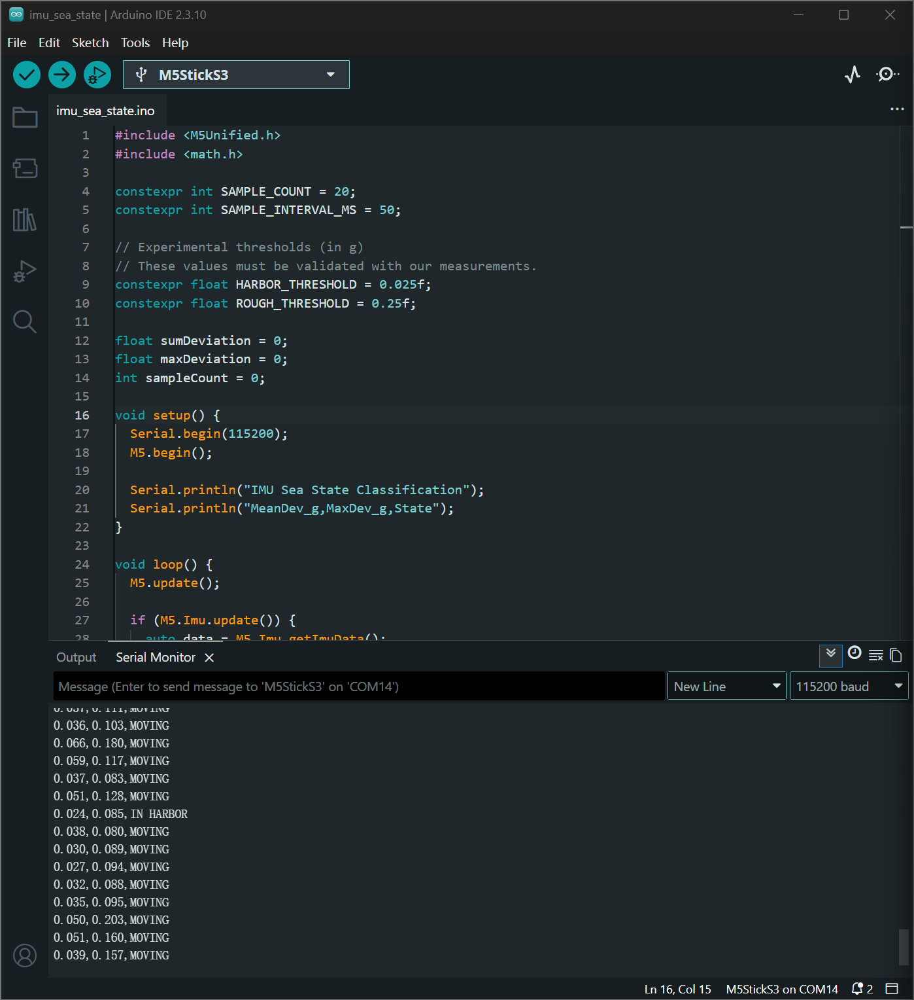
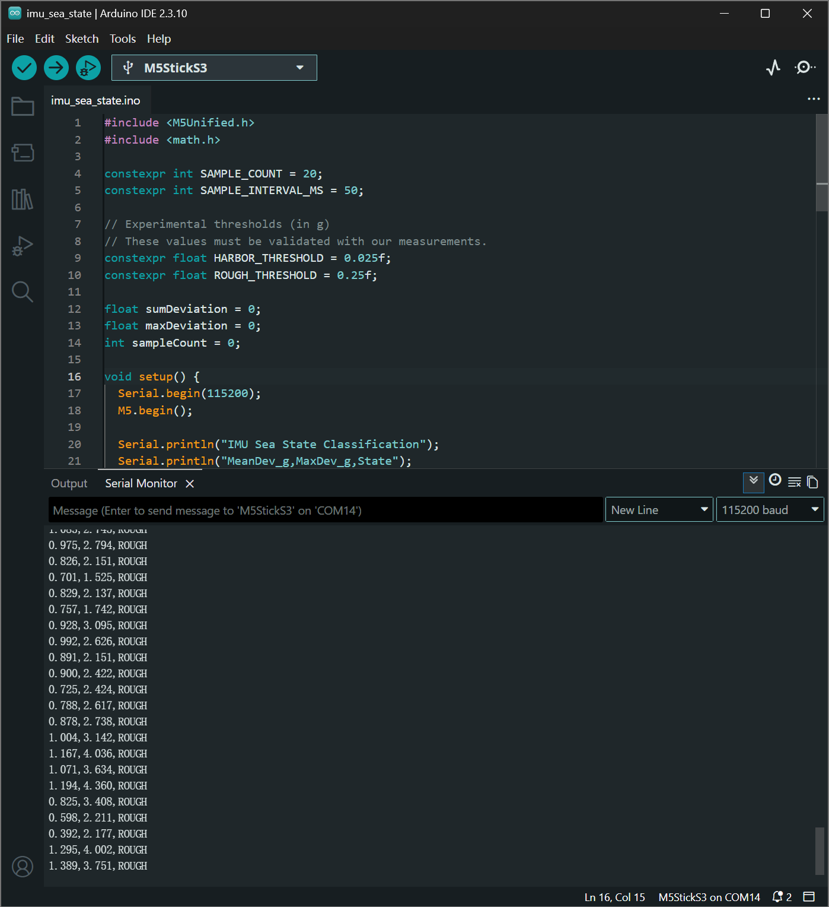

# Module 4 partner reference — Sections 4–6

Source: [LudwigMo's Module04 README](https://github.com/LudwigMo/sensorik-aktorik-portfolio/blob/a91cfa6491b854ff9ea7858242c6c1142b48ca65/Module04/README.md) at commit `a91cfa6491b854ff9ea7858242c6c1142b48ca65`. The source's [MIT license](LICENSE) accompanies this excerpt and its files.

The first-person wording below comes from LudwigMo's portfolio and describes the partner's experiments and recommendations. Mei Zhengyong's experiment records are linked from the [Module 4 index](../README.md).

Section 6 draws on the partner's [ultrasonic calibration](https://github.com/LudwigMo/sensorik-aktorik-portfolio/blob/a91cfa6491b854ff9ea7858242c6c1142b48ca65/Module04/README.md#2-volume-calibration-and-validation) and [foam and tilt tests](https://github.com/LudwigMo/sensorik-aktorik-portfolio/blob/a91cfa6491b854ff9ea7858242c6c1142b48ca65/Module04/README.md#3-foam-and-tilt-interference-tests) for its volume and motion claims. Section 5 records that the ultrasonic and IMU measurements were collected separately.

### Related Arduino sketches

- [HD-38 Binary Water Detection](code/water_sensor_binary.ino)
- [BMI270 IMU Measurement](code/imu_motion_test.ino)
- [IMU Sea-State Classification](code/imu_sea_state.ino)

### 4. Binary Water Detection

We used an HD-38 module with a two-prong conductive sensor to detect the presence of water.

**Binary Sensor Setup**



We connected the HD-38 conductive sensor to the ESP32 to test binary wet/dry detection.

We connected the sensor to the ESP32 using the following pins:

| HD-38 | ESP32 |
|---|---|
| VCC (+) | 3V3 |
| GND (-) | GND |
| DO | GPIO27 |
| AO | Not connected |

**Experimental Results**

| Test Condition | Digital Output | Observation |
|---|---|---|
| Dry probe | 1 | No water detected |
| Probe immersed in water | 0 | Water detected |
| Probe removed and dried | 1 | Returned to dry state |

We adjusted the potentiometer on the HD-38 module to set the detection threshold. Under our test conditions, the digital output changed when the probe was immersed approximately 0.3 cm into the water.

**Software Debounce**

We implemented a 300 ms software debounce to prevent short signal changes from immediately triggering a new state.

The Serial Monitor displayed the expected transitions:

```text
WATER DETECTED
DRY
```

**Binary Sensor Output**



We confirmed the dry-to-wet and wet-to-dry transitions using a 300 ms software debounce.

**Limitations**

The HD-38 detects electrical conductivity between its metal probes rather than measuring the exact liquid level.

We initially encountered a loose power connection, which caused invalid readings. After restoring the 3.3 V supply and adjusting the potentiometer, the sensor successfully distinguished between dry and wet conditions.

The switching threshold may change with water conductivity, probe contamination, and corrosion. Therefore, the HD-38 is suitable for our laboratory demonstration but would require additional validation before use in a real marine environment.


### 5. IMU Motion Detection and Sea-State Classification

We used the BMI270 IMU integrated into the M5StickS3 to simulate three boat-motion conditions: In Harbor, Moving, and Rough.

We measured acceleration along the X, Y, and Z axes and calculated the acceleration magnitude:

$$
a = \sqrt{a_x^2 + a_y^2 + a_z^2}
$$

where:
- $a_x$ is the acceleration along the X-axis.
- $a_y$ is the acceleration along the Y-axis.
- $a_z$ is the acceleration along the Z-axis.
- $a$ is the total acceleration magnitude.

We then calculated the absolute deviation from 1 g:

$$
D = |a - 1g|
$$

We used the mean deviation within a short measurement window to classify the motion state.

**Experimental Results**

| Motion Condition | Mean Deviation | Observation |
|---|---|---|
| In Harbor | Approximately 0.002 g | Stable acceleration |
| Moving | Approximately 0.027–0.066 g | Moderate fluctuations |
| Rough | Approximately 0.598–1.389 g | Large fluctuations and acceleration peaks |

**Automatic Sea-State Classification**

We developed a classification program using the following experimental thresholds:

| Mean Acceleration Deviation | Classification |
|---|---|
| Below 0.025 g | IN HARBOR |
| 0.025 g to below 0.25 g | MOVING |
| 0.25 g or higher | ROUGH |

We successfully identified stationary and rough-motion conditions. During the gentle-motion test, the system mainly reported MOVING, although one measurement window was classified as IN HARBOR because its mean deviation was approximately 0.024 g.

**Relevance to Liquid-Level Measurement**

Our earlier ultrasonic experiments showed that liquid movement and container tilt can affect distance measurements.

We can use IMU data to identify motion conditions in which liquid-level readings may become less reliable. However, we did not perform synchronized ultrasonic and IMU measurements, so this remains a proposed improvement.

**IMU Motion Classification**



We observed stable acceleration readings under stationary conditions.



We mainly detected MOVING during gentle motion, with one classification as IN HARBOR near the selected threshold.



We successfully classified the simulated rough-motion condition using the BMI270 IMU.

**Limitations**

The thresholds were selected for our laboratory demonstration and were not calibrated against real sea conditions.

Slow tilting may change individual acceleration components while the total acceleration magnitude remains close to 1 g. Therefore, additional gyroscope data and further testing would be necessary for more reliable motion detection.


### 6. Decision Sheet — Sensor Selection for Four Tanks

We evaluated suitable sensing principles for the four tanks on the Nordwind sailing yacht. We considered the liquid properties, required measurements, possible failures, and installation conditions.

| Tank | Decision | Mode | Principle (Primary / Failsafe) | Evidence | Failure + Installation Note |
|---|---|---|---|---|---|
| Diesel | Remaining fuel level and low-level warning | Hybrid: continuous + binary | Diesel-compatible continuous level sender / independent low-level float switch | Our ultrasonic and IMU experiments demonstrated the influence of motion on distance measurements. | Sloshing can cause unstable readings. We recommend fuel-compatible sensors, stable mounting, and filtering. |
| Fresh Water | Remaining water volume and low-level warning | Hybrid: continuous + binary | Ultrasonic level sensor / low-level float switch | Our volume calibration used seven reference points. One validation test showed a relative deviation of 2.36%. | Foam, movement, and unwanted reflections may affect readings. We recommend filtering and suitable mounting. |
| Waste Water | High-level alarm to prevent overflow | Threshold + high failsafe | Non-contact capacitive level switch / independent high-level float switch | Our HD-38 experiment demonstrated binary wet/dry detection and 300 ms software debounce. | Contamination and deposits may cause incorrect detection. We recommend verifying tank-wall compatibility and sensor reliability. |
| Bilge | Detect unwanted water accumulation | Staggered binary | Low-level water detector / independent high-level float switch | Our HD-38 sensor detected water contact at approximately 0.3 cm immersion depth. | Corrosion, salt deposits, and contamination may cause false readings. We recommend marine-rated sensors and independent alarm levels. |

#### Recommendation Summary

We recommend continuous measurement with an independent low-level alarm for the diesel and fresh-water tanks because the crew needs information about the remaining liquid volume.

For the waste-water tank, we prioritize reliable high-level detection to prevent overflow.

For the bilge, we recommend staggered binary sensing to detect unwanted water early and provide an independent emergency alarm.

Our laboratory experiments provide evidence for ultrasonic distance measurement, conductive water detection, and motion classification. The proposed fuel-compatible, capacitive, and float-switch solutions would require additional testing before installation on a real sailing yacht.
