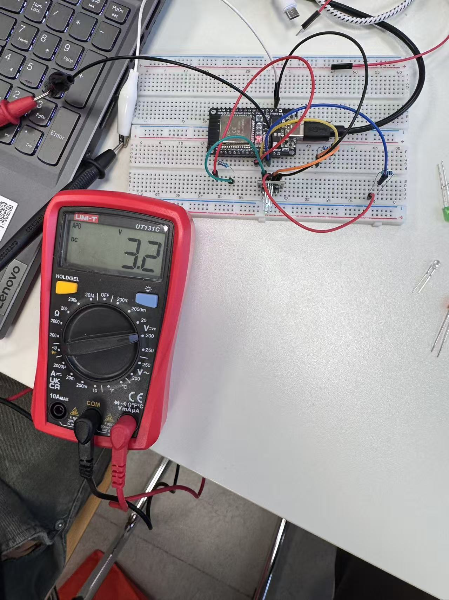
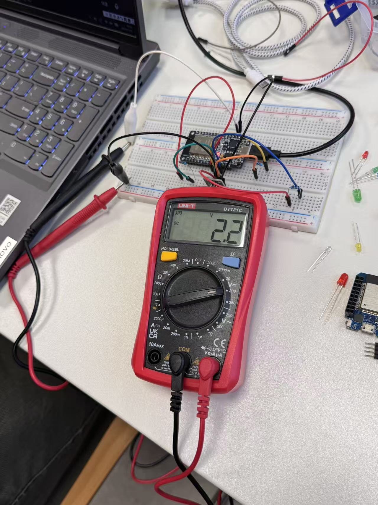
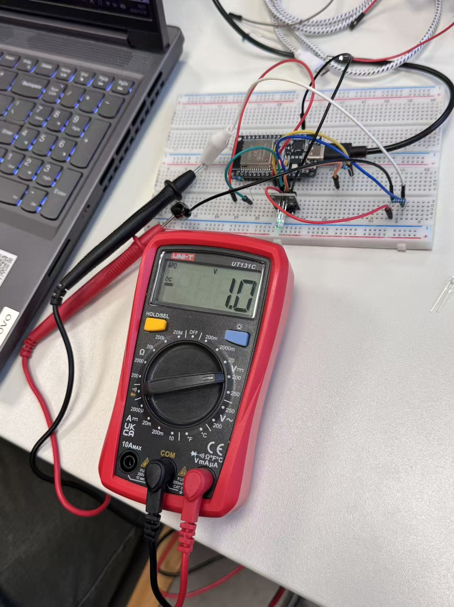
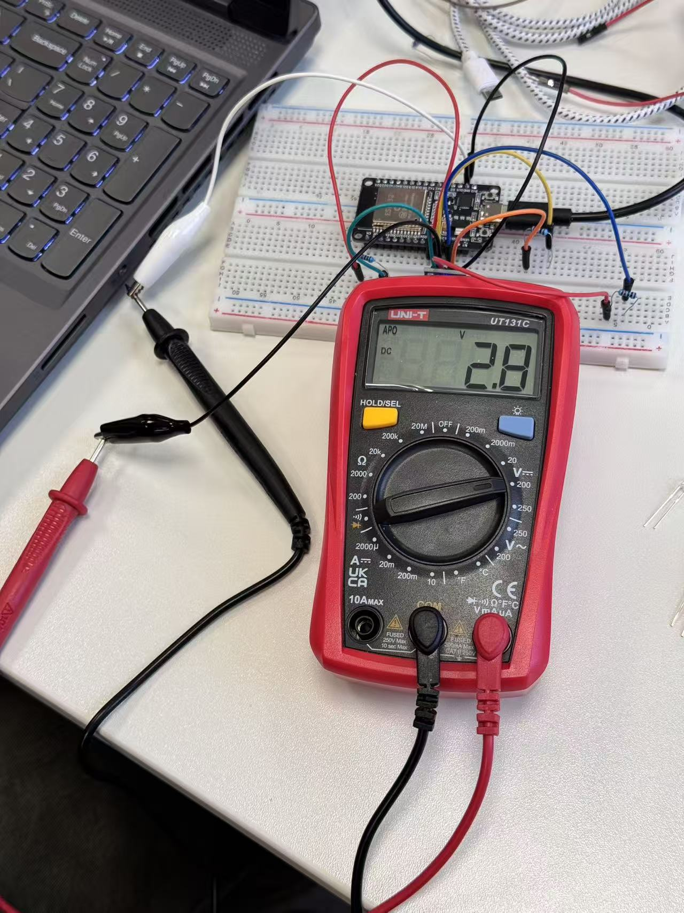
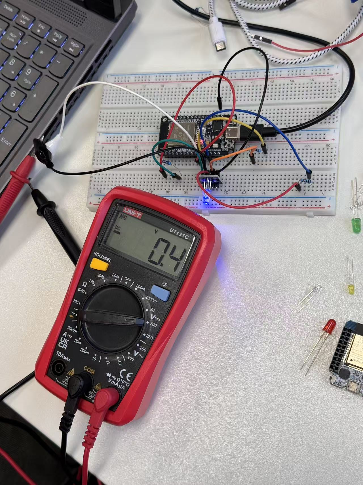
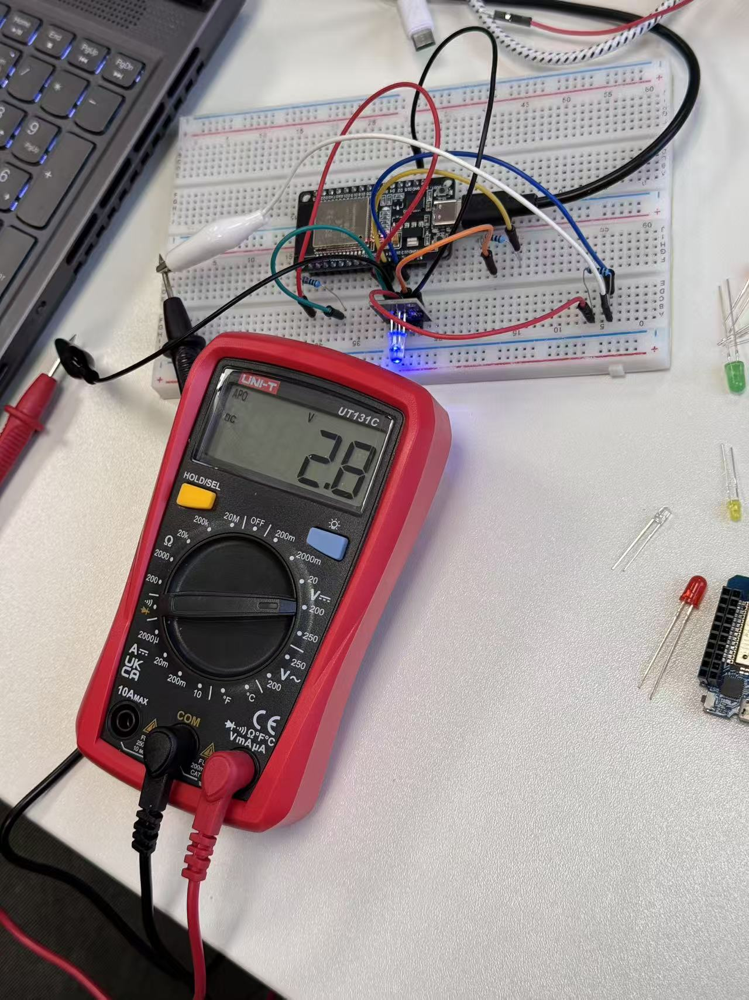
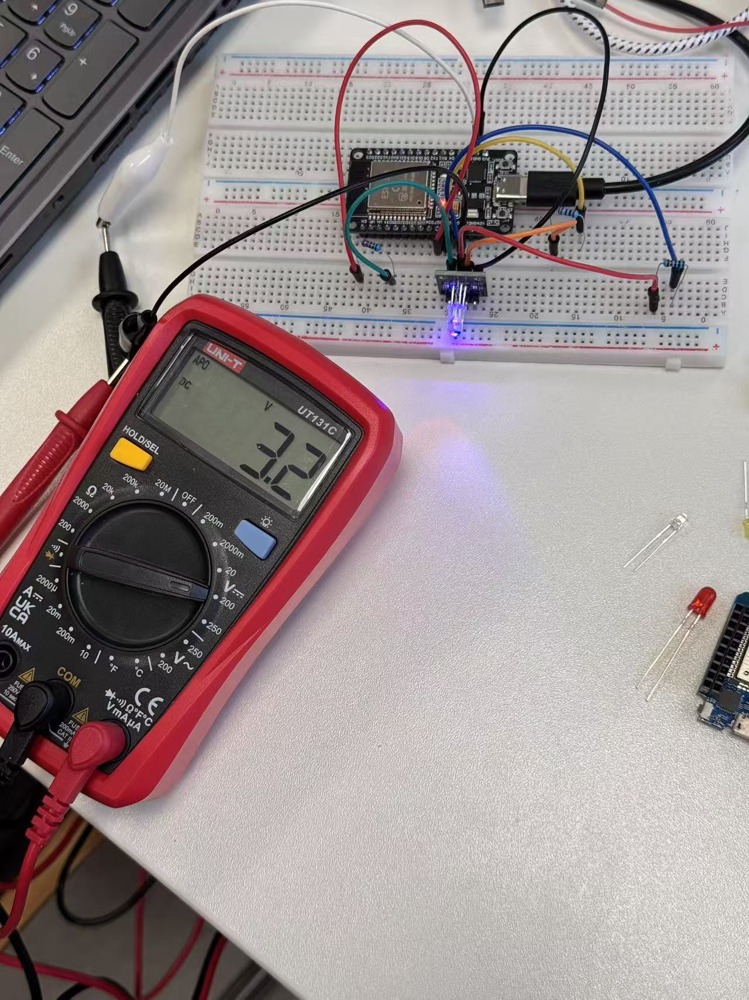
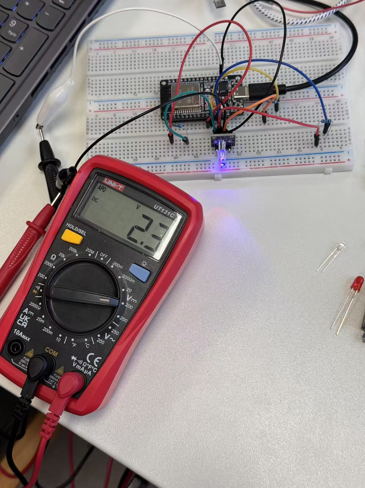
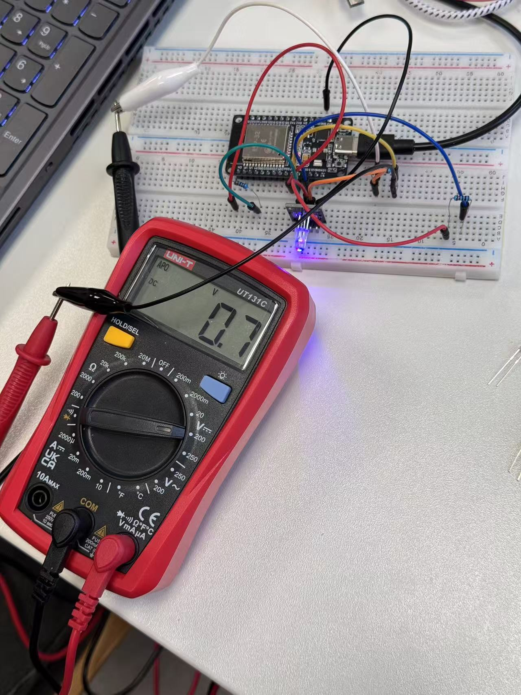

# Task 2 — RGB LED with a serial `R G B` REPL

A common-cathode RGB LED driven by three PWM channels, controlled by typing
three integers into the serial monitor.

## Wiring

| Channel | GPIO | Resistor | RGB LED pin |
|---|---|---|---|
| Red | **13** | 220 ohm | red leg |
| Green | **14** | 220 ohm | green leg |
| Blue | **27** | 220 ohm | blue leg |
| Common | — | — | **GND** (common cathode) |

**Pin deviation.** The course module specifies GPIO 16 / 17 / 18. This board
does not break out GPIO 16, so the channels are on GPIO 13 / 14 / 27. GPIO 13 is
also used by Task 1's single LED — unplug that LED before measuring this task.

For a common-anode part, wire the common pin to 3V3 instead of GND and set
`COMMON_ANODE = true` at the top of `src/main.cpp`; the duty cycle is then
inverted so that 255 still means full brightness.

## Commands

| Input | Effect |
|---|---|
| `255 0 0` | red only |
| `0 255 0` | green only |
| `0 0 255` | blue only |
| `255 255 255` | all channels fully on |
| `128 128 128` | mid-level grey |
| `off` | every channel off |
| `300 0 0` | rejected: value outside 0..255 |
| `255 0` | rejected: needs exactly three integers |
| `hello` | rejected: not numeric |

The firmware echoes the applied values (`applied R=… G=… B=…`) so the serial log
is its own evidence, and prints an error line for anything it rejects.

## Build, flash, monitor

```sh
cd Module05/task2-rgb
pio run -t upload
pio device monitor -b 115200
```

`platformio.ini` sets `monitor_speed = 115200` and `monitor_echo = yes` so typed
characters are echoed locally.

**Deliberate deviation:** the course prompt asks for
`monitor_filters = send_on_enter`, but that filter only transmits once its buffer
ends with CRLF, while a Windows / VS Code terminal sends a bare CR on Enter. The
result was a monitor that accepted typing and transmitted nothing. The filter is
therefore not enabled, and the firmware accepts CR, LF and CRLF as line endings
instead.

## Photographic measurements and branch-current calculation

Nine original multimeter photographs document three operator-identified colour
conditions: green, blue, and near-white. Within each group, the operator identifies
the photographs as GPIO high-level voltage, LED forward voltage `Uf`, and
series-resistor voltage `UR`, in that order. The readings below transcribe the
displayed values without adding decimal places. They are real photographic
observations, not simulated data or newly acquired serial measurements.

For the documented **nominal 220 ohm resistor in each branch**, Ohm's law gives:

```text
I [mA] = 1000 × UR [V] / 220 [ohm]
Voltage consistency check: delta = VGPIO - Uf - UR
```

The resistor value comes from the existing wiring record; these photographs do
not independently measure its resistance or tolerance. Calculated currents are
therefore estimates, not direct ammeter measurements.

| Colour condition | GPIO indication (V) | LED indication Uf (V) | Resistor indication UR (V) | I = UR / 220 ohm (mA) | delta (V) | Interpretation |
|---|---:|---:|---:|---:|---:|---|
| Green | 3.2 | 2.2 | 1.0 | approximately 4.5 | 0.0 | Readings are consistent at the displayed precision. |
| Blue, using the supplied photograph assignments | 2.8 | 0.4 | 2.8 | 12.7, conditional arithmetic only | -0.4 | Assignment/state inconsistent; **not a validated blue-channel current**. |
| Near-white, one measured branch | 3.2 | 2.3 | 0.7 | approximately 3.2 | +0.2 | Current estimate from the assigned resistor reading; voltage balance remains unresolved. |

### Green condition

The three indications satisfy `3.2 V = 2.2 V + 1.0 V` at the available display
precision. The resistor drop gives `I = 1.0 / 220 A`, approximately **4.5 mA**.
This is compatible with a current-limited green LED branch. Agreement of the
rounded readings is not a precision calibration of the meter or resistor.

| GPIO voltage: 3.2 V | LED forward drop: 2.2 V | Resistor drop: 1.0 V |
|---|---|---|
|  |  |  |

### Blue condition: measurement assignment requires confirmation

In the supplied order, the visible readings are **2.8 V, 0.4 V, and 2.8 V**.
They do not support a consistent same-state series-branch measurement:
`2.8 - 0.4 - 2.8 = -0.4 V`. In particular, the assigned 0.4 V LED drop requires
checking against the actual probe nodes. The calculation `2.8 / 220 A = 12.7 mA`
is shown solely to make the supplied assignment transparent; it must not be
reported as an established operating current.

If the **0.4 V** photograph actually measures the resistor, the corresponding
current would instead be `0.4 / 220 A`, approximately **1.8 mA**. This is an
alternative interpretation requiring operator confirmation, not a correction
made to the evidence. Neither the photographs nor their captions have been
silently reordered to force agreement.

| Photo 4: assigned GPIO voltage, 2.8 V | Photo 5: assigned LED drop, 0.4 V | Photo 6: assigned resistor drop, 2.8 V |
|---|---|---|
|  |  |  |

### Near-white condition

The assigned resistor drop gives `I = 0.7 / 220 A`, approximately **3.2 mA**
for the measured branch. The three indications leave a **0.2 V** difference:
`3.2 - 2.3 - 0.7 = 0.2 V`. Sequential measurements, changed operating conditions,
probe placement, and meter behaviour under PWM are possible explanations, not
verified causes. These readings do not establish a closed voltage balance.

Near-white is the operator's visual description; no chromaticity measurement
was supplied. The colour branch used for this measurement is not identified,
so the 3.2 mA estimate cannot be assigned to all three channels or multiplied by
three to obtain total RGB current.

| GPIO voltage: 3.2 V | LED drop: 2.3 V | Resistor drop: 0.7 V |
|---|---|---|
|  |  |  |

## Interpretation and remaining measurements

Different LED forward voltages leave different voltages across equal series
resistors, so equal PWM commands do not guarantee equal currents or equal
perceived brightness. Brightness also depends on optical efficiency and visual
sensitivity; forward voltage alone does not explain every brightness difference.

The photographs show DC voltage indications with 0.1 V display increments.
The exact serial commands and PWM duty during each photograph were not supplied.
A DC meter indication under PWM must not automatically be interpreted as the
instantaneous high-level voltage or the LED's on-state forward drop. If the
meter adequately measures mean resistor voltage, `UR / R` estimates **mean**
branch current; a full-duty DC test is needed to establish the on-state value
without that ambiguity. No meter accuracy specification or uncertainty is
inferred from the photographs.

**Evidence status:** nine unmodified original photographs are archived; the
green current estimate is supported by consistent displayed voltages. Blue
measurement-node assignments need confirmation. The near-white estimate remains
limited to one unidentified branch, with an unresolved voltage-balance difference.
A separate red-only current measurement and a confirmed full-duty per-channel
comparison remain pending. The existing firmware and previous hardware record
are preserved; no new flashing or serial acquisition was performed for this update.
