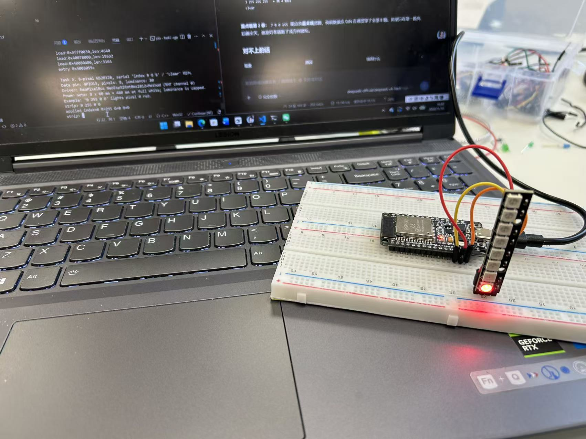
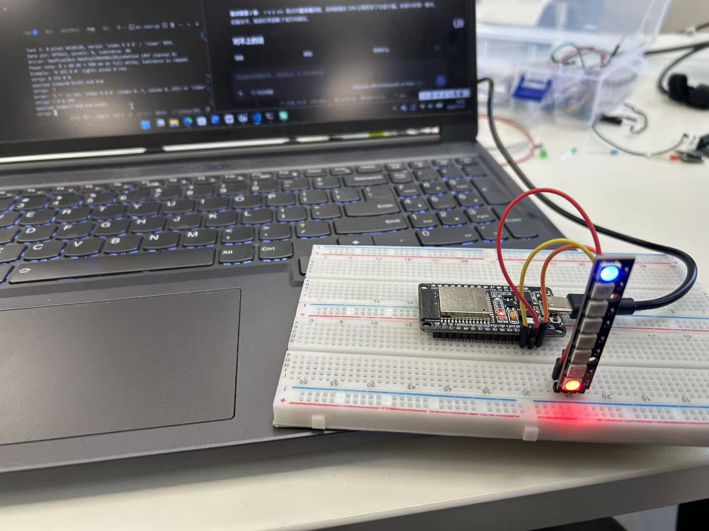
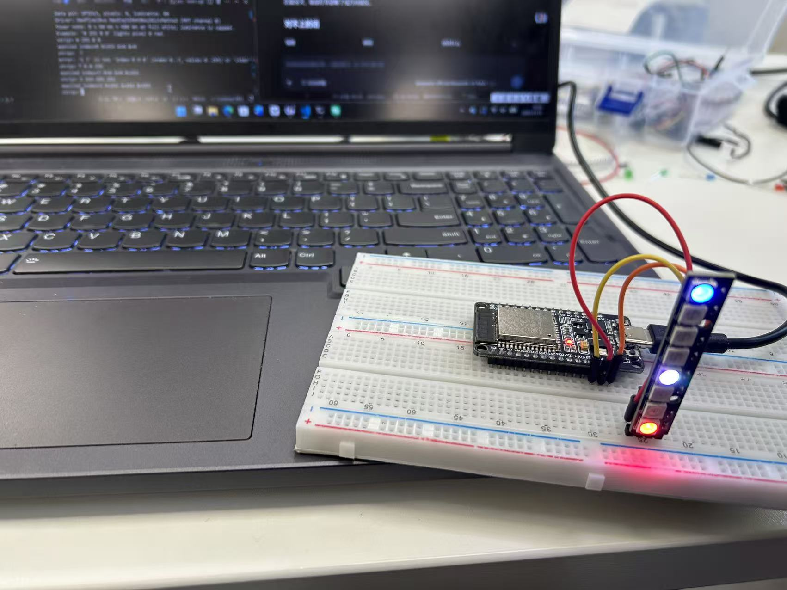
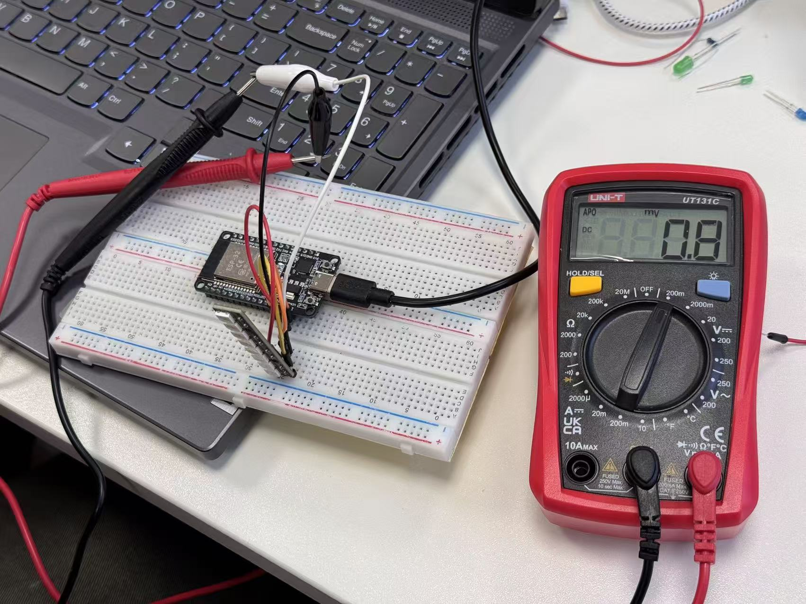
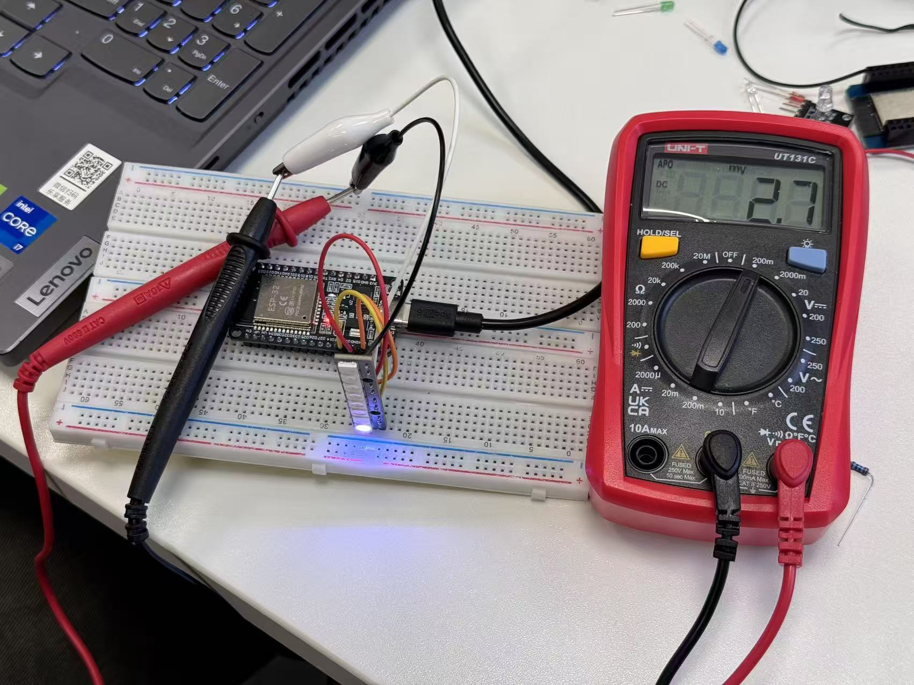
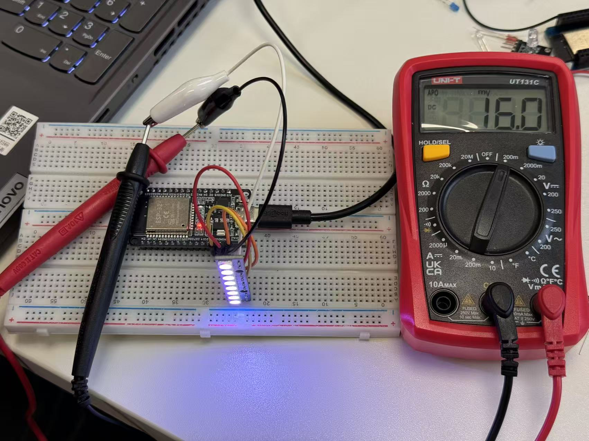

# Task 3 — Individually Addressable WS2812B LED Strip

## Objective

Control an eight-pixel RGB strip from an ESP32, demonstrate independent pixel
selection, and compare the visible output with all pixels off, one pixel lit,
and all eight lit. Unlike Task 2's discrete RGB LED with three PWM outputs, this
strip uses a single serial data connection to select multiple RGB pixels.

## Equipment and implementation record

- ESP32 development board connected to the computer by USB.
- Eight-pixel strip identified as WS2812B in the photographed program banner.
- Breadboard and jumper wires.
- Windows computer with a PlatformIO serial-monitor session visible in the photographs.
- UNI-T UT131C multimeter in the three electrical-observation photographs.

The readable banner in photograph 1 identifies **GPIO13**, **8 pixels**, the
**NeoPixelBus** library with an **ESP32 RMT hardware method**, and a configured
**luminance value of 96**. These details are transcribed from the photographed
running program, and differs from the subsequently archived source setting of 80. A terminal value
of 96 is a software setting, not a measured optical brightness or supply current.

The library supports individually addressable LEDs. Its API separates setting a
pixel in a buffer from transmitting the updated buffer with `Show()`; see the
[official library](https://github.com/Makuna/NeoPixelBus) and
[source API](https://github.com/Makuna/NeoPixelBus/blob/master/src/NeoPixelBus.h).
The archived [source](src/main.cpp) uses
`NeoPixelBusLg<NeoGrbFeature, NeoEsp32Rmt0Ws2812xMethod, NeoGammaNullMethod>`,
GPIO13, eight pixels, and luminance **80**. It accepts `index R G B`,
`all R G B`, and `clear`, validates index and channel ranges, and calls `Show()`
after changes. This source was added in a concurrent repository update. It is not
claimed to be identical to the photographed binary, whose banner shows 96.
The [project README](README.md) documents commands, wiring, and a theoretical
power budget; the [PlatformIO configuration](platformio.ini) records dependencies.

## Circuit and addressing

| Connection | Available evidence |
|---|---|
| ESP32 GPIO13 to strip data input | GPIO13 is stated in the photographed program banner; the strip is visibly wired to the board. |
| Strip power and common ground | The archived wiring record specifies strip VDC to board 5V and strip GND to board GND, with DOUT unused. Supply voltage was not independently measured in these photographs. |
| Pixel count | Eight physical LED packages are visible, matching the program banner. |

The strip stands vertically in photographs 1–3. To describe its arrangement
unambiguously, this report numbers **physical positions from bottom to top,
0 through 7**. This is a photographic position convention; the correspondence
with every firmware index has not been independently checked from source.

## Experimental procedure and evidence source

The six original photographs supplied by the experimenter are the hardware
evidence for this report. Photographs 1–3 show successive independently selected
colour patterns. Photographs 4–6 show an off state, a single illuminated pixel,
and an eight-pixel illuminated state alongside the multimeter.

This update archives and interprets the existing experiment. It does not claim
a new upload, serial capture, or repeat measurement. Original JPEGs are preserved
without cropping, retouching, or alteration of the terminal or meter display.

## Results — independent pixel selection

In the table, `R` denotes visibly red, `B` blue/cyan in the photograph, `W`
white-appearing, and `–` off. Positions run **bottom to top**. Colour names
describe the photographs, not a calibrated colour measurement.

| Photograph | Physical positions 0 → 7 | Illuminated pixels | Observation |
|---|---|---:|---|
| 1 | R, –, –, –, –, –, –, – | 1 | Only the bottom pixel is visibly red. |
| 2 | R, –, –, –, –, –, –, B | 2 | The bottom stays red while the top is blue/cyan. |
| 3 | R, –, W, –, –, –, –, B | 3 | A white-appearing pixel at the third position from the bottom is added; both end colours remain visible. |

### Photograph 1 — bottom red pixel

The terminal and physical output appear together. This is evidence that a strip
program ran and produced a selected-pixel output. The photograph is not a
substitute for the original text log or a compiler/upload verification record.

### Photograph 2 — red and blue at opposite ends

Two separated pixels display different colours simultaneously. This supports
independent pixel selection rather than a single shared RGB value for the strip.

### Photograph 3 — additional white-appearing pixel

The added white-appearing pixel demonstrates another distinct position while
the two end colours remain visible. The actual RGB command and channel values
are not assigned from camera colour alone.

## Results — off, one pixel, and all eight pixels

| Photograph | Visible strip state | Multimeter indication | What can be concluded |
|---|---|---|---|
| 4 | All eight appear off | **0.8 mV DC** | An off-state voltage indication is recorded. |
| 5 | One end pixel appears white/violet; seven appear off | **2.7 mV DC** | A higher voltage indication accompanies one illuminated pixel. |
| 6 | All eight appear white/violet | **16.0 mV DC** | The largest recorded voltage indication accompanies eight illuminated pixels. |

### Photograph 4 — all pixels off

### Photograph 5 — one illuminated end pixel

### Photograph 6 — all eight illuminated

The voltage indications increase across these three photographed states.
They are **not mA readings**: the display explicitly shows **mV**, and the leads
are in the voltage and common sockets. The measurement nodes and a current-sense
resistor value are not documented. Consequently, no numerical strip current or
power is inferred. If these were confirmed voltage drops across a known series
shunt, current could be calculated as `I = Ushunt / Rshunt`; that condition has
not been established here. The off-state indication must not be assumed to be
pure instrument offset or subtracted as a calibrated baseline.

## Discussion

The three colour patterns demonstrate the principal advantage of an addressable
strip: several LED packages can retain different colours using one data signal.
Task 2 instead controls the red, green, and blue branches of a single LED with
three GPIO outputs. The strip's integrated pixel controllers perform the local
colour-channel driving after receiving serial data.

Lighting more pixels and more colour channels generally increases electrical
load. The photographed meter trend is qualitatively compatible with this, but
it does not quantify the current without a defined measurement circuit. Equal
software commands also do not establish equal optical brightness: LED properties,
brightness settings, supply conditions, camera exposure, and white balance affect
appearance. The blue/cyan and white/violet camera colours are therefore reported
as appearances rather than precise colour coordinates.

## Limitations and completion status

| Item | Status |
|---|---|
| Physical eight-pixel output | **Hardware demonstrated** by the supplied photographs. |
| Independent positions and simultaneous different colours | **Hardware demonstrated** by photographs 1–3. |
| Off / single-pixel / eight-pixel states | **Hardware demonstrated** by photographs 4–6. |
| Original photographic evidence | **Archived**, six unmodified JPEGs. |
| Firmware source and PlatformIO configuration | **Archived** in [src/main.cpp](src/main.cpp) and [platformio.ini](platformio.ini); source luminance 80 differs from photographed luminance 96. |
| Raw terminal transcript | Not supplied for these six photographs; terminal text remains within the original images. |
| Independent build/upload verification | **Not performed in this report update**; original logs were not supplied. |
| Power wiring and electrical measurements | Wiring is documented in the project README; actual supply voltage, current, and power are **not verified** by these photos. |
| Calibrated brightness, exact colour, and timing waveform | **Not measured**. |

## Conclusion

The existing photographs provide real evidence of selected-pixel control and
multiple simultaneous colours on an eight-pixel strip. They also document
off, single-pixel, and all-pixel states, with meter indications of 0.8, 2.7,
and 16.0 **mV**, respectively. The visual demonstration is supported; quantitative
current and power conclusions remain outside the available measurement evidence.

## Reproducibility and references

- [Module 5 overview](../README.md)
- [Task 2: discrete RGB LED and branch-current measurements](../task2-rgb/README.md)
- [Original Task 3 photographs](images/)
- [NeoPixelBus official repository](https://github.com/Makuna/NeoPixelBus)
- [NeoPixelBus source API](https://github.com/Makuna/NeoPixelBus/blob/master/src/NeoPixelBus.h)

All six images retain their supplied filenames. The current source and configuration are linked above. The exact photographed
command sequence and the earlier luminance-96 binary are not reconstructed or
presented as new logs. No hardware run was repeated for this report update.
