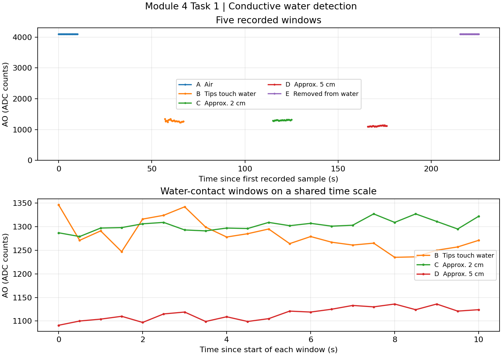

# Module 4 Task 1 — Conductive Water Level Detection

## Setup and procedure

The two metal probes were connected to the LM393 module. The ESP32 DevKit supplied 3.3 V and shared ground with the module. AO went to GPIO34 and DO to GPIO18. The [Arduino sketch](Module4_Task1_WaterLevel.ino) used 12-bit ADC readings, 500 ms sampling, and a 115200 baud serial connection on COM3.

After the operator confirmed each position, 21 samples were recorded over a 10.0 s first-to-last interval. The same probe pair was used for all five conditions. The immersion depths are approximate. In E the probes were fully out of the water and left unwiped. Gaps between windows correspond to periods without recorded samples, so the plot cannot establish the timing of the actual transitions.

## Results

| Test | Probe position | Samples | AO mean | AO min | AO max | DO=0 | DO=1 | DO changes within window |
|---|---|---:|---:|---:|---:|---:|---:|---:|
| [A](data/test-A-air.csv) | In air before immersion | 21 | 4095.00 | 4095 | 4095 | 0 | 21 | 0 |
| [B](data/test-B-water-contact.csv) | Both tips just touching water | 21 | 1279.95 | 1235 | 1346 | 21 | 0 | 0 |
| [C](data/test-C-depth-2cm.csv) | Approximately 2 cm immersed | 21 | 1303.14 | 1279 | 1327 | 21 | 0 | 0 |
| [D](data/test-D-depth-5cm.csv) | Approximately 5 cm immersed | 21 | 1115.10 | 1091 | 1136 | 21 | 0 | 0 |
| [E](data/test-E-removed-from-water.csv) | Fully removed from water | 21 | 4095.00 | 4095 | 4095 | 0 | 21 | 0 |

The sketch's serial `state` field remained `UNCALIBRATED` throughout this run. The known physical conditions establish the observed DO mapping for this setup and threshold: `1` with the probes in air and `0` when both probes contacted the water. This mapping was inferred from the recorded tests without entering calibration commands.

## Interpretation

- **Air versus water.** The air windows returned 4095 on every sample, the ADC's upper limit. All water-contact windows were below 1347. DO separated the tested air and water-contact conditions without a switch inside any recorded window. E matched A from the start of the recorded window. ADC saturation leaves any analog differences between the two air conditions unresolved.
- **Immersion depth.** The AO mean rose by 23.19 counts from B to C and their ranges overlapped. The mean fell by 188.05 counts from C to D and their ranges did not overlap. The readings differed across depth conditions in this run, and the three wet means did not follow a monotonic sequence. A single window per condition does not isolate the effect of depth or establish repeatability. Water conductivity and probe geometry can also affect the response. AO is reported in raw counts without a calibrated voltage conversion.
- **Use case.** The observed separation supports a point-level water alarm at the probe position for this tested setup. Reliable continuous liquid-level measurement would require a repeatable, calibrated depth response over the intended range and water conditions. These five windows do not establish that response.
