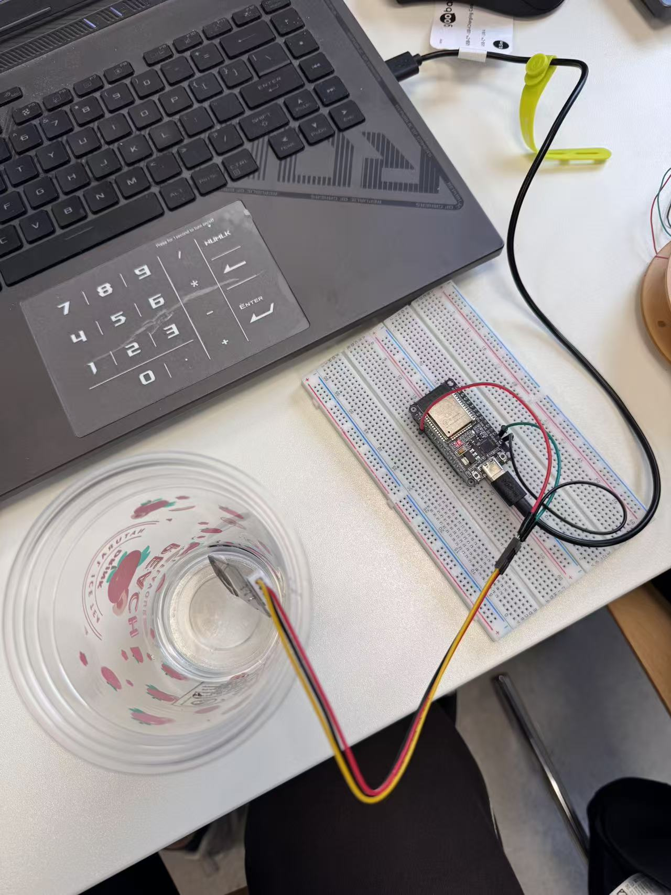
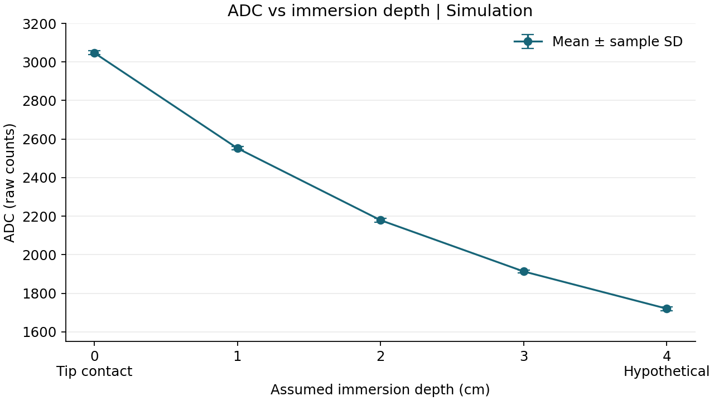
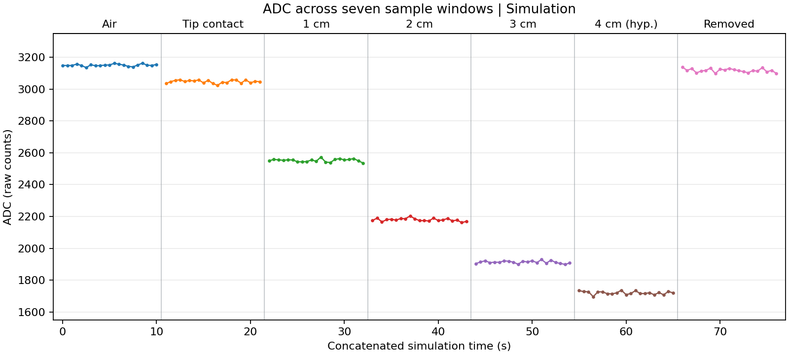

# Module 4 – Experiment 2: Capacitive Liquid Level Measurement

## 1. Objective

Evaluate how the analog output of a capacitive probe can be used to distinguish liquid levels. Examine the direction and sensitivity of the depth response, short-term variation, and the requirements for a usable calibration.

## 2. Equipment

- ESP32 development board
- Capacitive Soil Moisture Sensor V1.2
- Breadboard and jumper wires
- Transparent plastic cup and water

## 3. Circuit Connection

| Sensor terminal | ESP32 connection |
|---|---|
| VCC | 3V3 |
| GND | GND |
| AOUT | GPIO34 |

The [Arduino sketch](Module4_Task2_Capacitive.ino) configures GPIO34 as an input and reads the 12-bit ADC every 500 ms. The serial output contains the elapsed device time in milliseconds and the raw ADC count at 115200 baud. Counts are used directly because the input voltage was not independently calibrated. [Arduino-ESP32 ADC documentation](https://docs.espressif.com/projects/arduino-esp32/en/latest/api/adc.html)

*Figure 1. The physical bench setup used for the hardware check.*

## 4. Experimental Procedure

1. Connect the sensor and upload the sketch. Confirm the serial stream and sampling interval in air.
2. For a depth sweep, hold the cup and probe in a fixed orientation. Use air and tip contact as baseline conditions, followed by 1 cm, 2 cm, 3 cm, and a higher depth within the probe's rated immersion range. Keep the electronics and connector above the water. A return-to-air condition completes the sequence.
3. Once each condition is stable, log a 10 s window. Compute the arithmetic mean, minimum, maximum, and sample standard deviation. Compare the depth windows and the two air conditions.

**Data source.** The table and figures in Section 5 use the existing [synthetic CSV](simulation/synthetic-capacitive-water-level.csv). It contains 147 modeled ADC values across seven windows, each with 21 samples spaced 500 ms apart and 10 s from first to last. The model assigns a decreasing response with depth, adds random variation, and includes a hypothetical 4 cm level. These values were generated separately from the bench records and provide a dataset for demonstrating the analysis. The hypothetical depth does not establish an immersion rating for this board.

**Initial bench check.** The sketch was compiled and uploaded, and COM3 returned serial samples at 500 ms intervals. The [air retest](data/test-A-air-retest-20261111-171317-334.csv) and the [approximately 1 cm diagnostic](data/diagnostic-water-1cm-20261111-171908-796-deduplicated.csv) each contained 21 distinct samples. Every ADC value in both windows was 0. Duplicate lines in the original capture were counted once per device timestamp in the diagnostic summary. That diagnostic run stopped at this point. A separate set of depth readings supplied by the operator is analyzed below.

## 5. Results and Data Analysis

| Condition | n | Mean ADC | Minimum | Maximum | Sample SD |
|---|---:|---:|---:|---:|---:|
| Air | 21 | 3150.48 | 3135 | 3163 | 6.50 |
| Initial water contact | 21 | 3047.38 | 3024 | 3059 | 9.76 |
| 1 cm immersion | 21 | 2552.43 | 2536 | 2573 | 9.08 |
| 2 cm immersion | 21 | 2179.24 | 2162 | 2203 | 9.49 |
| 3 cm immersion | 21 | 1913.24 | 1899 | 1930 | 8.26 |
| Hypothetical 4 cm immersion | 21 | 1720.14 | 1696 | 1737 | 10.15 |
| Removed from water | 21 | 3117.48 | 3098 | 3138 | 11.51 |

The mean decreases monotonically from tip contact through 4 cm. The decrease per 1 cm step becomes smaller, falling from about 495 counts between contact and 1 cm to 193 counts between 3 and 4 cm. This indicates a declining sensitivity in the modeled response. The adjacent depth windows have nonoverlapping ranges in this dataset.

The time plot places the seven independent windows on a common display axis. Within-window times come from the CSV, and spacing between windows is for display. The return-to-air mean is 33 counts below the initial air mean. Since the model assigns different baseline values to those conditions, the difference cannot establish a physical residual film, drift, or hysteresis.

### Two-point calibration and held-out depth check

The operator supplied 21 integer ADC readings at each reported depth of 1, 2, and 3 cm. The [operator-supplied CSV](data/operator-supplied-depth-calibration.csv) preserves all 63 values in the order supplied. The lists came without timestamps or a serial export, so their timing and acquisition order cannot be verified. The statistics below are recalculated from those readings.

| Reported depth (cm) | Role | n | Mean ADC | Minimum | Maximum | Sample SD |
|---:|---|---:|---:|---:|---:|---:|
| 1 | Calibration endpoint | 21 | 2549.71 | 2532 | 2569 | 7.72 |
| 2 | Held-out validation | 21 | 2185.29 | 2166 | 2207 | 10.39 |
| 3 | Calibration endpoint | 21 | 1909.95 | 1895 | 1926 | 7.93 |

Fitting only the 1 cm and 3 cm means gives `ADC = 2869.59524 − 319.88095 × depth_cm`. Inverting the line at the held-out 2 cm mean gives **2.139 cm**, a signed error of **+0.139 cm** relative to the reported reference depth. The depth check verifies the calibration against this one operator-supplied level. The measured error does not establish an accuracy specification across the full range.

### Supplementary timestamped data

The [timestamped CSV supplied by the operator](data/operator-supplied-depth-timestamped.csv) contains 21 readings per depth. Its timestamps are 200 ms apart within each group, with a 4.0 s span from first to last. The archived sketch samples every 500 ms. The ADC values also differ from the untimestamped list at 52 of 63 corresponding row positions. The timestamp source and the relationship between the two submissions have not been confirmed, so the datasets are analyzed separately.

| Reported depth (cm) | n | Mean ADC | Minimum | Maximum | Sample SD |
|---:|---:|---:|---:|---:|---:|
| 1 | 21 | 2550.90 | 2532 | 2569 | 7.50 |
| 2 | 21 | 2187.43 | 2166 | 2207 | 10.63 |
| 3 | 21 | 1910.67 | 1895 | 1926 | 7.82 |

Fitting the timestamped 1 and 3 cm means gives `ADC = 2871.02381 − 320.11905 × depth_cm`. The held-out 2 cm mean gives **2.135 cm**, a signed error of **+0.135 cm**. This supplementary calculation does not resolve the timing discrepancy or establish repeatability between independent runs.

## 6. Discussion

A capacitive probe creates an electric field around its electrodes. Water changes the effective permittivity within that field as more of the probe is wetted, changing the capacitance sensed by the circuit. The module converts its electrical response to an analog output, which the ESP32 digitizes. The output polarity and sensitivity depend on the electronics and geometry. The probe's response in a cup may also depend on water composition, probe position, nearby surfaces, and the presence of residual moisture. [DFRobot capacitive sensing reference](https://wiki.dfrobot.com/sen0193/docs/18035) · [Texas Instruments capacitive liquid-level sensing reference](https://www.ti.com/lit/ds/symlink/fdc1004.pdf)

Sample standard deviations range from 6.50 to 11.51 ADC counts in the simulated windows and from 7.72 to 10.39 counts in the operator-supplied depth groups. They describe within-group spread. A 12-bit output code does not establish voltage accuracy, depth accuracy, or minimum resolvable depth. The held-out depth error illustrates the limit of a single linear fit. Further reference levels and repeated rising and falling sweeps would help assess accuracy and repeatability under controlled cup geometry, probe placement, and water conditions.

## 7. Conclusion

The operator-supplied mean ADC values decreased from 1 to 3 cm. The two-point calibration was checked at one held-out depth, with an error of +0.139 cm at the reported 2 cm level. This supports a preliminary interpolation over the tested interval. Repeatability across runs, a wider operating range, and continuous liquid-level accuracy remain to be established.
