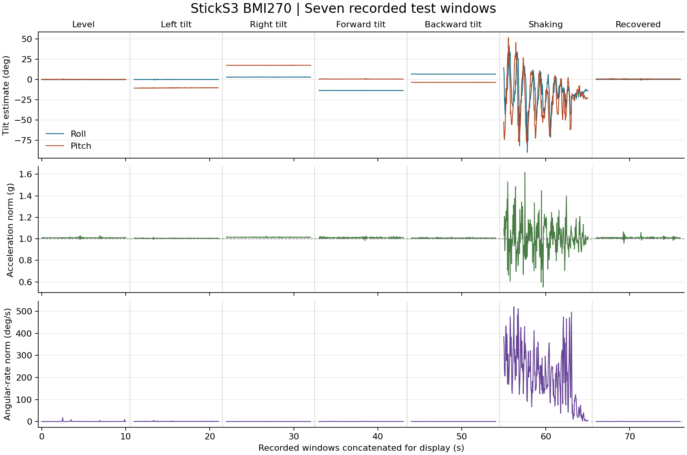
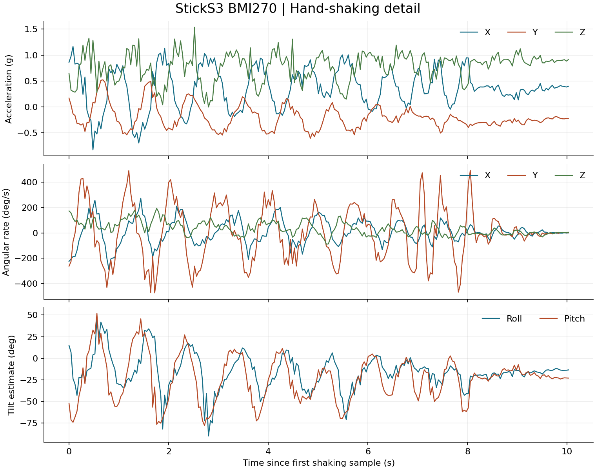

# Module 4 Task 3 — Six-Axis Attitude Measurement

## Objective

Measure three-axis acceleration and three-axis angular rate with the M5Stack StickS3 and its BMI270. Compare gravity-based roll and pitch estimates across static orientations, hand shaking, and a return to the level position.

## Equipment and method

The StickS3 was connected to a Windows computer over native USB. The [Arduino sketch](Module4_Task3_IMU.ino) uses the M5Unified BMI270 driver and displays acceleration, angular rate, roll, and pitch on the onboard display. The computer received CSV frames over COM6 at the configured 115200 baud. Each test window was started after the operator confirmed the pose or readiness to shake. Acceleration is reported in g, angular rate in degrees per second, and time in milliseconds since device boot. The onboard sensor and board configuration are described in the [M5Stack hardware documentation](https://docs.m5stack.com/en/core/StickS3) and [official IMU example](https://github.com/m5stack/M5Unified/tree/master/examples/Basic/Imu).

The estimates use `roll = atan2(ay, az)` and `pitch = atan2(−ax, hypot(ay, az))`, converted to degrees. The reference orientation has static acceleration along the device's positive Z axis. The logged gyro channels measure rotation rate independently of the angle calculation. The angle calculations use only the accelerometer and become sensitive to linear acceleration during movement. Near a pitch of ±90°, roll also becomes ill-conditioned as both of its inputs approach zero.

For the static trials the screen faced upward and the USB end faced the operator. For left and right tilt, the corresponding side was kept lower. For forward tilt the USB end was raised, and for backward tilt it was lowered. No reference inclinometer was used. The angle readings therefore describe the reported poses without establishing absolute accuracy.

## Results

The seven windows contain **1,749 frames**. Each window spans about 10 s from the first recorded frame to the last, and every within-window timestamp interval is 40 or 41 ms. The values after `±` are sample standard deviations. Angular-rate RMS is calculated from the three-axis vector magnitude.

| Test | Frames | Span (s) | Roll (°) | Pitch (°) | Acceleration norm range (g) | Angular-rate RMS (°/s) |
|---|---:|---:|---:|---:|---:|---:|
| [A · Level](data/test-A-level-stationary.csv) | 249 | 10.014 | −0.093 ± 0.082 | +0.271 ± 0.095 | 0.994–1.030 | 1.702 |
| [B · Left tilt](data/test-B-left-tilt.csv) | 250 | 10.030 | +0.072 ± 0.098 | −10.330 ± 0.200 | 0.992–1.013 | 0.836 |
| [C · Right tilt](data/test-C-right-tilt.csv) | 250 | 10.009 | +3.014 ± 0.061 | +17.639 ± 0.060 | 1.010–1.024 | 0.381 |
| [D · Forward tilt](data/test-D-forward-tilt.csv) | 250 | 10.025 | −13.523 ± 0.062 | +0.654 ± 0.097 | 0.984–1.025 | 0.406 |
| [E · Backward tilt](data/test-E-backward-tilt.csv) | 250 | 10.019 | +6.755 ± 0.059 | −3.494 ± 0.053 | 1.001–1.016 | 0.342 |
| [F · Shaking](data/test-F-slow-shaking.csv) | 251 | 10.028 | −15.975 ± 20.190 | −23.592 ± 26.005 | 0.553–1.619 | 239.157 |
| [G · Recovered](data/test-G-recovered-stationary.csv) | 249 | 10.007 | +0.143 ± 0.149 | +0.710 ± 0.153 | 0.960–1.065 | 0.390 |

*The overview concatenates the seven windows for display. Within-window timing comes from the device timestamps. The gaps do not represent the time needed to move between poses.*

## Discussion

**Static tilt.** In the chosen physical orientation, left and right tilt mainly changed pitch, and forward and backward tilt mainly changed roll. The dominant angle changed sign when the tilt was reversed. The opposite tilts were set by hand, so their unequal magnitudes and secondary-axis offsets do not establish an axis-specific accuracy error. The first level window had a brief Z-axis angular-rate peak of 17.76°/s. Its cause was not identified, and the sample remains in the recorded data.

**Dynamic response.** During shaking, 107 of 251 frames had an acceleration norm outside the descriptive 0.9–1.1 g band, and the angular-rate norm peaked at 521.04°/s. The acceleration includes both the gravity-related component and acceleration from motion. The large angle variations combine actual rotation with estimator error. Without an independent attitude reference, the dynamic angle error cannot be quantified. The norm band identifies some departures from near-static conditions and is not an error bound.

**Return to rest.** The recovered mean angles differed from the initial level means by +0.236° for roll and +0.438° for pitch. The acceleration norm averaged about 1.010 g in both windows. The small angle differences can include changes in placement and sensor offset. One before-and-after comparison cannot isolate gyro drift or establish long-term repeatability.

## Conclusion

The six-axis logger distinguished the tested static directions and recorded a substantially larger inertial response during hand shaking. Gravity-based roll and pitch described the static poses and returned close to the initial values after movement. Quantifying angular accuracy during motion would require a reference orientation trace and a method that accounts for both angular rate and linear acceleration.
